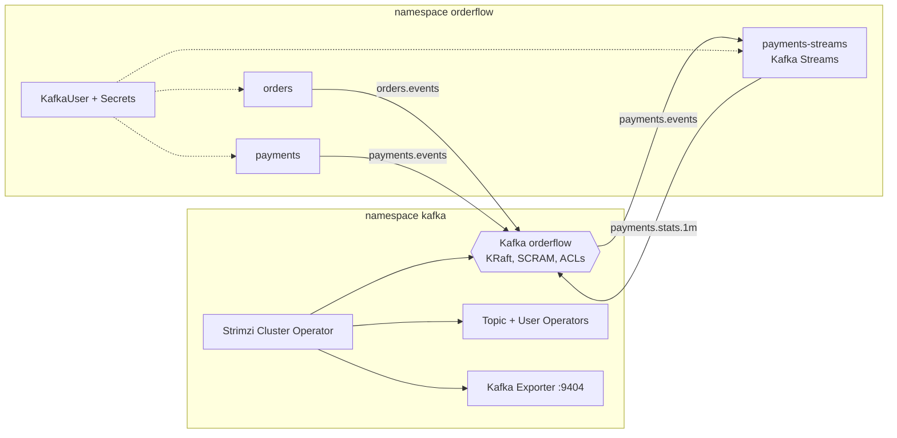

# Módulo 5: Kafka no Kubernetes: Strimzi, a decisão de plataforma e Kafka Streams

**Objetivo:** trocar o Kafka "de brinquedo" do Módulo 4 por um Kafka operado por um **operador**
(Strimzi), com tópicos, usuários e ACLs declarados em Git; saber **decidir** entre Strimzi,
Confluent Cloud e Event Hubs com critérios defensáveis; e escrever uma aplicação **Kafka Streams**
com estado, janelas e tempo de evento.

**Pré-requisitos:** Módulo 4 (cluster kind no ar) e Módulos 2 e 3 (produtores e consumidores).

**Tempo estimado:** 10 a 12 horas, mais os exercícios. Cobre a parte de Streams e operação da
**CCDAK** e reforça a **CKAD** (CRDs, Secrets entre recursos, probes de aplicações com estado).

## O que você constrói

- `deploy/k8s/strimzi/`: cluster para o kind (1 nó) e para o AKS (3 controllers + 3 brokers em
  zonas), `KafkaTopic` e `KafkaUser` com o mínimo de permissão, Kafka Exporter ligado.
- `java/payments-streams/`: agregados de pagamento por janela de 1 minuto, com tempo de evento,
  carência, `suppress`, `exactly_once_v2`, standby replicas e testes com `TopologyTestDriver`.
- `deploy/helm/payments-streams/` e `deploy/docker/payments-streams.Dockerfile`.

## Lições

| # | Lição | Tempo |
|---|---|---|
| 5.1 | [Operadores e o Strimzi: Kafka declarado como recurso](01-operadores-e-strimzi.md) | 75 min |
| 5.2 | [Tópicos, usuários e ACLs como código](02-topicos-usuarios-e-acls.md) | 60 min |
| 5.3 | [Strimzi, Confluent Cloud ou Event Hubs?](03-strimzi-confluent-eventhubs.md) | 45 min |
| 5.4 | [Kafka Streams: tabelas, janelas e tempo](04-kafka-streams-conceitos.md) | 75 min |
| 5.5 | [O payments-streams por dentro](05-payments-streams.md) | 75 min |
| ✍️ | [Exercícios e desafio](exercicios.md) | 4 a 6 h |
| 🎤 | [Perguntas de entrevista](perguntas-de-entrevista.md) | 40 min |

## Sobre o que foi validado

Os manifestos do Strimzi passaram no `kubeconform -strict` contra os schemas gerados das CRDs do
**Strimzi 1.3.0** (API `kafka.strimzi.io/v1`); o chart do payments-streams foi renderizado e
validado como os do Módulo 4. O projeto Java **não foi compilado** (sem acesso ao Maven Central no
ambiente de escrita): as APIs usadas (Kafka Streams 4.2.1, Spring Kafka 4.1.1, Spring Boot 4.1.1)
foram conferidas no código-fonte das tags correspondentes. O primeiro passo do Exercício 1 é
`./mvnw verify`.

Próximo módulo: [6: AKS de verdade](../modulo-06/README.md).
