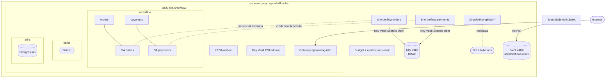
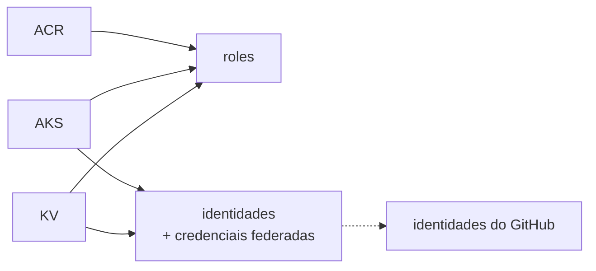

# 6.1 O que vamos criar no Azure, e quanto custa

Arquivos: [`infra/bicep/main.bicep`](../../infra/bicep/main.bicep), [`infra/bicep/modules/aks.bicep`](../../infra/bicep/modules/aks.bicep), [`infra/terraform/main.tf`](../../infra/terraform/main.tf)

Até aqui tudo rodou de graça na sua máquina. Agora cada recurso tem preço por hora. A regra do curso (Módulo 0): **cria, faz o laboratório, destrói no mesmo dia**.

## O desenho



| Recurso | Para quê | Lição |
|---|---|---|
| AKS (3 nós em 3 zonas) | onde tudo roda | esta |
| ACR Basic | imagens dos serviços | 6.3 |
| Key Vault | segredos (connection string, senha do banco) | 6.4 |
| Identidades gerenciadas + credenciais federadas | pods e pipeline sem senha | 6.3, 6.4 |
| Gateway API (App Routing) | entrada HTTP | 6.5 |
| KEDA (add-on) | escala pelo lag | 6.6 |
| Budget | alerta de custo | esta |

::: porque Por que o Postgres continua dentro do cluster
Um Azure Database for PostgreSQL Flexible Server é o certo para produção (backup, alta disponibilidade, patches), mas é mais um recurso cobrado por hora e mais um conjunto de conceitos (rede privada, autenticação pelo Entra ID). O foco do módulo é AKS, identidade e escala. O laboratório reaproveita o Postgres de `deploy/k8s/dev/10-postgres.yaml` e o Exercício 5 troca pelo gerenciado. O que **não** se negocia: a senha do banco já vem do Key Vault.
:::

## O cluster, propriedade por propriedade

Do [`aks.bicep`](../../infra/bicep/modules/aks.bicep):

| Propriedade | Valor | Por quê |
|---|---|---|
| `sku.tier` | `Free` | sem SLA do control plane; `Standard` dá 99,95% com zonas e custa por hora |
| `agentPoolProfiles[0]` | 3 × `Standard_D4ds_v5`, zonas 1-2-3, `osSKU: AzureLinux` | 3 nós para os 3 brokers do Strimzi com rack awareness; Azure Linux é a distro enxuta da Microsoft para nós |
| `networkProfile` | Azure CNI **Overlay** + **Cilium** | pods em faixa própria (não gastam IPs da VNet); Cilium faz dataplane eBPF e aplica as NetworkPolicies |
| `aadProfile` + `disableLocalAccounts` | Entra ID + RBAC do Azure | ninguém tem certificado de admin "eterno"; acesso sai junto com a conta |
| `oidcIssuerProfile` + `securityProfile.workloadIdentity` | ligados | base do Workload Identity (lição 6.4) |
| `addonProfiles.azureKeyvaultSecretsProvider` | rotação a cada 2 min | CSI driver do Key Vault |
| `workloadAutoScalerProfile.keda` | ligado | KEDA gerenciado (lição 6.6) |
| `ingressProfile` | Gateway API + App Routing Istio | lição 6.5 |
| `autoUpgradeProfile` | `patch` + `NodeImage` | patches de Kubernetes e imagem de nó automáticos (e é aí que os PDBs do Módulo 4 trabalham) |

::: armadilha `disableLocalAccounts` e o `az aks get-credentials --admin`
Com contas locais desligadas, `--admin` não existe mais. Para usar o `kubectl`, você precisa do papel **Azure Kubernetes Service RBAC Cluster Admin** (o Bicep dá ao `adminPrincipalId`) e do `kubelogin`:

```bash
az aks get-credentials -g rg-orderflow-lab -n aks-orderflow
kubelogin convert-kubeconfig -l azurecli
kubectl get nodes
```

Sem o papel, o erro é um `Forbidden` com o seu e-mail no texto, que confunde quem espera "não autenticado".
:::

## Quanto custa (e como não levar susto)

Os números exatos mudam por região, câmbio e contrato; consulte a calculadora de preços da Azure para `brazilsouth` (ou a região que escolher) antes de criar. Os grandes itens deste laboratório, em ordem:

1. **As VMs dos nós** (3 × 4 vCPU). É de longe o maior custo. Rodando 4 horas, é uma fração pequena do mês; esquecido ligado por um mês, é o susto.
2. **Discos** dos nós e dos PVCs do Strimzi (`managed-csi-premium` em `kafka-aks.yaml`; com `kafka-kind.yaml` no AKS, bem menos).
3. **Load balancer e IP público** do Gateway.
4. ACR Basic e Key Vault: centavos por dia no volume do laboratório.

::: dica Economize sem perder o aprendizado
- Use `kafka-kind.yaml` (1 nó) no AKS também, salvo no Exercício de falha de zona.
- `nodeCount = 2` e `nodeVmSize` menor no `main.bicepparam` para os labs de identidade e Gateway.
- `az aks stop -g rg-orderflow-lab -n aks-orderflow` desliga as VMs e mantém a configuração (os discos continuam cobrados). `az aks start` volta.
- No fim do dia: `az group delete -n rg-orderflow-lab --yes --no-wait`. O Key Vault fica 7 dias em *soft delete* (lição 6.4).
:::

O `budget` criado pelo Bicep/Terraform manda e-mail quando o gasto **real** do resource group passa de 50% e 90% do valor e quando a **previsão** passa de 100%. Budget **não desliga nada**: ele avisa. E o custo chega com atraso de horas no Cost Management: o alerta é rede de segurança para o esquecimento, não um limite.

::: previsao
Você roda `az group delete` às 18 h. Na manhã seguinte, recebe o e-mail "90% do orçamento atingido". O que aconteceu?
???
Provavelmente nada novo: o Cost Management processa o uso com atraso de várias horas, e o alerta reflete o consumo de **ontem**, quando o cluster ainda existia. Confira em Cost Management → Cost analysis, filtrando pelo resource group, se há custo **depois** das 18 h. Se houver, algo sobrou: um disco, um IP público ou um recurso no resource group de nós (`MC_rg-orderflow-lab_aks-orderflow_brazilsouth`), que normalmente é apagado junto com o cluster. Esse "resource group de nós" (`node_resource_group`) é onde o AKS cria VMSS, discos e load balancers; nunca edite à mão o que está lá.
:::

## Ordem de criação (e por quê)



As identidades dos workloads dependem do AKS porque a credencial federada precisa da **URL do emissor OIDC** do cluster (`oidcIssuerUrl`), que só existe depois que ele é criado. No Bicep a dependência é implícita (`aks.outputs.oidcIssuerUrl`); no Terraform, também (`azurerm_kubernetes_cluster.this.oidc_issuer_url`). Recriar o cluster muda o emissor: as credenciais federadas antigas param de funcionar, e o IaC as recria. É uma das razões para não criar essas coisas à mão no portal.

## Perguntas para responder sem olhar

::: pergunta
O que é o resource group `MC_...` que aparece junto com o AKS?
???
O resource group de nós, gerenciado pelo AKS: VMSS dos nós, discos, load balancers, IPs públicos. É criado e apagado com o cluster. Mexer nele à mão causa divergência entre o que o AKS acha que existe e o que existe.
:::

::: pergunta
Por que desligar as contas locais do AKS?
???
Para que todo acesso passe pelo Entra ID e pelo RBAC do Azure: auditável, com MFA e acesso condicional, e revogado quando a conta é desativada. O certificado de admin local nunca expira na prática e não identifica quem o usou.
:::

**Próxima:** [6.2 Bicep e Terraform, lado a lado](02-bicep-e-terraform.md)
