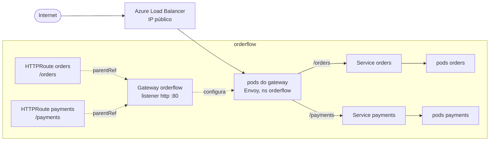

# 6.5 A entrada: Gateway API do App Routing, e a rede por dentro

Arquivos: [`deploy/k8s/aks/gateway.yaml`](../../deploy/k8s/aks/gateway.yaml), templates `httproute.yaml` e `networkpolicy.yaml`, `ingressProfile` em [`aks.bicep`](../../infra/bicep/modules/aks.bicep)

## A decisão: por que não ingress-nginx

O roteiro original do curso dizia "Ingress NGINX". Em outubro de 2026 essa resposta está **errada**, e entender por que vale mais que o YAML:

- O projeto **ingress-nginx** da comunidade Kubernetes foi aposentado: a manutenção terminou em **março de 2026**. Sem correções de segurança, num componente exposto à internet.
- O **App Routing add-on** do AKS, versão NGINX (classe `webapprouting.kubernetes.azure.com`), recebe da Microsoft só patches críticos de segurança **até novembro de 2026**.
- A Microsoft recomenda migrar para a **implementação Gateway API do App Routing** (baseada no plano de controle do Istio, sem sidecars nos seus pods) ou para o Application Gateway for Containers.

| Opção | Prós | Contras | Para quem |
|---|---|---|---|
| ingress-nginx autogerenciado | conhecido, muito material | **sem manutenção**; você assume o risco | ninguém, em projeto novo |
| App Routing NGINX (add-on) | gerenciado, simples | fim do suporte em nov/2026 | só quem já tem e está migrando |
| **App Routing Gateway API** (escolhido) | gerenciado, padrão Gateway API, sem sidecar | recurso recente; não tem `EnvoyFilter`, rate limit, nem ajuste de limites de corpo; não convive com o add-on de service mesh Istio | a maioria dos serviços HTTP no AKS |
| Application Gateway for Containers | L7 gerenciado fora do cluster, WAF | mais um recurso pago, mais configuração de rede | exigência de WAF, tráfego alto |

::: conceito Gateway API
A evolução do recurso `Ingress`, com papéis separados: **GatewayClass** (qual implementação; aqui `approuting-istio`, criada pelo add-on), **Gateway** (a porta de entrada: listeners, portas, TLS; do time de plataforma) e **HTTPRoute** (as regras de roteamento de um serviço; do time do serviço). No `Ingress`, tudo isso ficava num objeto só, e o que não cabia virava anotação específica de cada controlador.
:::

## As peças no OrderFlow



O `gateway.yaml` (uma vez por cluster, do "time de plataforma"):

```yaml
apiVersion: gateway.networking.k8s.io/v1
kind: Gateway
metadata:
  name: orderflow
  namespace: orderflow
spec:
  gatewayClassName: approuting-istio
  listeners:
    - name: http
      port: 80
      protocol: HTTP
      allowedRoutes:
        namespaces:
          from: Same
```

E cada chart traz a sua rota (`httpRoute.enabled` nos values de dev e prod):

```yaml
apiVersion: gateway.networking.k8s.io/v1
kind: HTTPRoute
spec:
  parentRefs:
    - name: orderflow
      sectionName: http
  rules:
    - matches:
        - path: { type: PathPrefix, value: /orders }
      backendRefs:
        - name: orders
          port: 80
```

::: porque Por que `allowedRoutes.namespaces.from: Same`
Sem essa restrição, qualquer namespace poderia pendurar uma HTTPRoute no Gateway e capturar `/orders`. A separação Gateway (plataforma) × HTTPRoute (serviço) só é segura se o Gateway disser **quem** pode se pendurar nele. Para vários times em vários namespaces, use `from: Selector` com um rótulo de namespace.
:::

::: porque Os health checks não ficam expostos
As rotas casam só `/orders` e `/payments`. `/health/*` e `/actuator/*` não têm rota e o Gateway responde 404. O kubelet chama as probes direto no IP do pod, sem passar pelo Gateway. Expor o Actuator com `show-details: always` na internet é vazar a topologia interna do serviço.
:::

```bash
kubectl apply -f deploy/k8s/aks/gateway.yaml
kubectl -n orderflow wait gateway/orderflow --for=condition=Programmed --timeout=5m
GW_IP=$(kubectl -n orderflow get gateway orderflow -o jsonpath='{.status.addresses[0].value}')
curl -i "http://$GW_IP/orders?page=1"
kubectl -n orderflow get httproute orders -o jsonpath='{.status.parents[0].conditions}'
```

::: armadilha A rota "aceita" que não funciona
Uma HTTPRoute com erro de referência (Service com outro nome, porta errada) é criada sem erro pelo `kubectl`. O problema só aparece no **status**: condição `ResolvedRefs=False` com o motivo `BackendNotFound`. Uma rota com `parentRefs` errado aparece com `Accepted=False`. Diagnóstico de Gateway API é ler `status.parents[].conditions`, não logs.
:::

::: video Kubernetes Gateway API vs Ingress (em inglês)
https://www.youtube.com/watch?v=s95-g7AL-qE
Os papéis GatewayClass, Gateway e HTTPRoute comparados ao Ingress, e o que muda na prática.
:::

## A rede por dentro: NetworkPolicy de saída

O cluster usa **Cilium** como motor de NetworkPolicy (`networkPolicy: 'cilium'`). Os charts geram, em dev e prod, uma política de **saída** (`networkPolicy.enabled`):

```yaml
egress:
  - to: [ kube-system / k8s-app: kube-dns ]        # DNS, portas 53 UDP e TCP
  - to: [ namespace kafka ]           ports: [9092, 9093]
  - to: [ namespace infra ]           ports: [5432]
  - to: [ namespace observabilidade ] ports: [4317, 4318]   # OpenTelemetry (lição 7.5)
```

Assim que **uma** política com `policyTypes: [Egress]` seleciona o pod, toda saída não listada é bloqueada. Se o Orders for comprometido, ele não alcança o metadata service da VM, nem outros namespaces, nem a internet.

::: armadilha Esquecer o DNS
A primeira regra de toda política de saída é o DNS. Sem ela, nenhum nome resolve e cada dependência falha com um erro diferente e enganoso ("unknown host", timeout de conexão no Kafka, falha no exportador OTLP). E lembre que no **kind** padrão (kindnet) a NetworkPolicy é aceita pela API e **ignorada**: "funcionou no kind" não testa política nenhuma.
:::

::: previsao
Com a NetworkPolicy ligada, o time de observabilidade muda o Collector do namespace `observabilidade` para `monitoring`. O que acontece com o Orders e com os dados no Grafana?
???
O Orders continua funcionando: o SDK do OpenTelemetry não derruba a aplicação quando o exportador falha, só registra erros de exportação (lição 7.5). No Grafana, **os dados do Orders e do Payments param de chegar**, sem nenhum alerta de "serviço fora". A política bloqueia a saída para o namespace novo. É o motivo para monitorar a própria telemetria (alerta de ausência de dados) e para os nomes de namespace serem um contrato documentado entre times.
:::

## Perguntas para responder sem olhar

::: pergunta
Por que não usar ingress-nginx num projeto novo no AKS em 2026?
???
O projeto da comunidade foi aposentado (manutenção encerrada em março de 2026) e o App Routing NGINX só tem patches críticos até novembro de 2026. Um componente exposto à internet sem manutenção é risco de segurança. O caminho recomendado é Gateway API, com a implementação do App Routing ou o Application Gateway for Containers.
:::

::: pergunta
Quais as vantagens da Gateway API sobre o Ingress?
???
Papéis separados (GatewayClass, Gateway, HTTPRoute), permitindo que plataforma controle a entrada e cada time controle suas rotas com limites claros (allowedRoutes); recursos padronizados que no Ingress eram anotações específicas de cada controlador (divisão de tráfego por peso, cabeçalhos, vários protocolos); e status detalhado por rota.
:::

**Próxima:** [6.6 KEDA: escalar pelo lag do Kafka](06-keda-por-lag.md)
