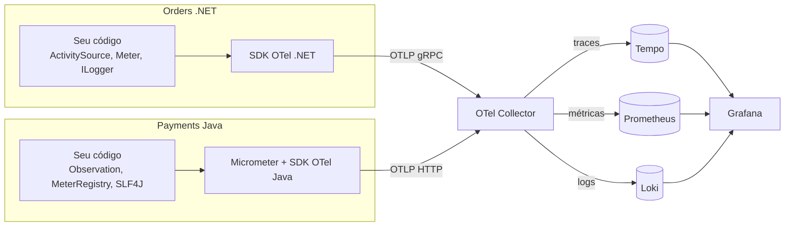

# 7.1 Observabilidade e OpenTelemetry: as peças antes do código

Até o Módulo 6, quando algo dava errado você tinha `kubectl logs` e muita paciência. Com dois
serviços em linguagens diferentes conversando por Kafka, isso não escala: um pedido que "sumiu"
pode ter parado no Orders, no tópico, no consumer do Payments, no gateway ou na volta. Esta lição
monta o vocabulário; as próximas ligam cada peça no código.

::: conceito Observabilidade
A capacidade de responder perguntas sobre o sistema **que você não previu** quando escreveu o
código, olhando só o que ele emite. Monitoramento responde "a CPU passou de 80%?" (pergunta
conhecida). Observabilidade responde "por que os pedidos do cliente X, só os com cupom, estão
levando 4 segundos desde ontem às 15h?" (pergunta nova, sem deploy de log novo).
:::

## Os três sinais, e o que cada um responde

| Sinal | O que é | Pergunta que responde | Custo |
|---|---|---|---|
| **Métrica** | número agregado no tempo (contador, histograma) | "**está** acontecendo? quanto?" | baixo e fixo: 1 série por combinação de labels, não importa o tráfego |
| **Trace** | a árvore de operações de UMA requisição, entre serviços | "**onde** está acontecendo?" | proporcional ao tráfego (por isso se amostra) |
| **Log** | evento com texto e campos | "**o que** exatamente aconteceu?" | proporcional ao tráfego e ao que você escreve |

O fluxo de investigação real usa os três em sequência: o **alerta** vem de uma métrica (taxa de
5xx), o **exemplo** vem de um trace (aquele pedido lento), o **detalhe** vem do log daquele span.
A lição 7.5 mostra o clique de um para o outro no Grafana. Esse clique só existe se os três
sinais compartilham o mesmo `trace_id` e o mesmo `service.name`. É isso que o OpenTelemetry padroniza.

::: analogia
Pense numa transportadora. A **métrica** é o painel da central: "1.200 entregas hoje, 3% atrasadas".
O **trace** é o rastreamento de UMA encomenda: coletada em Sorocaba 9h, centro de distribuição
11h, saiu para entrega 14h, entregue 17h. O **log** é a anotação do motorista: "portão fechado,
deixei com o vizinho do 12". Sem o código de rastreio comum (o `trace_id`), você teria as três
informações e nenhuma forma de juntá-las.
:::

## O que é o OpenTelemetry (e o que ele não é)

OpenTelemetry (OTel) é um projeto da CNCF que padroniza **como** a telemetria é produzida e
transportada. Ele **não** é um banco nem uma tela: não guarda nada e não mostra nada.



| Peça | O que é | No OrderFlow |
|---|---|---|
| **API** | interfaces para criar spans, métricas e logs. Estável, sem dependências pesadas | no .NET é o próprio `System.Diagnostics`; no Java, a API do Micrometer na frente da API do OTel |
| **SDK** | a implementação: amostragem, agrupamento em lotes, exportação | `OpenTelemetry.Extensions.Hosting` (.NET), SDK Java configurado pelo Spring Boot |
| **Instrumentação** | código que cria spans/métricas para bibliotecas que você não escreveu | ASP.NET Core, Spring MVC, Spring Kafka |
| **OTLP** | o protocolo de transporte (protobuf sobre gRPC na 4317, ou HTTP na 4318) | os dois serviços falam OTLP |
| **Collector** | um processo que recebe, transforma e reenvia telemetria | `deploy/observabilidade/collector/values.yaml` |
| **Convenções semânticas** | os NOMES padronizados dos atributos: `http.route`, `messaging.destination.name`... | é o que faz o Tempo reconhecer um span como "Kafka" |
| **Resource** | quem está emitindo: `service.name`, `service.version`, `k8s.pod.name` | vai junto em todo sinal |

::: porque Por que OpenTelemetry e não o SDK do fornecedor
Application Insights, Datadog, New Relic, todos têm SDK próprio, e por anos foi assim que se
fazia. O problema: o código fica casado com o fornecedor. Trocar de Datadog para Grafana era
reescrever a instrumentação dos dois serviços. Com OTel, o código emite OTLP, e o destino é uma
linha de configuração no Collector. Os próprios fornecedores aderiram: todos aceitam OTLP hoje.
A decisão está registrada no [ADR 0007](../adr/0007-opentelemetry-e-grafana-lgtm.md).
:::

## Trace por dentro: span, contexto e o header `traceparent`

Um **trace** é uma árvore de **spans**. Cada span é uma operação com início, fim, atributos e
status, e aponta para o span pai. Todos os spans do trace têm o mesmo `trace_id`.

```
trace_id 4bf92f3577b34da6a3ce929d0e0e4736
└─ POST /orders                        orders    120 ms   (SERVER)
   ├─ INSERT orders / outbox           orders     15 ms   (CLIENT, Módulo 3)
   └─ send orders.events               orders      8 ms   (PRODUCER)
      └─ process orders.events         payments  340 ms   (CONSUMER)   ← outro processo, outra linguagem
         ├─ gateway authorize          payments  300 ms   (INTERNAL)
         └─ send payments.events       payments    6 ms   (PRODUCER)
            └─ process payments.events orders     20 ms   (CONSUMER)
```

Como o Payments, em Java, sabe que o span dele é filho de um span criado no .NET? Pelo
**contexto propagado**: o produtor escreve o identificador do span atual num header da mensagem,
e o consumidor lê e usa como pai. O formato é o padrão **W3C Trace Context**:

```
traceparent: 00-4bf92f3577b34da6a3ce929d0e0e4736-00f067aa0ba902b7-01
             │  │                                │                │
             │  trace-id (16 bytes, hex)         parent-id        flags (01 = sampled)
             versão                              (span do produtor, 8 bytes)
```

| Campo | Para que serve |
|---|---|
| `trace-id` | o mesmo do começo ao fim; é o que junta tudo |
| `parent-id` | o span que **enviou**; o receptor cria o seu como filho dele |
| `flags` | o bit `01` diz "quem começou decidiu gravar este trace". Quem recebe deve respeitar (lição 7.2, amostragem) |

Junto pode ir o `tracestate` (dados específicos de fornecedor) e o `baggage` (pares chave/valor
que você quer que viajem com a requisição, como `tenant=acme`).

::: previsao
O Orders (.NET) e o Payments (Java) usam bibliotecas de tracing totalmente diferentes. Se o
Orders escrever o header `traceparent` numa mensagem Kafka e o Payments estiver configurado com
a propagação padrão do Micrometer Tracing, o trace sai inteiro ou partido em dois?
???
Inteiro. O padrão W3C é exatamente o contrato que torna isso possível: a biblioteca do .NET
escreve `traceparent` com o formato acima, e o Micrometer Tracing com a ponte OTel lê o mesmo
header por padrão (`management.tracing.propagation.type=w3c`). As linguagens não precisam saber
nada uma da outra, como no contrato JSON dos eventos.

O trace sairia partido se um dos lados usasse outro formato, como o B3 do Zipkin (`X-B3-TraceId`),
que era o padrão do Spring Cloud Sleuth antigo. Por isso a lição 7.4 confere o header na mão.
:::

## Métricas por dentro: o tipo certo para cada pergunta

| Tipo | Exemplo no OrderFlow | Como se lê | Erro comum |
|---|---|---|---|
| **Counter** (só sobe) | `orderflow.orders.created` | sempre com `rate()`: "pedidos por segundo" | olhar o valor absoluto, que zera a cada restart do pod |
| **UpDownCounter / Gauge** (sobe e desce) | itens na fila, lag do consumidor | o valor atual | usar gauge para algo que é contagem de eventos |
| **Histogram** | `http.server.request.duration` | percentis com `histogram_quantile` | fazer média de percentis entre pods (matematicamente errado: some os baldes antes) |

::: armadilha Cardinalidade: o jeito mais rápido de derrubar o Prometheus
Cada combinação distinta de labels é uma **série temporal** separada, guardada para sempre (até a
retenção). `http_requests{route="/orders/{id}"}` é uma série. `http_requests{order_id="01a150ba..."}`
é uma série **por pedido**: um milhão de pedidos, um milhão de séries, e o Prometheus fica sem
memória. Regra: label de métrica só com conjunto pequeno e fechado (rota, status, resultado).
Identificador de entidade vai no **trace** e no **log**, onde cada evento é independente.
Repare que a instrumentação usa `http.route` (o template `/orders/{id}`), nunca a URL real.
:::

## Os quatro sinais de ouro, RED e USE

Você não precisa inventar o que medir. Há três listas clássicas, e elas se complementam:

| Método | Para | Mede |
|---|---|---|
| **RED** (Tom Wilkie) | serviços que atendem requisições | **R**ate (taxa), **E**rrors (erros), **D**uration (duração) |
| **USE** (Brendan Gregg) | recursos (CPU, memória, conexões, fila) | **U**tilization, **S**aturation, **E**rrors |
| **Quatro sinais de ouro** (livro de SRE do Google) | os dois | latência, tráfego, erros, saturação |

O painel do OrderFlow (lição 7.5) é RED para cada serviço, mais o lag do Kafka (saturação do
consumidor), mais métricas de negócio. Esta última linha é a que os painéis genéricos esquecem.

::: video Distributed Tracing Explained (em inglês)
https://www.youtube.com/watch?v=PmrSvsEJBUc
Spans, contexto e propagação entre serviços, com diagramas. Assista antes da lição 7.4.
:::

::: video OpenTelemetry Explained: Observability Framework for Distributed Systems (em inglês)
https://www.youtube.com/watch?v=iTRymaKNGLc
Visão geral do projeto: API, SDK, Collector e OTLP, e por que o padrão aberto ganhou.
:::

## Perguntas para responder sem olhar

::: pergunta
Qual a diferença entre o que uma métrica e um trace respondem, e por que um não substitui o outro?
???
A métrica responde "está acontecendo e quanto" com custo fixo, independente do tráfego: é dela
que vêm os alertas. O trace responde "onde, nesta requisição específica", com custo proporcional
ao tráfego, por isso é amostrado. Sem métrica você não sabe que há problema; sem trace você sabe
que há, mas não em qual dos dez saltos.
:::

::: pergunta
O que viaja no header `traceparent`, e o que o receptor faz com cada parte?
???
Versão, `trace-id` (o identificador do trace inteiro), `parent-id` (o span de quem enviou) e
`flags` (o bit de amostragem). O receptor cria o próprio span com o mesmo `trace-id`, com o
`parent-id` como pai, e respeita a decisão de amostragem que veio nas flags.
:::

::: pergunta
Por que `orderId` pode ser atributo de span mas não label de métrica?
???
Cada valor distinto de label cria uma série temporal nova no backend de métricas: milhões de
pedidos viram milhões de séries e derrubam o Prometheus (explosão de cardinalidade). Num span,
o atributo é só um dado daquele evento, sem custo de série.
:::

**Próxima:** [7.2 OpenTelemetry no .NET](02-otel-no-dotnet.md).
