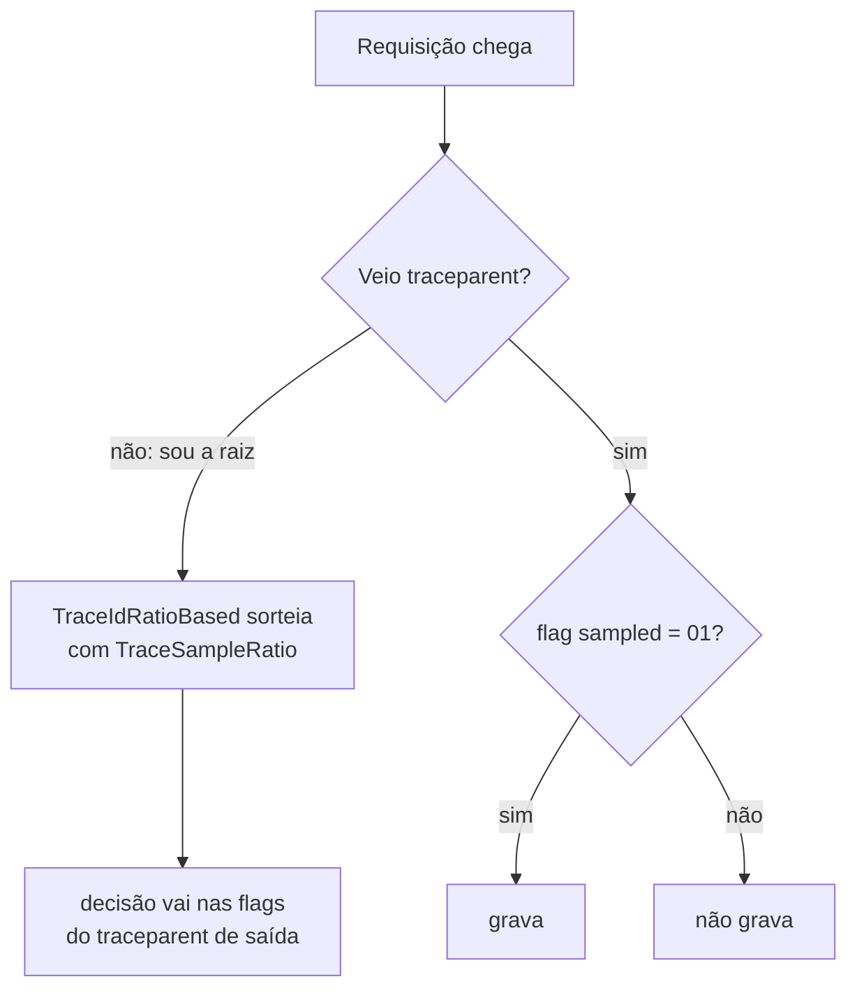

# 7.2 OpenTelemetry no .NET: traces, métricas e logs com uma linha no Program.cs

Arquivos: `src/OrderFlow.Orders.Api/Observabilidade/` (`ObservabilidadeExtensions.cs`,
`OrdersTelemetry.cs`, `OrdersMetrics.cs`, `MeteredOrderEventPublisher.cs`, `ObservabilidadeOptions.cs`)

## O .NET já tinha quase tudo

A primeira coisa que surpreende quem vem do Node: no .NET, o OpenTelemetry **não traz uma API de
spans própria**. O runtime já tinha `System.Diagnostics.Activity` desde muito antes do OTel
existir, e o projeto OTel decidiu adotá-la em vez de competir com ela.

| OpenTelemetry | .NET | No Node (para comparar) |
|---|---|---|
| Tracer | `ActivitySource` | `trace.getTracer('orders')` |
| Span | `Activity` | `tracer.startSpan(...)` |
| Contexto atual | `Activity.Current` (um `AsyncLocal`, segue o `await`) | `context.active()` (AsyncLocalStorage) |
| Meter, Counter, Histogram | `System.Diagnostics.Metrics` | `metrics.getMeter(...)` |
| Logger | `ILogger` (o mesmo do Módulo 1) | um logger + bridge |

Consequência prática: o ASP.NET Core, o `HttpClient` e o EF Core **já criam Activities**
sozinhos. O que o pacote do OpenTelemetry faz é **escutar** essas fontes e exportar o que ouviu.
Sem o SDK ligado, `ActivitySource.StartActivity` devolve `null` e o custo é quase zero; é por isso
que todo código de tracing no .NET usa `activity?.SetTag(...)`.

## A extensão, linha a linha

O `Program.cs` ganha uma linha (veja a seção [Integração](#integracao)). Tudo o mais está em
`ObservabilidadeExtensions.AddOrderFlowObservabilidade`:

```csharp
builder.Services.AddOpenTelemetry()
    .ConfigureResource(resource => resource.AddService(
        serviceName: OrdersTelemetry.ServiceName,           // "orders"
        serviceNamespace: OrdersTelemetry.ServiceNamespace, // "orderflow"
        serviceVersion: typeof(OrdersTelemetry).Assembly.GetName().Version?.ToString()))
    .WithTracing(tracing => tracing
        .SetSampler(new ParentBasedSampler(new TraceIdRatioBasedSampler(options.TraceSampleRatio)))
        .AddAspNetCoreInstrumentation(aspnet =>
            aspnet.Filter = ctx => !ctx.Request.Path.StartsWithSegments("/health", StringComparison.OrdinalIgnoreCase))
        .AddSource(OrdersTelemetry.ActivitySourceName))
    .WithMetrics(metrics => metrics
        .AddAspNetCoreInstrumentation()
        .AddMeter("System.Runtime")
        .AddMeter(OrdersMetrics.MeterName))
    .WithLogging(configureBuilder: null, configureOptions: logging => { ... })
    .UseOtlpExporter();
```

| Chamada | O que faz | Por que assim |
|---|---|---|
| `ConfigureResource(AddService(...))` | define o **Resource**: atributos que vão em todo span, métrica e log | `service.namespace` + `service.name` viram o label `job="orderflow/orders"` no Prometheus. O Payments usa o mesmo namespace, e o painel filtra os dois do mesmo jeito |
| `SetSampler(ParentBased(TraceIdRatio))` | decide quais traces gravar | explicado abaixo, em "Amostragem" |
| `AddAspNetCoreInstrumentation` (traces) | escuta as Activities do ASP.NET Core: um span `SERVER` por requisição, com `http.route`, `http.response.status_code` | o `Filter` tira as probes: o kubelet chama `/health/*` a cada poucos segundos em cada pod |
| `AddSource("OrderFlow.Orders")` | escuta a NOSSA fonte: os spans de Kafka (lição 7.4) | uma fonte que não é registrada aqui é ignorada em silêncio. É o erro número um de "meu span não aparece" |
| `AddAspNetCoreInstrumentation` (métricas) | liga os Meters nativos do ASP.NET Core (.NET 8+): `http.server.request.duration`, conexões do Kestrel | é a métrica RED do painel |
| `AddMeter("System.Runtime")` | GC, heap, thread pool, exceções (.NET 9+ emite nativamente) | substitui o pacote `OpenTelemetry.Instrumentation.Runtime`, um pacote a menos |
| `WithLogging` | cada `ILogger.Log` vira um registro OTLP, **com o TraceId e o SpanId do Activity atual** | é o que permite ir do log para o trace no Grafana |
| `UseOtlpExporter()` | um exportador OTLP para os três sinais | lê `OTEL_EXPORTER_OTLP_ENDPOINT` e `OTEL_EXPORTER_OTLP_PROTOCOL`; padrão `grpc` em `localhost:4317` |

::: porque Por que o endereço do Collector não está no appsettings
As variáveis `OTEL_*` são parte da especificação do OpenTelemetry e valem para **todas** as
linguagens: o mesmo `OTEL_EXPORTER_OTLP_ENDPOINT` configura o .NET, o Java (agente), Go, Node.
O chart Helm (Módulo 4) passa as mesmas variáveis aos dois serviços, e quem opera o cluster não
precisa saber onde cada framework guarda a configuração. O que é decisão do **serviço** (a fração
de amostragem) fica no `appsettings`, na seção `Observabilidade`, validada na subida.
:::

::: armadilha `UseOtlpExporter` e `AddOtlpExporter` juntos
`UseOtlpExporter()` configura os três sinais de uma vez. Se alguém, num PR futuro, acrescentar
`.AddOtlpExporter()` dentro do `WithTracing`, a aplicação **lança exceção na subida**: as duas
formas não podem ser misturadas. Se precisar de destinos diferentes por sinal, troque o
`UseOtlpExporter()` por um `AddOtlpExporter` em cada `With...`.
:::

## Amostragem: quem decide, e quando

Gravar 100% dos traces em produção custa caro (armazenamento proporcional ao tráfego). Amostrar
"10%" parece simples até você perceber que **cada serviço sorteia sozinho**. Se o Orders sorteia
"grava" e o Payments sorteia "não grava", o trace chega pela metade.



O `ParentBasedSampler` resolve: **só a raiz sorteia**, e todos os outros obedecem à flag que veio
no `traceparent`. O Spring Boot usa a mesma regra por padrão. E o sorteio do `TraceIdRatioBased`
não é aleatório: é uma função do próprio `trace-id`, então dois serviços com a mesma fração
chegam à mesma resposta para o mesmo trace.

Esse método se chama **head sampling** (decide no começo). A limitação: quando o Orders decide,
ele não sabe se o trace vai ter erro no Payments. O Collector do projeto complementa com **tail
sampling** (decide no fim, guardando todo trace com erro ou lento). Lição 7.5.

::: previsao
Com `Observabilidade:TraceSampleRatio = 0.1` no Orders e o Payments com `management.tracing.sampling.probability: 1.0`, quantos dos traces de criação de pedido aparecem completos (com os spans do Payments)?
???
10%, e completos. Os traces começam no Orders (o `POST /orders` é a raiz), então é o Orders que
sorteia. O Payments recebe o `traceparent` com a flag e obedece: grava os 10% marcados e descarta
os 90% não marcados, apesar de estar configurado com 1.0. A probabilidade do Payments só vale para
traces que **começam** nele (uma chamada direta ao `POST /payments`).

Se o Payments ignorasse a flag e gravasse tudo, você teria 90% de traces "órfãos": spans do
Payments sem o pai.
:::

## Métricas de negócio sem sujar o caso de uso

O `OrderService` (Módulo 1) não deveria importar `System.Diagnostics.Metrics`: ele é a camada de
aplicação, e métrica é preocupação de infraestrutura. A solução usa uma peça que você já tem, a
**porta** `IOrderEventPublisher`, e um **decorator**:

```csharp
internal sealed class MeteredOrderEventPublisher(IOrderEventPublisher inner, OrdersMetrics metrics)
    : IOrderEventPublisher
{
    public async ValueTask PublishAsync(IOrderEvent orderEvent, CancellationToken ct)
    {
        await inner.PublishAsync(orderEvent, ct);
        metrics.Record(orderEvent);   // OrderCreated → created++ e total no histograma; etc.
    }
}
```

No modo em memória, todo fato de negócio do Orders passa por essa porta como evento (no modo
Postgres do Módulo 3, quem conta é o repositório, veja a Integração). Contar ali dá as métricas
`orderflow.orders.created/paid/cancelled` e o histograma `orderflow.orders.total` sem tocar no
`OrderService`. O mesmo desenho existe no Java (`MeteredPaymentEventPublisher`).

::: porque Por que `IMeterFactory` e não `new Meter("OrderFlow.Orders")`
Um `Meter` estático vive o processo todo. Nos testes de integração, várias `WebApplicationFactory`
sobem no mesmo processo e contariam no **mesmo** Meter: um teste veria as medições do outro. O
`IMeterFactory`, registrado pelo host do .NET 8+, cria um Meter por container de DI e o descarta
junto. É o mesmo raciocínio do `TimeProvider` injetável do Módulo 1: dependência global vira
dependência injetada.
:::

::: armadilha Histograma com os baldes errados
O histograma tem limites de balde fixos. Os padrões do OpenTelemetry (`0, 5, 10, 25, 50, 75, 100,
250, 500, 750, 1000, 2500, 5000, 7500, 10000`) foram pensados para milissegundos. Para valores de
pedido em reais, o `OrdersMetrics` passa limites próprios por `InstrumentAdvice`
(`10, 50, 100, 250, 500, 1000, 2500, 5000, 10000`). Com baldes errados, o `histogram_quantile`
devolve números que parecem precisos e são interpolação dentro de um balde enorme.
:::

## Logs correlacionados

Nada muda nos `[LoggerMessage]` do Módulo 1. O `WithLogging` instala um provedor de log a mais
(o console continua funcionando), e cada registro sai com:

- o **template** e os **campos estruturados** (`OrderId`, `Total`), como atributos;
- o **TraceId e o SpanId** da `Activity.Current` no momento do log.

Esse último item é o elo: no Grafana, um log do Loki vira um link para o trace no Tempo. Não há
nada a fazer no código além de **logar dentro do span**, o que já acontece no fluxo HTTP e,
com a lição 7.4, no consumer Kafka.

::: checkpoint
Com o LGTM local de pé (`docker compose -f deploy/observabilidade/docker-compose.yml up -d`) e a
integração feita:

```bash
OTEL_EXPORTER_OTLP_ENDPOINT=http://localhost:4317 dotnet run --project src/OrderFlow.Orders.Api
curl -s -X POST localhost:5279/orders -H 'Content-Type: application/json' \
  -d '{"customerId":"cli-001","items":[{"sku":"TECLADO-01","quantity":2,"unitPrice":150.50}]}'
```

No Grafana (`localhost:3000`) → Explore → Tempo → Search, `service.name = orders`: o span
`POST /orders` aparece. Em Explore → Prometheus, `orderflow_orders_created_total` vale 1. Em
Explore → Loki, `{service_name="orders"}` mostra "Pedido ... criado", com `trace_id` preenchido.
:::

::: quebra Lab: a fonte esquecida
Comente a linha `.AddSource(OrdersTelemetry.ActivitySourceName)` e repita o checkpoint depois da
integração Kafka (lição 7.4). O span `POST /orders` aparece? E o `send orders.events`? E o lado
Java do trace?
:::

::: solucao
O `POST /orders` continua aparecendo (vem da instrumentação do ASP.NET Core, outra fonte). O
`send orders.events` some: o `StartActivity` devolve `null`, porque ninguém escuta a fonte
`OrderFlow.Orders`. E o `KafkaTracing.Inject` cai no `Activity.Current`, que agora é o span HTTP:
o Payments recebe um `traceparent` com o span HTTP como pai. O trace continua inteiro, só sem o
degrau do produtor. Por isso o código usa o `Activity.Current` como reserva: degradar sem quebrar.
:::

## Integração

O código desta lição está todo em `Observabilidade/`. Para ligá-lo, três mudanças fora da pasta:

**1. `OrderFlow.Orders.Api.csproj`**: os pacotes (linha 1.20.x em out/2026; confira a última no nuget.org).
O `Confluent.Kafka` vem do Módulo 2 e é usado pelo `KafkaTracing`.

```xml
<ItemGroup>
  <PackageReference Include="OpenTelemetry.Extensions.Hosting" Version="1.20.1" />
  <PackageReference Include="OpenTelemetry.Exporter.OpenTelemetryProtocol" Version="1.20.1" />
  <PackageReference Include="OpenTelemetry.Instrumentation.AspNetCore" Version="1.20.1" />
</ItemGroup>
```

**2. `Program.cs`**: uma linha logo depois do `CreateBuilder`:

```csharp
using OrderFlow.Orders.Api.Observabilidade;

var builder = WebApplication.CreateBuilder(args);
builder.AddOrderFlowObservabilidade();   // ← a linha da observabilidade
```

As métricas de negócio já estão ligadas no **modo Postgres** (Módulo 3): o `EfOrderRepository`
recebe o `OrdersMetrics` e chama `Record` para cada evento gravado no outbox, **depois do commit**
da transação. É o lugar mais fiel para contar: pedido que não foi salvo não conta.
No **modo em memória**, o repositório repassa os eventos ao `IOrderEventPublisher`; para contar
também nesse modo, envolva o publicador com o decorator no `Infrastructure/DependencyInjection.cs`:

```csharp
// no lugar de: services.AddSingleton<IOrderEventPublisher, ChannelOrderEventPublisher>();
services.AddSingleton<ChannelOrderEventPublisher>();
services.AddSingleton<IOrderEventPublisher>(sp => new MeteredOrderEventPublisher(
    sp.GetRequiredService<ChannelOrderEventPublisher>(),
    sp.GetRequiredService<OrdersMetrics>()));
```

Não use o decorator **e** a chamada do `EfOrderRepository` no mesmo modo: cada pedido contaria duas vezes.

**3. `appsettings.json`**: a seção opcional (o padrão é 1.0):

```json
"Observabilidade": { "TraceSampleRatio": 1.0 }
```

No chart Helm, produção sobrescreve com `Observabilidade__TraceSampleRatio=0.1`.

## Perguntas para responder sem olhar

::: pergunta
Seu span customizado não aparece no Tempo, mas os spans HTTP aparecem. Qual a primeira coisa que você confere?
???
Se o nome da `ActivitySource` está registrado com `AddSource(...)` no `WithTracing`. Fonte não
registrada não tem ouvinte, o `StartActivity` devolve `null` e nada é criado, sem erro nenhum.
Depois confiro se o trace não foi descartado pelo sampler.
:::

::: pergunta
Por que usar `ParentBasedSampler` em vez de só `TraceIdRatioBasedSampler`?
???
Para que só a raiz do trace decida e todos os serviços seguintes obedeçam à flag do
`traceparent`. Se cada serviço decidisse por conta própria, os traces chegariam incompletos.
:::

::: pergunta
Como você adiciona métricas de negócio sem acoplar o caso de uso ao OpenTelemetry?
???
Medindo numa borda que já existe. No OrderFlow, todo fato de negócio passa pela porta
`IOrderEventPublisher`, então um decorator conta os eventos depois de publicá-los, e o
`OrderService` não muda. As métricas usam um `Meter` criado pelo `IMeterFactory`.
:::

**Próxima:** [7.3 OpenTelemetry no Java](03-otel-no-java.md).
