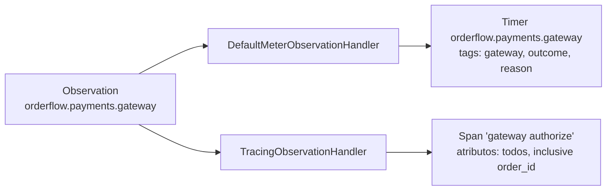

# 7.3 OpenTelemetry no Java: agente ou Micrometer? (e por que o OrderFlow escolheu o Micrometer)

Arquivos: `java/payments/src/main/java/com/orderflow/payments/observabilidade/`
(`ObservabilidadeConfiguration.java`, `ObservedPaymentGateway.java`,
`MeteredPaymentEventPublisher.java`), `pom.xml`

## Três caminhos, uma decisão

No .NET havia um caminho óbvio. No Java há três, e escolher entre eles é uma pergunta clássica de
entrevista para vaga Spring:

| | **Agente Java do OTel** | **Micrometer + `spring-boot-starter-opentelemetry`** | Starter Spring do próprio OTel |
|---|---|---|---|
| Como liga | `-javaagent:opentelemetry-javaagent.jar` na linha de comando | uma dependência no `pom.xml` | uma dependência no `pom.xml` |
| Como instrumenta | reescreve o bytecode das bibliotecas na carga das classes | as bibliotecas Spring já chamam a API Observation do Micrometer; o starter liga essa API ao OTel | instrumentação OTel para bibliotecas Spring |
| Cobertura | enorme: JDBC, Kafka cru, Redis, gRPC, dezenas de clientes HTTP, sem código | tudo que o ecossistema Spring instrumenta (MVC, RestClient, Spring Kafka, Spring Data...) | parecida com a do agente, para o mundo Spring |
| Versões | o agente precisa reconhecer a versão de cada biblioteca; descompasso falha em silêncio | gerenciadas pelo parent do Boot, testadas juntas | à parte do Boot |
| AOT, imagem nativa GraalVM, CDS | exige trabalho extra; pode brigar com outros agentes | funciona | funciona |
| Métricas | nomes do OTel (`http.server.request.duration`) | nomes do Micrometer (`http.server.requests`) | nomes do OTel |
| Quem recomenda | o projeto OpenTelemetry (é o padrão dele) | o time do Spring Boot | o OTel, quando o agente não serve |

::: porque A escolha do OrderFlow: o starter do Boot 4 com Micrometer
1. **O Spring Kafka já propaga o contexto** pela API Observation: ligando duas propriedades, o
   `KafkaTemplate` escreve o `traceparent` e o `@KafkaListener` o lê (lição 7.4). O agente faria
   o mesmo, mas aqui o comportamento está no código e nas propriedades, visível no PR.
2. **Uma dependência a menos para casar versões.** O parent do Boot fixa as versões do Micrometer
   e do SDK do OTel testadas juntas. Com o agente, a imagem Docker carrega um JAR a mais cuja
   versão você precisa casar com Spring Kafka, JDBC driver e o resto.
3. **O Dockerfile do Módulo 4 não muda**, e os testes de integração rodam com a mesma instrumentação de produção.

O custo, assumido no [ADR 0007](../adr/0007-opentelemetry-e-grafana-lgtm.md): bibliotecas fora
do ecossistema Spring (um cliente HTTP exótico, o `kafka-clients` usado sem Spring Kafka) não
são instrumentadas sozinhas. E os nomes das métricas HTTP diferem do .NET, como mostra o painel.
:::

## O que o starter já entrega

Só com a dependência no `pom.xml` e as propriedades da [Integração](#integracao):

- **Spans** de toda requisição Spring MVC, com `http.route` e status;
- **Propagação W3C**: lê o `traceparent` que chega e o escreve em chamadas de saída feitas com
  `RestClient.Builder`/`WebClient.Builder` injetados (não com um `RestClient.create()` solto);
- **Métricas** do Micrometer exportadas por OTLP: HTTP, JVM (heap, GC, threads, inclusive as virtuais), Tomcat;
- **traceId e spanId no MDC**: o log do console passa a mostrar `[payments,4bf92f...,00f067...]`
  sem configuração nenhuma.

## O que o OrderFlow acrescenta, peça por peça

### 1. Fora com as probes

```java
@Bean
ObservationPredicate ignoreActuatorObservations() {
    return (name, context) -> {
        if (context instanceof ServerRequestObservationContext server) {
            return !server.getCarrier().getRequestURI().startsWith("/actuator");
        }
        return true;
    };
}
```

Um `ObservationPredicate` decide, antes de começar, se uma observação acontece. O Boot aplica ao
`ObservationRegistry` todo bean desse tipo. É o par do `Filter` do ASP.NET Core da lição 7.2.

### 2. Logs pelo OTLP

O starter **exporta** logs por OTLP, mas não liga o Logback a ele. A ponte é o
`OpenTelemetryAppender` (artefato `opentelemetry-logback-appender-1.0`, só existe em versão
`-alpha`). O guia do Spring declara o appender num `logback-spring.xml`; o OrderFlow anexa por
código, numa classe só:

```java
if (root.getAppender(APPENDER_NAME) == null) {     // testes sobem vários contextos na mesma JVM
    OpenTelemetryAppender appender = new OpenTelemetryAppender();
    appender.setName(APPENDER_NAME);
    appender.setContext(context);
    appender.start();
    root.addAppender(appender);
}
OpenTelemetryAppender.install(openTelemetry);       // liga ao SDK que o Boot criou
```

::: armadilha O appender que existe e não exporta
O Logback sobe **antes** do Spring (é ele que imprime o banner). Até o `install(openTelemetry)`
rodar, o appender recebe os logs e não tem para onde mandar: os logs da subida (inclusive o
erro de configuração que derrubou o pod) **não chegam ao Loki**. Eles continuam no console, e é
por isso que o primeiro passo dos runbooks é `kubectl logs --previous`, não o Grafana.
:::

### 3. Uma observação, duas saídas: o `ObservedPaymentGateway`

Este é o ponto conceitual mais importante do lado Java. Compare com o .NET, onde um span é uma
`Activity` e uma métrica é um `Histogram`, duas APIs. No Micrometer você descreve a **operação**
uma vez:

```java
Observation observation = Observation.createNotStarted("orderflow.payments.gateway", registry)
        .contextualName("gateway authorize")
        .lowCardinalityKeyValue("gateway", gatewayName)
        .highCardinalityKeyValue("orderflow.order_id", orderId.toString());
observation.start();
try (Observation.Scope _ = observation.openScope()) {
    GatewayDecision decision = delegate.authorize(...);
    // outcome=approved|declined, reason=none|card_declined|limit_exceeded
    return decision;
} catch (RuntimeException e) {
    observation.error(e);
    throw e;
} finally {
    observation.stop();
}
```

e os **handlers** registrados no `ObservationRegistry` decidem o que ela vira:



| | Vai para a métrica? | Vai para o span? |
|---|---|---|
| `lowCardinalityKeyValue` | sim, vira tag do timer | sim |
| `highCardinalityKeyValue` | **não** | sim |

É a regra de cardinalidade da lição 7.1 escrita na API: o `orderId` nunca chega ao Prometheus.

::: previsao
O gateway real lança `SocketTimeoutException` (embrulhada numa `RuntimeException`) em 2% das chamadas. O que aparece no Prometheus e no Tempo?
???
No Prometheus, o timer ganha séries com `outcome="error"` e `reason="<nome da exceção>"`, e a
observação acrescenta a tag `error` com o tipo da exceção. A taxa de erro do gateway é
`rate(orderflow_payments_gateway_seconds_count{outcome="error"}[5m])`. No Tempo, o span
`gateway authorize` fica com status de erro e um evento `exception` com a pilha, e o trace
inteiro aparece vermelho a partir dele. Como o tail sampling do Collector guarda 100% dos traces
com erro, esses 2% estão todos lá, mesmo com amostragem de 10%.
:::

### 4. Contar os fatos de negócio

`MeteredPaymentEventPublisher` é o par exato do decorator do .NET: conta
`orderflow.payments.events{type=approved|declined|refunded}` depois de publicar. O `switch` sobre
a sealed interface `PaymentEvent` é exaustivo: um evento novo sem tag não compila.

::: porque Por que decorators e não `@Timed`/`@Observed` nas classes
O Micrometer tem anotações (`@Observed`) que fazem isso por AOP. Funcionariam, mas exigiriam
que `PaymentService` e `FakePaymentGateway` fossem beans com proxy e importassem Micrometer, e o
Módulo 1-J manteve domínio, aplicação e infraestrutura em **Java puro, testável com `new`**. O
decorator respeita isso: a observabilidade entra no `PaymentsConfiguration`, na montagem.
:::

## Os nomes de métrica não batem com o .NET (e tudo bem)

| Pergunta | Orders (.NET, convenção OTel) | Payments (Java, convenção Micrometer) |
|---|---|---|
| Duração HTTP | `http_server_request_duration_seconds` | `http_server_requests_seconds` |
| Rota | label `http_route` | label `uri` |
| Status | label `http_response_status_code` | label `status` |

Você poderia forçar o Java a usar a convenção OTel (registrando uma `ObservationConvention`
própria para as requisições do servidor, ou a alternativa alinhada ao OTel que as versões
recentes do Spring Framework trazem; confira na documentação da sua versão), mas isso muda nomes
de métrica que dashboards e alertas existentes usam. O OrderFlow aceita a diferença e a documenta no painel: em sistema
poliglota real, **padronizar o que a métrica significa** importa mais do que padronizar o nome.

::: checkpoint
Com o LGTM local de pé e a integração feita, `./mvnw spring-boot:run` e um `POST /payments`
(requisição 1 do `java/payments/requests.http`):

- o console mostra o log com `[payments,<traceId>,<spanId>]`;
- no Tempo, `service.name = payments` traz `POST /payments` com o filho `gateway authorize`;
- no Prometheus, `orderflow_payments_gateway_seconds_count` existe com `outcome="approved"`;
- `GET /actuator/health` repetido **não** gera spans.
:::

## Integração

O código está todo em `observabilidade/` e é encontrado pelo component scan. Fora da pasta:

**1. `pom.xml`**: já feito neste módulo, as duas dependências comentadas
(`spring-boot-starter-opentelemetry`, sem versão, e `opentelemetry-logback-appender-1.0` em
`2.21.0-alpha`). O Spring Kafka vem do Módulo 2.

**2. `PaymentsConfiguration.java`**: envolver os dois beans nos decorators.

```java
@Bean
PaymentGateway paymentGateway(PaymentsProperties properties, ObservationRegistry observationRegistry) {
    return new ObservedPaymentGateway(new FakePaymentGateway(properties.approvalLimit()), observationRegistry, "fake");
}

@Bean
PaymentEventPublisher paymentEventPublisher(BlockingQueue<PaymentEvent> paymentEventQueue, MeterRegistry meterRegistry) {
    // no Módulo 2/3, troque o QueuePaymentEventPublisher pelo publicador Kafka/outbox
    return new MeteredPaymentEventPublisher(new QueuePaymentEventPublisher(paymentEventQueue), meterRegistry);
}
```

**3. `application.yml`**: acrescentar.

```yaml
management:
  tracing:
    sampling:
      probability: 1.0          # só para traces que COMEÇAM no Payments; os outros seguem o traceparent
  opentelemetry:
    resource-attributes:
      service.namespace: orderflow   # job="orderflow/payments" no Prometheus, como o Orders
    tracing:
      export:
        otlp:
          endpoint: http://localhost:4318/v1/traces
    logging:
      export:
        otlp:
          endpoint: http://localhost:4318/v1/logs
  otlp:
    metrics:
      export:
        url: http://localhost:4318/v1/metrics
        base-time-unit: seconds      # timers em segundos, como no .NET
        step: 30s
  metrics:
    distribution:
      percentiles-histogram:
        # sem isto o timer sai sem baldes e o histogram_quantile do painel não funciona
        http.server.requests: true
        orderflow.payments.gateway: true

spring:
  kafka:
    template:
      observation-enabled: true    # o KafkaTemplate escreve o traceparent (lição 7.4)
    listener:
      observation-enabled: true    # o @KafkaListener lê o traceparent e abre o span de consumo
```

Note o prefixo diferente das métricas (`management.otlp.metrics...`) e dos traces/logs
(`management.opentelemetry...`): é assim no Boot 4, e é a armadilha de configuração mais comum.
No cluster, o chart sobrescreve os três endereços com variáveis de ambiente
(`MANAGEMENT_OPENTELEMETRY_TRACING_EXPORT_OTLP_ENDPOINT=http://otel-collector.observabilidade:4318/v1/traces` etc.).

## Perguntas para responder sem olhar

::: pergunta
Agente Java do OpenTelemetry ou Micrometer com o starter do Spring Boot: quando cada um?
???
Agente quando preciso de cobertura máxima sem tocar no código (muitas bibliotecas fora do
Spring, sistema legado, nenhum time para instrumentar). Micrometer/starter quando a aplicação é
Spring moderno: versões gerenciadas pelo Boot, funciona com AOT e imagem nativa, sem JAR extra na
imagem, e o ecossistema Spring (MVC, Kafka, Data) já é instrumentado pela API Observation.
:::

::: pergunta
Qual a diferença entre `lowCardinalityKeyValue` e `highCardinalityKeyValue` numa Observation?
???
As de baixa cardinalidade vão para a métrica (tags do timer) e para o span; as de alta vão só
para o span. É a proteção contra explosão de séries: identificadores como `orderId` são de alta.
:::

::: pergunta
Os logs da subida do Payments não aparecem no Loki, mas os da operação normal aparecem. Por quê?
???
O Logback inicializa antes do contexto Spring, e o `OpenTelemetryAppender` só passa a exportar
depois do `install(openTelemetry)`, que roda quando o bean do SDK existe. Os logs anteriores
ficam só no console, então falha de subida se investiga com `kubectl logs --previous`.
:::

**Próxima:** [7.4 O traceparent pelo Kafka, de .NET para Java e de volta](04-traceparent-pelo-kafka.md).
