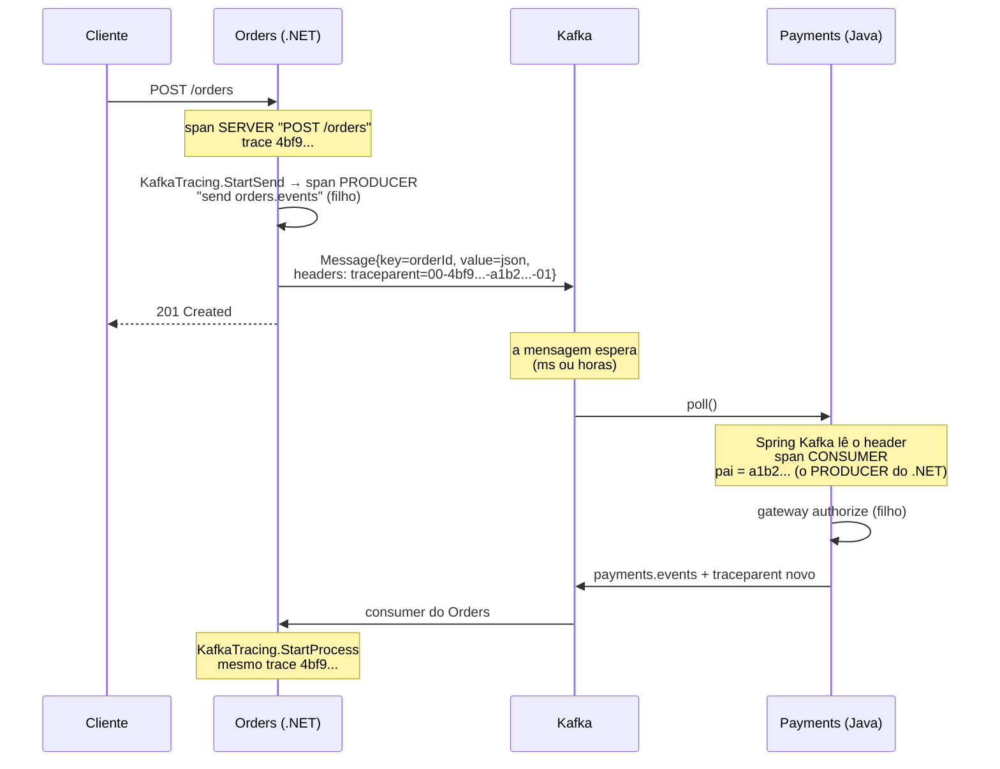

# 7.4 O traceparent pelo Kafka: de .NET para Java e de volta

Arquivos: `src/OrderFlow.Orders.Api/Observabilidade/KafkaTracing.cs`, as propriedades
`spring.kafka.*.observation-enabled` do Payments

## O problema: o Kafka quebra a corrente

Em HTTP, a propagação é automática dos dois lados: o `HttpClient` do .NET escreve o
`traceparent` no request, o Spring MVC lê. Uma mensagem Kafka não tem request. O produtor grava
bytes num log, e o consumidor lê esses bytes **minutos depois, em outro processo, em outra
linguagem**. Se ninguém colocar o contexto **dentro da mensagem**, o trace acaba no produtor e
um trace novo, sem relação, começa no consumidor.

O lugar certo para o contexto é o **header** da mensagem (Kafka tem headers desde a versão 0.11):
metadados ao lado da chave e do valor, sem misturar com o JSON do evento.



## O lado .NET: escrito à mão, de propósito

O cliente `Confluent.Kafka` não emite `Activity`. Existe o pacote
`OpenTelemetry.Instrumentation.ConfluentKafka`, que embrulha producer e consumer
(`InstrumentedProducerBuilder`), mas em out/2026 ele está em `0.x-alpha`. O OrderFlow escreve as
cerca de 60 linhas do `KafkaTracing` e ganha duas coisas: nenhuma dependência instável, e você
entende o mecanismo que a biblioteca esconderia.

### Produzir

```csharp
using var activity = KafkaTracing.StartSend(topic, key);        // span PRODUCER, filho do atual
var message = new Message<string, string> { Key = key, Value = json, Headers = new Headers() };
KafkaTracing.Inject(activity, message.Headers);                  // escreve traceparent
await producer.ProduceAsync(topic, message, ct);
```

Por dentro do `Inject`:

```csharp
Propagators.DefaultTextMapPropagator.Inject(
    new PropagationContext(context, Baggage.Current),   // o QUE propagar: span + baggage
    headers,                                            // ONDE escrever (o "carrier")
    SetHeader);                                         // COMO escrever uma chave/valor nele
```

O propagador não sabe nada de Kafka. Ele sabe produzir pares `chave → texto`
(`traceparent → 00-...`, `baggage → ...`), e você ensina a escrever no seu transporte:

```csharp
private static void SetHeader(Headers headers, string key, string value)
{
    headers.Remove(key);                              // retry da mesma Message não duplica
    headers.Add(key, Encoding.UTF8.GetBytes(value));  // header Kafka é byte[]
}
```

::: armadilha Header repetido
O Kafka **aceita** dois headers com a mesma chave. Se o código de retry do producer reaproveitar
a mesma `Message` e chamar `Inject` de novo, sem o `Remove` sairiam dois `traceparent`. Qual o
consumidor usa? Depende da biblioteca: o `TryGetLastBytes` do .NET pega o último; outra
biblioteca, em outra linguagem, pode pegar o primeiro. Trace ligado ao pai errado é pior que trace
partido, porque parece certo.
:::

### Consumir

```csharp
var result = consumer.Consume(ct);
using var activity = KafkaTracing.StartProcess(result, groupId);   // lê traceparent, abre CONSUMER
try { await HandleAsync(result, ct); }
catch (Exception ex) { KafkaTracing.RecordFailure(activity, ex); throw; }
consumer.Commit(result);
```

O `StartProcess` faz o caminho inverso: `Extract` lê os headers e devolve o `ActivityContext` do
produtor, que vira o **pai** do span `process payments.events`.

### Os atributos: convenção semântica de mensageria

| Atributo | Valor | Para quê |
|---|---|---|
| `messaging.system` | `kafka` | o Tempo desenha o nó "Kafka" no grafo de serviços |
| `messaging.destination.name` | `orders.events` | filtrar "todos os spans deste tópico" |
| `messaging.operation.type` | `send` / `process` | separar produção de consumo |
| `messaging.consumer.group.name` | `orders` | qual grupo processou |
| `messaging.destination.partition.id`, `messaging.kafka.offset` | `3`, `18234` | achar **a** mensagem exata no tópico |
| `messaging.kafka.message.key`, `orderflow.order_id` | o `orderId` | buscar o trace de um pedido no Tempo: `{ span.orderflow.order_id = "01a1..." }` |

Partição e offset no span são o detalhe que paga o esforço: num incidente de mensagem
envenenada, o trace com erro diz exatamente qual offset reprocessar ou pular (runbook
[lag de consumidor](../runbooks/lag-de-consumidor.md)).

## O lado Java: duas propriedades

```yaml
spring:
  kafka:
    template:
      observation-enabled: true
    listener:
      observation-enabled: true
```

Com elas, o `KafkaTemplate` auto-configurado cria uma observação por envio (span PRODUCER) e
escreve o contexto nos headers do `ProducerRecord`; o contêiner do `@KafkaListener` cria uma
observação por registro (span CONSUMER), lendo o contexto dos headers. O formato é o da
propagação configurada no Micrometer Tracing: **W3C** por padrão. Mesmo header, mesmo formato, o
.NET entende.

::: armadilha `KafkaTemplate` próprio ignora a propriedade
As propriedades valem para os beans que o **Boot** cria. Se o Módulo 2 declarar o próprio
`KafkaTemplate` ou `ConcurrentKafkaListenerContainerFactory` com `@Bean`, ligue na mão:
`template.setObservationEnabled(true)` e
`factory.getContainerProperties().setObservationEnabled(true)`. Sintoma de esquecer: o trace
do Orders termina no `send orders.events` e o Payments começa um trace novo, sem erro nenhum.
:::

::: armadilha Listener em lote
Num `@KafkaListener` que recebe `List<ConsumerRecord>`, o Spring Kafka **não** cria observação por
registro por padrão (precisa de `setRecordObservationsInBatch(true)` no contêiner). E aí aparece a
questão de fundo: um lote de 100 mensagens tem 100 pais diferentes. Qual é o pai do span do lote?
:::

## Filho ou link?

| Modelo | Quando | Como fica no Tempo |
|---|---|---|
| **Pai e filho** (o OrderFlow) | uma mensagem, um processamento | um trace só, de ponta a ponta: HTTP → Kafka → Java → Kafka → .NET |
| **Link** | processamento em lote, ou consumo que acontece muito depois (horas) | o span do lote começa um trace novo com N *links* clicáveis para os traces de origem |

O OrderFlow processa mensagem a mensagem, e o trace de ponta a ponta é exatamente o que se quer
ver. Mas pense no custo: se o Payments ficar fora duas horas e drenar o atraso depois, o trace do
`POST /orders` passa a ter **duas horas** de duração, com um buraco no meio. Para o Tempo, tudo
bem; para quem lê, o buraco é informação (o tempo na fila). Medir esse tempo de fila é o desafio
do módulo.

::: previsao
O consumer do Payments está parado. O Orders cria 30 pedidos. Uma hora depois o consumer volta e
processa os 30. No Tempo, quantos traces existem, e qual a duração do span raiz `POST /orders` de cada um?
???
30 traces, um por pedido, cada um com os spans do Orders e, uma hora depois, os do Payments.
A duração do span `POST /orders` continua sendo a da requisição HTTP (milissegundos): o span do
servidor termina quando a resposta sai. O que cresce é a **duração do trace** (do primeiro início
ao último fim), que passa a ser de uma hora. Na visualização em cascata, aparece um vão enorme
entre `send orders.events` e o span de consumo do Payments. Esse vão é o tempo de espera na fila.

Ponto sutil: o tail sampling do Collector espera só 10 segundos (`decision_wait`) para decidir
cada trace. Os spans do Payments, chegando uma hora depois, são decididos como se fossem outro
trace. Com a política de 10%, parte dos traces aparece só com o lado do Orders.
:::

## Baggage: o que viaja junto, e o perigo

`Baggage` é um conjunto de pares chave/valor que o propagador leva no header `baggage` e todos os
serviços seguintes podem ler. Uso legítimo: `tenant=acme`, `canal=app`, para filtrar spans de
todos os serviços por um dado que só a borda conhece.

::: armadilha Baggage é público
O header `baggage` vai em toda chamada de saída, **inclusive para terceiros** (o adquirente, num
gateway real). Nunca coloque CPF, e-mail ou token. E ele não vira atributo de span sozinho: no
Java, `management.tracing.baggage.remote-fields` e `tag-fields` controlam o que é propagado e o
que é copiado para os spans; no .NET, você lê `Baggage.Current` e faz o `SetTag`.
:::

::: quebra Lab: o trace partido
Depois da integração do Módulo 2, com os dois serviços mandando telemetria para o LGTM local:

1. Crie um pedido e ache o trace no Tempo. Conte os serviços na visualização.
2. No `KafkaTracing.Inject`, comente a linha do `Propagator.Inject(...)`. Rode de novo.
3. Leia a mensagem direto no tópico com os headers:
   ```bash
   kubectl -n kafka exec -it <pod-do-broker> -- bin/kafka-console-consumer.sh \
     --bootstrap-server localhost:9092 --topic orders.events --from-beginning \
     --property print.headers=true --property print.key=true --max-messages 5
   ```

Antes de rodar: quantos traces aparecem para um pedido agora? Os logs do Payments ainda têm `trace_id`?
:::

::: solucao
Dois traces por pedido: um do Orders (`POST /orders` → `send orders.events`) e outro, sem relação,
começando no span de consumo do Payments. Os logs do Payments **continuam** com `trace_id`,
mas é o id do trace novo: procurar pelo id do Orders não acha nada. No `kafka-console-consumer`,
as mensagens antigas mostram `traceparent:00-...` e as novas, `NO_HEADERS`.

É o sintoma mais comum em sistema real, e o mais traiçoeiro: nada falha, nenhum alerta toca, só a
investigação do próximo incidente fica impossível. Por isso o desafio do módulo pede um **teste
automatizado** que confere o header.
:::

::: video How To Do Distributed Tracing With Opentelemetry in Spring Boot (em inglês)
https://www.youtube.com/watch?v=jfbUwZwzC98
Tracing entre serviços Spring com OpenTelemetry. Foi gravado antes do starter do Boot 4: preste
atenção nos conceitos (propagação, spans, exportação), não nas dependências.
:::

## Perguntas para responder sem olhar

::: pergunta
Por que o contexto de trace vai no header da mensagem, e não dentro do JSON do evento?
???
Porque é metadado de transporte, não dado de negócio. No header, as bibliotecas de tracing leem e
escrevem sem conhecer o formato do evento, o contrato do evento (e o Schema Registry) não muda, e
um consumidor que não faz tracing simplesmente ignora.
:::

::: pergunta
Um serviço .NET e um Java trocam mensagens pelo Kafka e o trace sai partido. Onde você procura?
???
Primeiro no tópico: as mensagens têm o header `traceparent`? Se não têm, o problema é no
produtor (não injeta, ou o `KafkaTemplate` foi criado sem observação). Se têm, no consumidor:
o listener está com observação ligada, e a propagação é W3C dos dois lados (e não B3 de um)?
:::

::: pergunta
Quando usar span link em vez de relação pai e filho no consumo de mensagens?
???
Em processamento em lote (uma operação com muitas origens) e quando o consumo é tão posterior
que juntar tudo num trace atrapalha a leitura. Link mantém a navegação para as origens sem
forçar uma árvore única.
:::

**Próxima:** [7.5 Grafana LGTM: o Collector, os painéis e os alertas](05-grafana-lgtm.md).
