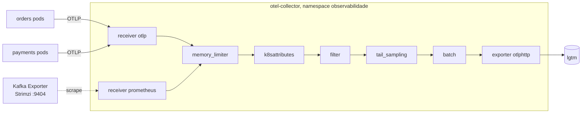

# 7.5 Grafana LGTM: o Collector, os painéis e os alertas

Arquivos: `deploy/observabilidade/` (`docker-compose.yml`, `lgtm/lgtm.yaml`,
`collector/values.yaml`, `dashboards/orderflow.json`, `alertas/orderflow-slo.rules.yaml`)

## LGTM: quatro projetos, um para cada pergunta

| Letra | Projeto | Guarda | Linguagem de consulta |
|---|---|---|---|
| **L** | Loki | logs (indexa só os labels, não o texto) | LogQL: `{service_name="orders"} \|= "erro"` |
| **G** | Grafana | nada: é a tela, que consulta os outros | — |
| **T** | Tempo | traces (busca por id, e por atributos com TraceQL) | TraceQL: `{ span.orderflow.order_id = "01a1..." }` |
| **M** | Mimir (ou Prometheus) | métricas | PromQL: `rate(orderflow_orders_created_total[5m])` |

Para estudar, a Grafana publica a imagem `grafana/otel-lgtm`: um contêiner com um Collector,
Grafana, Tempo, Loki e um backend de métricas, já ligados entre si. A própria documentação avisa:
é para **desenvolvimento, demonstração e testes**. O OrderFlow usa a imagem em dois lugares:

- **na sua máquina**: `docker compose -f deploy/observabilidade/docker-compose.yml up -d`, com os serviços rodando por `dotnet run`/`mvnw`;
- **no AKS de estudo**: `kubectl apply -f deploy/observabilidade/lgtm/lgtm.yaml`, atrás do Collector.

## O Collector: por que um intermediário

Os serviços poderiam mandar OTLP direto para o LGTM. O OrderFlow põe um **Collector** no meio
(`deploy/observabilidade/collector/values.yaml`, chart oficial `open-telemetry/opentelemetry-collector`):



| Processador | O que faz | Sem ele |
|---|---|---|
| `memory_limiter` | recusa dados quando o Collector chega a 80% do limite de memória | o Collector morre por OOM num pico, e você perde tudo, inclusive o pico que queria investigar |
| `k8sattributes` (preset do chart) | acrescenta `k8s.pod.name`, `k8s.namespace.name`, `k8s.deployment.name` a todo sinal | o trace lento não diz em qual pod rodou; o serviço teria que descobrir isso sozinho |
| `filter` | descarta spans de `/health` e `/actuator` que escaparem | um serviço novo esquecido enche o Tempo de probes |
| `tail_sampling` | decide **depois** do trace terminar: 100% com erro, 100% acima de 1 s, 10% do resto | só head sampling: 90% dos traces com erro seriam descartados antes de se saber que tinham erro |
| `batch` | agrupa antes de enviar | uma requisição de rede por span |

::: porque Por que o Collector é a peça que mais paga o esforço
1. **Trocar de backend sem redeploy.** Amanhã o time decide ir para Grafana Cloud ou Azure Monitor:
   muda o `exporters` do Collector. Os dois serviços, em duas linguagens, não são tocados.
2. **Decisões que só dá para tomar no meio.** Tail sampling precisa ver todos os spans de um trace,
   de todos os serviços. Nenhum serviço sozinho vê isso.
3. **Credenciais num lugar só.** A chave do backend fica no Collector, não em cada pod.
:::

::: armadilha Tail sampling com duas réplicas
A política "guarde o trace se algum span tem erro" só funciona se **todos** os spans do trace
chegarem ao **mesmo** processo. Com `replicaCount: 2` e o Service do Kubernetes distribuindo as
conexões, os spans do Orders caem numa réplica e os do Payments na outra: cada uma decide com
meio trace. Por isso o `values.yaml` fixa uma réplica. Para escalar, a arquitetura vira duas
camadas: Collectors com o exporter `loadbalancing` (roteia por `traceID`) na frente de Collectors com o `tail_sampling`.
:::

### O lag do Kafka entra pelo Collector também

O lag do consumer group não é medido pelos serviços: quem sabe o offset do grupo e o fim do
tópico é o broker. O Strimzi (Módulo 5) sobe o **Kafka Exporter**, que expõe
`kafka_consumergroup_lag` em formato Prometheus na porta 9404. O receiver `prometheus` do Collector
raspa esse endpoint (descobrindo os pods pelo label `strimzi.io/name`) e manda junto com o resto.

## Instalar no AKS

```bash
kubectl apply -f deploy/observabilidade/lgtm/lgtm.yaml
helm repo add open-telemetry https://open-telemetry.github.io/opentelemetry-helm-charts
helm upgrade --install otel-collector open-telemetry/opentelemetry-collector \
  --version 0.178.1 -n observabilidade -f deploy/observabilidade/collector/values.yaml
kubectl -n observabilidade port-forward svc/lgtm 3000:3000
```

E os serviços passam a apontar para o Collector, pelas variáveis do chart de cada um (Módulo 4):

| Serviço | Variável | Valor no cluster |
|---|---|---|
| Orders | `OTEL_EXPORTER_OTLP_ENDPOINT` | `http://otel-collector.observabilidade:4317` |
| Orders | `Observabilidade__TraceSampleRatio` | `0.1` em prod |
| Payments | `MANAGEMENT_OPENTELEMETRY_TRACING_EXPORT_OTLP_ENDPOINT` | `http://otel-collector.observabilidade:4318/v1/traces` |
| Payments | `MANAGEMENT_OPENTELEMETRY_LOGGING_EXPORT_OTLP_ENDPOINT` | `http://otel-collector.observabilidade:4318/v1/logs` |
| Payments | `MANAGEMENT_OTLP_METRICS_EXPORT_URL` | `http://otel-collector.observabilidade:4318/v1/metrics` |
| Payments | `MANAGEMENT_TRACING_SAMPLING_PROBABILITY` | `0.1` em prod |
| os dois | `OTEL_RESOURCE_ATTRIBUTES` | `deployment.environment.name=prod` |

::: armadilha NetworkPolicy
Se o Módulo 6 aplicou NetworkPolicy de "nega tudo por padrão" no namespace `orderflow`, a saída
para `observabilidade:4317/4318` precisa de uma regra explícita. Sintoma: nenhum dado chega, e o
log do Orders mostra falhas do exportador (o SDK **não** derruba a aplicação por isso, só registra).
:::

## O painel do OrderFlow

Importe `deploy/observabilidade/dashboards/orderflow.json` (Dashboards → New → Import). Ele tem
quatro linhas, e a ordem é proposital: do sintoma para a causa.

| Linha | Painéis | Pergunta |
|---|---|---|
| Orders (.NET): RED | RPS por rota, taxa de 5xx, p95/p99 | o Orders está saudável? |
| Payments (Java): RED | o mesmo, com os nomes do Micrometer | o Payments está saudável? |
| Negócio | pedidos/min, taxa de aprovação, gateway p95 por resultado | o **negócio** está saudável? |
| Kafka | lag por grupo, variação do lag | os eventos estão fluindo? |

Mais um painel de logs de erro e aviso dos dois serviços, de onde se clica no `traceId`.

Três detalhes de PromQL que o painel usa e que caem em entrevista:

```promql
# 1. Percentil: SOMA os baldes de todos os pods, por "le", e só então calcula.
histogram_quantile(0.95, sum by (le) (rate(http_server_request_duration_seconds_bucket{job="orderflow/orders"}[$__rate_interval])))

# 2. Taxa de erro: razão de duas taxas, nunca razão de dois contadores absolutos.
sum(rate(..._count{http_response_status_code=~"5.."}[5m])) / sum(rate(..._count[5m]))

# 3. Contador sempre com rate(): o valor bruto zera a cada restart de pod.
sum(rate(orderflow_orders_created_total[$__rate_interval])) * 60
```

::: armadilha Média de percentis
Calcular o p95 de cada pod e tirar a média **não** é o p95 do serviço. Com um pod em 2 s e nove em
100 ms, a média dos p95 é cerca de 290 ms; o p95 real do serviço pode ser bem pior, dependendo de
quanto tráfego o pod lento recebe. Percentil não se soma nem se tira média. Por isso o histograma
guarda **baldes** (contagens), que se somam, e o percentil é calculado depois.
:::

## Do alerta ao log, em três cliques

O fluxo que justifica todo o trabalho deste módulo:

1. O alerta `OrdersQueimaRapidaDoOrcamentoDeErro` toca. O painel mostra 5xx em `POST /orders`.
2. No painel de latência, os **exemplars** (pontos sobre o gráfico, quando habilitados no
   datasource) levam a traces reais daquele momento. Ou, no Tempo:
   `{ resource.service.name = "orders" && status = error }`.
3. No trace, o span vermelho é o `send orders.events`, com a exceção do producer. Um clique em
   "Logs for this span" abre no Loki os logs com aquele `trace_id`: "Local: Message timed out".

Cada clique depende de uma decisão das lições anteriores: o `service.name` igual nos três
sinais, o `trace_id` nos logs, o span do produtor Kafka existir.

## Alertas: SLO e taxa de queima

`deploy/observabilidade/alertas/orderflow-slo.rules.yaml` define um **SLO**: 99,5% das requisições
do Orders sem 5xx em 30 dias. O que sobra, 0,5%, é o **orçamento de erro**: quanto o sistema pode
falhar no mês sem descumprir o objetivo.

::: conceito Taxa de queima (burn rate)
Quantas vezes mais rápido que o "aceitável" o orçamento está sendo gasto. Taxa 1 = o orçamento
acaba exatamente no fim dos 30 dias. Taxa 14,4 por uma hora = 2% do orçamento do mês queimado em
uma hora; mantido, ele acaba em cerca de dois dias.
:::

Por que não simplesmente "alerta se 5xx > 1% por 5 minutos"? Porque esse limiar é arbitrário:
toca em picos que não ameaçam o SLO e cala em degradações lentas que ameaçam. O alerta por taxa
de queima em **duas janelas** (1 h confirmada por 5 min) toca rápido quando é grave e para de
tocar logo depois que o problema some. É o método do livro *The Site Reliability Workbook* do Google.

Cada alerta tem `runbook_url`. Alerta sem runbook é proibido no OrderFlow: se ninguém sabe o que
fazer quando ele toca, ele não deveria tocar (lição 7.7).

## Em produção, o que muda

| Opção | O que é | Quando |
|---|---|---|
| **Grafana Cloud** | o mesmo LGTM, gerenciado; o Collector exporta por OTLP com uma chave | time pequeno, sem querer operar Loki/Tempo/Mimir |
| **Azure Monitor** (Application Insights + Managed Prometheus) **+ Azure Managed Grafana** | o caminho nativo da Azure; aceita OTLP | empresa já padronizada em Azure, com compliance pedindo dados no tenant |
| **LGTM próprio no cluster** | charts separados de Loki, Tempo e Mimir, com armazenamento em Blob Storage | volume alto, custo de SaaS proibitivo, time de plataforma para operar |

Nos três casos, **o código dos serviços não muda**: muda o exporter do Collector. Foi para isso
que o OTel entrou no projeto.

::: video OpenTelemetry Explained: Observability Framework for Distributed Systems (em inglês)
https://www.youtube.com/watch?v=iTRymaKNGLc
Se não viu na lição 7.1, veja agora a parte do Collector: receivers, processors, exporters.
:::

## Perguntas para responder sem olhar

::: pergunta
Por que existe o OpenTelemetry Collector, se os SDKs já exportam OTLP direto?
???
Para desacoplar os serviços do backend (trocar de destino sem redeploy), para tomar decisões que
exigem ver o sistema inteiro (tail sampling, enriquecimento com metadados do Kubernetes) e para
concentrar credenciais, filtros e limites de memória num ponto só.
:::

::: pergunta
O que é tail sampling e qual o cuidado ao escalar o Collector que o faz?
???
Decidir se o trace é guardado depois que ele termina, com regras como "todo trace com erro" ou
"todo trace acima de 1 s". Exige que todos os spans de um trace cheguem ao mesmo Collector:
com várias réplicas, uma camada na frente roteia por `traceID` (exporter loadbalancing).
:::

::: pergunta
Por que alertar por taxa de queima do orçamento de erro, e não por um limiar fixo de 5xx?
???
Porque o limiar fixo não tem relação com o objetivo: toca em picos irrelevantes e não percebe
degradação lenta. A taxa de queima mede quão rápido o SLO está sendo ameaçado; com duas janelas,
toca rápido no grave e para logo que o problema acaba.
:::

**Próxima:** [7.6 CI/CD com GitHub Actions e OIDC](06-cicd-github-actions.md).
