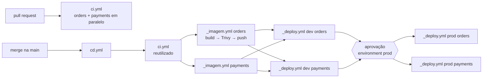
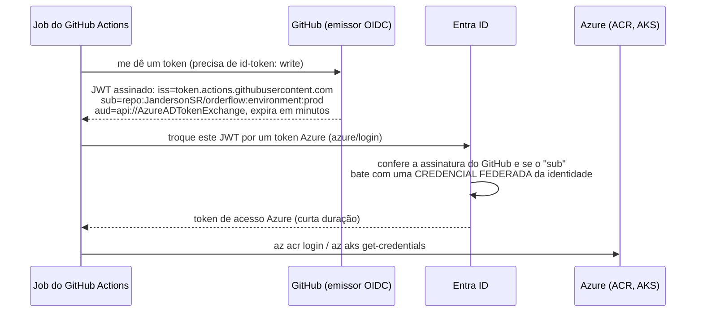

# 7.6 CI/CD com GitHub Actions: duas stacks, imagens analisadas e deploy por OIDC

Arquivos: `.github/workflows/ci.yml`, `_imagem.yml`, `_deploy.yml`, `cd.yml`

## O desenho



Quatro arquivos, cada um com uma responsabilidade:

| Arquivo | Dispara em | Faz |
|---|---|---|
| `ci.yml` | PR, push na main, e chamado pelo `cd.yml` | build e testes do .NET e do Java, em paralelo |
| `_imagem.yml` | só chamado (`workflow_call`) | constrói, analisa e publica a imagem de UM serviço |
| `_deploy.yml` | só chamado | `helm upgrade` de UM serviço em UM ambiente |
| `cd.yml` | push na main (fora de `docs/`), manual | orquestra: ci → imagens → dev → aprovação → prod |

O prefixo `_` é convenção do projeto para "workflow reutilizável, não dispara sozinho".

::: porque Por que workflows reutilizáveis e não um YAML só
Com dois serviços e dois ambientes, um arquivo único teria quatro cópias quase iguais do passo de
deploy. Na primeira correção (a versão do Helm, um parâmetro novo), alguém esquece uma das
cópias, e prod passa a ser implantado diferente de dev. Com `workflow_call`, o deploy existe uma
vez, recebe `environment`, `service` e `image`, e é chamado quatro vezes. É o DRY aplicado onde
ele mais importa: no caminho para produção.
:::

## CI: o que vale comentar

```yaml
concurrency:
  group: ci-${{ github.workflow }}-${{ github.ref }}
  cancel-in-progress: ${{ github.event_name == 'pull_request' }}
```

Três pushes seguidos num PR: só o último interessa, os anteriores são cancelados. Na main não:
cada commit da main precisa de resultado, porque é dele que sai o deploy.

| Escolha | Motivo |
|---|---|
| dois jobs (`orders`, `payments`) em vez de um | rodam em paralelo, e um Java quebrado não esconde o resultado do .NET; o PR mostra dois checks |
| `dotnet build -c Release` | o `TreatWarningsAsErrors` do `Directory.Build.props` vale igual no CI; warning novo quebra o PR |
| `mvn -B -ntp verify` | `-B` sem interação, `-ntp` sem as milhares de linhas de progresso de download |
| `upload-artifact` com `if: always()` | o relatório de testes importa justamente quando os testes **falham** |
| `permissions: contents: read` | o `GITHUB_TOKEN` do CI não consegue escrever nada no repositório; um passo comprometido não consegue publicar código |

## Imagens: build → scan → push, nessa ordem

```yaml
- name: Build          # load: true → fica no Docker do runner, ainda NÃO no ACR
- name: Scan           # Trivy, falha em CRITICAL/HIGH com correção disponível
- name: Login (OIDC)
- name: Push           # só chega aqui o que passou no scan
```

Se o scan rodasse depois do push, a imagem vulnerável já estaria no registry, com tag, pronta
para alguém implantar à mão "só para testar". A ordem garante que o registry só tem imagens
analisadas.

::: porque `ignore-unfixed: true`
Uma imagem base sempre tem alguma CVE sem correção publicada. Bloquear o pipeline por ela trava
o time sem dar nada para ele fazer. O critério do OrderFlow: bloqueia o que tem correção
(atualizar a imagem base ou a dependência resolve); o resto aparece no relatório e entra numa
revisão periódica. As imagens do Módulo 4 (chiseled no .NET, distroless no Java) existem para
manter essa lista curta: menos pacotes, menos CVEs.
:::

### Tag é ponteiro; digest é conteúdo

A imagem recebe a tag `SHA do commit` (12 caracteres), nunca `latest`. E o deploy não usa nem a
tag: usa o **digest** (`orders@sha256:9f86d0...`), o hash do conteúdo, que o `_imagem.yml` devolve
como saída. Uma tag pode ser reescrita por qualquer um com permissão de push; um digest não. O
que foi analisado pelo Trivy é exatamente o que roda.

::: armadilha A action fixada por tag
O mesmo raciocínio vale para as **actions**. Em março de 2026 (CVE-2026-33634), tags do
`aquasecurity/trivy-action` foram reapontadas para código malicioso: quem usava
`trivy-action@v0.x` executou o código do atacante no próprio pipeline, com acesso aos segredos.
Por isso o `_imagem.yml` fixa essa action pelo SHA do commit (`@ed142fd...  # v0.36.0`). As actions
oficiais do GitHub, Docker e Azure estão por tag de versão maior no projeto, por legibilidade; em
empresa com requisito de cadeia de suprimentos, todas vão por SHA, e o Dependabot atualiza.
:::

## OIDC por dentro: deploy sem segredo guardado

O jeito antigo: criar um *service principal* com senha, guardar a senha num secret do GitHub,
lembrar de renovar a cada ano. Se vazar, vale até alguém perceber.

O jeito do OrderFlow: **federação de identidade (OIDC)**. Não existe senha.



O coração é o campo `sub` (*subject*). A credencial federada, criada no Módulo 6 junto com a
identidade, diz exatamente qual subject é aceito:

| Job | `sub` emitido pelo GitHub | Credencial federada que aceita |
|---|---|---|
| `_imagem.yml` (sem environment) | `repo:JandersonSR/orderflow:ref:refs/heads/main` | identidade com `AcrPush` |
| `_deploy.yml` com `environment: dev` | `repo:JandersonSR/orderflow:environment:dev` | identidade de dev, acesso ao AKS de dev |
| `_deploy.yml` com `environment: prod` | `repo:JandersonSR/orderflow:environment:prod` | identidade de prod, acesso ao AKS de prod |

::: previsao
Alguém abre um PR que muda o `_deploy.yml` para rodar `helm upgrade` em produção direto, sem
`environment`. O PR roda o CI. O que acontece com o passo do `azure/login`?
???
Falha. Num pull request, o `sub` emitido é `repo:JandersonSR/orderflow:pull_request`, que não bate
com nenhuma credencial federada. Mesmo num push na main, sem `environment: prod` o `sub` seria
`ref:refs/heads/main`, que só tem `AcrPush`, sem acesso ao cluster de produção. A proteção não
depende de ninguém revisar o YAML com atenção: está na Azure. E o environment `prod` exige
aprovação de um revisor, então mesmo o caminho legítimo tem um humano no meio.
:::

::: armadilha `id-token: write` no lugar certo
Em workflow reutilizável, a permissão precisa estar **no job chamador** (o `cd.yml` passa
`permissions: id-token: write` em cada `uses:`) e é limitada pelo que o chamador concede. Sem
ela, o erro do `azure/login` fala de "ACTIONS_ID_TOKEN_REQUEST_URL" e não de permissão, o que
confunde muita gente.
:::

## Deploy com Helm: o comando inteiro

```bash
helm upgrade --install orders deploy/helm/orders \
  --namespace orderflow --create-namespace \
  -f deploy/helm/orders/values-prod.yaml \
  --set-string image.repository=acrorderflow.azurecr.io/orders \
  --set-string image.digest=sha256:9f86d0... \
  --set-string podAnnotations.orderflow/git-sha=<sha> \
  --rollback-on-failure --wait=watcher --timeout 10m \
  --history-max 10
```

| Opção | Por quê |
|---|---|
| `upgrade --install` | o mesmo comando instala na primeira vez e atualiza nas outras: o pipeline é idempotente |
| `--rollback-on-failure` | se o rollout não ficar saudável no `--timeout`, o Helm volta sozinho à última revisão boa. No Helm 3 era `--atomic`; no Helm 4 o nome antigo ainda funciona, mas está depreciado |
| `--wait=watcher` | espera os recursos ficarem prontos: pods `Ready`, ou seja, **readiness passando**. É aqui que as probes do Módulo 1 viram segurança de deploy |
| `--history-max 10` | cada revisão é um Secret no namespace; sem limite, eles se acumulam para sempre |
| `podAnnotations...git-sha` | `kubectl describe pod` diz de qual commit veio aquele pod |
| `concurrency` no job | dois deploys do mesmo release ao mesmo tempo dão "another operation is in progress" e podem deixar o release em `pending-upgrade` |

::: porque Push (o pipeline aplica) e não GitOps (o cluster puxa), por enquanto
No modelo deste módulo, o pipeline tem credencial para o cluster. A alternativa madura é GitOps
(Argo CD, Flux): o pipeline só grava a nova versão num repositório, e um agente dentro do cluster
aplica. O OrderFlow começa com push porque é um passo de cada vez: o fluxo é mais fácil de ver e
de depurar, e o OIDC com environment já elimina o pior risco (segredo de longa duração). O
[ADR 0008](../adr/0008-deploy-por-pipeline-com-oidc.md) registra a decisão e o gatilho para revisitá-la.
:::

## Configurar uma vez (fora do repositório)

1. **Variáveis do repositório** (Settings → Secrets and variables → Actions → Variables):
   `AZURE_TENANT_ID`, `AZURE_SUBSCRIPTION_ID`, `ACR_NAME` e `AZURE_CLIENT_ID` (a identidade que só
   tem `AcrPush`, usada pelo `_imagem.yml`). São identificadores, não segredos; ficam em `vars`, não em `secrets`.
2. **Environments** `dev` e `prod`, cada um com o próprio `AZURE_CLIENT_ID` (variável de
   environment tem precedência sobre a do repositório com o mesmo nome), `AKS_RESOURCE_GROUP` e `AKS_NAME`. Em `prod`: *Required reviewers* e *Deployment branches* só `main`.
3. **Credenciais federadas** na Azure (Bicep/Terraform do Módulo 6), uma por subject da tabela acima.
4. **Branch protection** na main: os checks `orders (.NET 10)` e `payments (Java 25)` obrigatórios.

::: video Connect to Azure from a GitHub Action with OpenID Connect (OIDC) (em inglês)
https://www.youtube.com/watch?v=IKuw9T6vZYU
A configuração da credencial federada passo a passo, do lado do Entra ID e do GitHub.
:::

::: video Security Scans for Docker Images using Trivy! (em inglês)
https://www.youtube.com/watch?v=nXTNEpLT3N4
O Trivy analisando imagens, e como ler o relatório.
:::

## Perguntas para responder sem olhar

::: pergunta
Como o pipeline se autentica na Azure sem nenhum segredo guardado no GitHub?
???
Por OIDC: o job pede ao GitHub um JWT de curta duração (precisa de `id-token: write`), e a Azure
troca esse JWT por um token de acesso se o emissor, a audiência e o `subject` baterem com uma
credencial federada da identidade. O subject inclui repositório e branch ou environment, então
cada ambiente tem sua própria identidade com o mínimo de permissão.
:::

::: pergunta
Por que o deploy usa o digest da imagem e não a tag?
???
A tag é um ponteiro mutável; o digest é o hash do conteúdo. Usando o digest, o que roda é
exatamente o que foi testado e analisado, e reconstruir ou reescrever uma tag não muda o que
está em produção.
:::

::: pergunta
O que o `--rollback-on-failure` do Helm garante, e o que ele não garante?
???
Garante que, se os recursos não ficarem prontos (readiness) dentro do timeout, o release volta à
última revisão boa. Não garante que a versão nova esteja correta: um bug que não derruba a
readiness passa. E não volta migrations de banco já aplicadas.
:::

**Próxima:** [7.7 Deploy sem downtime e runbooks](07-deploy-sem-downtime-e-runbooks.md).
