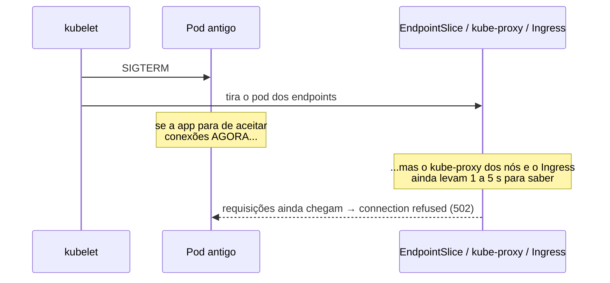

# 7.7 Deploy sem downtime e runbooks

Arquivos: os values dos charts `deploy/helm/orders` e `deploy/helm/payments` (Módulo 4),
`docs/runbooks/`

"Deploy sem downtime" não é uma opção que se liga. É a soma de seis peças, e basta uma faltar
para o cliente ver erro a cada deploy. Esta lição passa por cada uma, com o que quebra sem ela.

## 1. Rolling update e as duas alavancas

```yaml
strategy:
  type: RollingUpdate
  rollingUpdate:
    maxSurge: 1          # pode existir 1 pod A MAIS que o desejado durante a troca
    maxUnavailable: 0    # nunca menos pods prontos que o desejado
```

Com 3 réplicas, o Kubernetes sobe o 4º (novo), espera ele ficar **pronto**, tira um antigo, e
repete. A capacidade nunca cai abaixo de 3.

| Configuração | Comportamento | Quando |
|---|---|---|
| `maxSurge: 1, maxUnavailable: 0` | sobe antes de derrubar; capacidade total o tempo todo | o padrão do OrderFlow |
| `maxSurge: 0, maxUnavailable: 1` | derruba antes de subir; não precisa de espaço extra no cluster | cluster sem folga de CPU/memória, aceitando capacidade menor no deploy |
| padrão do Kubernetes (`25%`/`25%`) | arredonda: com 3 réplicas, surge 1 e unavailable 0 | funciona, mas deixe explícito: o padrão muda com o número de réplicas |

::: previsao
`maxSurge: 1`, `maxUnavailable: 0`, 3 réplicas, e a versão nova tem um bug que faz a readiness
falhar sempre. O que acontece com o tráfego, e quando o pipeline percebe?
???
O pod novo nunca fica pronto. Com `maxUnavailable: 0`, o Kubernetes não pode tirar nenhum antigo
antes de um novo estar pronto, então os 3 antigos continuam atendendo 100% do tráfego, e o
rollout fica parado com um pod novo não pronto. O cliente não vê nada.

O pipeline percebe no fim do `--timeout 10m` do Helm: o `--wait` não termina, o
`--rollback-on-failure` volta a revisão anterior, e o job falha. É a readiness funcionando como
**portão de deploy**. Com `maxUnavailable: 1` o mesmo bug tiraria um pod antigo antes: capacidade
de 2/3 durante 10 minutos.
:::

## 2. Readiness que significa "pronto de verdade"

O rolling update confia na readiness. Se ela responde 200 antes de a aplicação conseguir
atender, o Kubernetes manda tráfego para um pod que vai errar. As probes do Módulo 1 já foram
desenhadas para isso:

| | Orders | Payments |
|---|---|---|
| liveness | `/health/live`, sem dependências | `/actuator/health/liveness` |
| readiness | `/health/ready`: fila interna abaixo de 90% (+ Postgres e Kafka a partir dos Módulos 2/3) | `/actuator/health/readiness` |
| startup | `startupProbe` no chart, com prazo largo | idem; a JVM demora mais a esquentar |

::: armadilha A JVM fria
O Payments fica "pronto" quando o Spring termina de subir, mas as primeiras centenas de
requisições ainda rodam em código interpretado, antes do JIT compilar o caminho quente. Num
deploy com tráfego alto, o p99 do Payments sobe por um ou dois minutos a cada pod novo. Isso
aparece no painel como um "dente" no p99 em todo deploy. Mitigações: `minReadySeconds` no
Deployment (espera N segundos depois de pronto antes de seguir o rollout), CDS/AOT cache do
Java (Módulo 4), ou aquecer o pod com requisições sintéticas antes da readiness.
:::

## 3. O desligamento: o SIGTERM e a corrida com o Service

Esta é a peça que mais gente erra. Quando o Kubernetes decide matar um pod antigo, **duas coisas
começam ao mesmo tempo**, sem ordem garantida:



A correção é um `preStop` que **espera** antes de o SIGTERM chegar à aplicação:

```yaml
lifecycle:
  preStop:
    sleep:
      seconds: 10      # ação nativa "sleep" (Kubernetes 1.30+): não precisa de shell na imagem
terminationGracePeriodSeconds: 45
```

| Tempo | O que acontece |
|---|---|
| 0 s | o pod é marcado para encerrar; sai dos endpoints; o `preStop` começa |
| 0–10 s | a rede converge (ninguém mais manda tráfego novo); a app continua atendendo o que chega |
| 10 s | o `preStop` termina; o SIGTERM chega à aplicação |
| 10–30 s | desligamento gracioso: o Kestrel e o Spring (`timeout-per-shutdown-phase: 20s`) terminam as requisições em andamento; os consumers Kafka fecham e saem do grupo (`Close()`), o rebalanceamento acontece na hora |
| 45 s | se ainda estiver vivo, SIGKILL |

::: porque `preStop.sleep` e não `exec: sleep 10`
As imagens do Módulo 4 são *chiseled* (.NET) e *distroless* (Java): **não têm shell nem o binário
`sleep`**. Um `exec: ["sleep", "10"]` falharia, o Kubernetes registraria o erro do hook e
mandaria o SIGTERM na hora, sem a espera, e o problema voltaria em silêncio. A ação `sleep`
nativa do `preStop` existe justamente para isso.
:::

A regra de soma: `preStop` + desligamento da aplicação < `terminationGracePeriodSeconds`. Com
10 + 20 = 30 < 45, sobra margem.

## 4. PodDisruptionBudget: proteção contra o que não é deploy

O rolling update protege o seu deploy. Mas há **interrupções voluntárias** que não são seu
deploy: o AKS atualizando a versão dos nós, o cluster autoscaler removendo um nó vazio, alguém
rodando `kubectl drain`. Sem PDB, um *drain* pode despejar as 3 réplicas do Orders de uma vez se
estiverem no mesmo nó.

```yaml
apiVersion: policy/v1
kind: PodDisruptionBudget
metadata:
  name: orders
spec:
  maxUnavailable: 1
  selector:
    matchLabels:
      app.kubernetes.io/name: orders
```

| Escolha | Efeito |
|---|---|
| `maxUnavailable: 1` | no máximo um pod fora por interrupção voluntária, qualquer que seja o número de réplicas |
| `minAvailable: 2` | sempre 2 prontos; com HPA/KEDA mudando réplicas, fica rígido |
| `minAvailable: 100%` ou `maxUnavailable: 0` | **bloqueia** o drain para sempre: a atualização do AKS trava esperando. Não faça |

O PDB não protege contra interrupção **involuntária** (nó que morre). Para isso, as réplicas
precisam estar em nós e zonas diferentes: `topologySpreadConstraints` por `topology.kubernetes.io/zone`
no chart. Com KEDA reduzindo o Payments a 1 réplica em horário de pouco movimento, o PDB com
`maxUnavailable: 1` permite derrubar essa única réplica: é uma escolha consciente de custo × disponibilidade.

## 5. Migrations compatíveis: expand/contract

Durante o rolling update, **as duas versões rodam ao mesmo tempo** contra o mesmo banco por
alguns minutos. E depois de um rollback, a versão antiga roda contra o esquema novo. Logo:

> Todo esquema precisa funcionar com a versão N e com a versão N-1 do código.

Renomear a coluna `customer_id` para `client_id` num passo só quebra essa regra: no meio do
deploy, os pods antigos procuram uma coluna que não existe. O padrão é **expand/contract**,
em deploys separados:

| Deploy | Banco | Código |
|---|---|---|
| 1. expand | `ADD COLUMN client_id` (nulável) | escreve nas DUAS colunas, lê da antiga |
| 2. migrar | backfill em lotes: `UPDATE ... SET client_id = customer_id WHERE client_id IS NULL LIMIT ...` | igual |
| 3. trocar a leitura | — | lê da nova, ainda escreve nas duas |
| 4. contract | `DROP COLUMN customer_id` (só quando nenhuma versão em produção a usa) | só a nova |

Regras práticas para as migrations do Módulo 3 (EF Core e Flyway/JPA):

- **Nunca** `DROP`/`RENAME` no mesmo deploy que para de usar a coluna.
- `NOT NULL` em coluna nova só com `DEFAULT`, ou depois do backfill.
- No Postgres, índice em tabela grande com `CREATE INDEX CONCURRENTLY` (sem travar escrita). No EF
  Core isso exige SQL manual na migration, porque a criação concorrente não roda dentro de transação.
- Migration roda **antes** do código novo (um Job de *pre-upgrade* do Helm, ou um passo do
  pipeline), nunca na subida de cada pod: com 3 réplicas subindo juntas, 3 processos tentariam migrar ao mesmo tempo.

O mesmo vale para os **eventos** no Kafka: um campo novo no `OrderCreated` precisa ser opcional
para o consumidor antigo (Schema Registry com compatibilidade, [ADR 0005](../adr/0005-contratos-de-eventos-versionados.md)).
E a ordem do deploy importa: **consumidor primeiro**, que já aceita o campo, depois o produtor que passa a enviá-lo.

::: video LISA19 - Expand Contract Pattern for Continuous Delivery of Databases (USENIX, em inglês)
https://www.youtube.com/watch?v=Eh05k_O0Jjo
O padrão expand/contract explicado com exemplos de entrega contínua de banco de dados.
:::

## 6. O que mede se deu certo

"Sem downtime" é uma afirmação, e afirmação se prova com dado. Durante um deploy, rode um
gerador de carga simples e olhe o painel:

```bash
# em outro terminal, durante o "helm upgrade"
while true; do
  curl -s -o /dev/null -w '%{http_code}\n' -X POST https://<ingress>/orders \
    -H 'Content-Type: application/json' \
    -d '{"customerId":"carga","items":[{"sku":"X","quantity":1,"unitPrice":1}]}'
done | sort | uniq -c
```

Zero respostas diferentes de 201 durante o rollout = as seis peças estão no lugar. Um punhado de
502 no começo da troca de cada pod = falta o `preStop`. 503 = readiness respondendo errado.

::: quebra Lab: tire o preStop
No chart do Orders, remova o `lifecycle.preStop` e faça um deploy com o loop acima rodando. Depois
recoloque e repita. Compare as contagens.
:::

::: solucao
Sem o `preStop`, aparecem alguns 502 (ou `connection refused` no curl, que imprime `000`) a cada
pod antigo encerrado: são as requisições que o Ingress ainda mandou para um pod que já tinha
fechado o socket. A quantidade depende da carga e da velocidade de propagação dos endpoints, por
isso o problema às vezes "não aparece em homologação". Com o `preStop` de 10 s, zero. É o tipo de
bug que só se vê medindo, e o motivo de "deploy sem downtime" precisar de um teste, não de uma
promessa.
:::

## Runbooks: o que o plantão lê às 3h

O alerta acordou alguém. Essa pessoa pode não ser quem escreveu o código, não lembra a
arquitetura, e está com sono. O runbook existe para que a qualidade da resposta não dependa de
quem está de plantão.

Os do OrderFlow estão em [`docs/runbooks/`](../runbooks/README.md) e seguem o mesmo modelo:

| Seção | Por quê |
|---|---|
| **Impacto** | a primeira decisão é "quão urgente": o que o cliente sente |
| **Primeiros 5 minutos** | estancar, não entender. Rollback antes de diagnóstico, se houve deploy |
| **Diagnóstico** | perguntas em ordem, cada uma com onde olhar e o que cada resposta significa |
| **Mitigação** | reversível primeiro; irreversível com segunda pessoa |
| **Quando escalar** | um prazo, para não passar 3 horas sozinho por orgulho |
| **Depois** | postmortem sem culpados, e atualizar o runbook |

::: porque "Rollback primeiro, investigar depois"
Num incidente que começou logo depois de um deploy, a chance de o deploy ser a causa é alta, e o
rollback é **reversível e rápido**: se não resolver, você perdeu 3 minutos e descartou a hipótese
mais provável. Investigar primeiro, com o cliente vendo erro, é otimizar para a curiosidade do
engenheiro, não para o cliente. O rollback só é seguro porque as migrations são compatíveis
(peça 5): as seis peças dependem umas das outras.
:::

::: armadilha Runbook que ninguém testou
Um runbook com um comando errado é pior que nenhum: às 3h, a pessoa confia nele. Teste cada
runbook num ambiente de estudo (o desafio do módulo pede isso) e mantenha-o junto do código, no
mesmo repositório: quando o PR muda o nome de um consumer group, o revisor vê que o runbook
também precisa mudar.
:::

## Perguntas para responder sem olhar

::: pergunta
O que `maxSurge: 1` e `maxUnavailable: 0` garantem num rolling update?
???
Que a capacidade nunca cai abaixo do número desejado de réplicas: o Kubernetes sobe um pod novo,
espera ele ficar pronto (readiness), e só então derruba um antigo. Se o novo nunca fica pronto,
os antigos continuam atendendo e o rollout fica parado até o timeout.
:::

::: pergunta
Por que pods recebem requisições depois do SIGTERM, e como o OrderFlow evita os 502?
???
Porque tirar o pod dos endpoints e mandar o SIGTERM acontecem em paralelo, e o kube-proxy e o
Ingress levam alguns segundos para convergir. Um `preStop` com espera (a ação `sleep` nativa,
porque as imagens não têm shell) atrasa o SIGTERM até ninguém mais rotear para o pod.
:::

::: pergunta
Como você renomeia uma coluna sem downtime?
???
Expand/contract em deploys separados: adiciona a nova coluna, o código escreve nas duas, faz o
backfill em lotes, passa a ler da nova, e só remove a antiga quando nenhuma versão em produção a
usa. Durante o rolling update e depois de um rollback, versões diferentes do código rodam contra
o mesmo esquema.
:::

**Fim das lições.** Agora: [perguntas de entrevista](perguntas-de-entrevista.md) e o [desafio](desafio.md).
