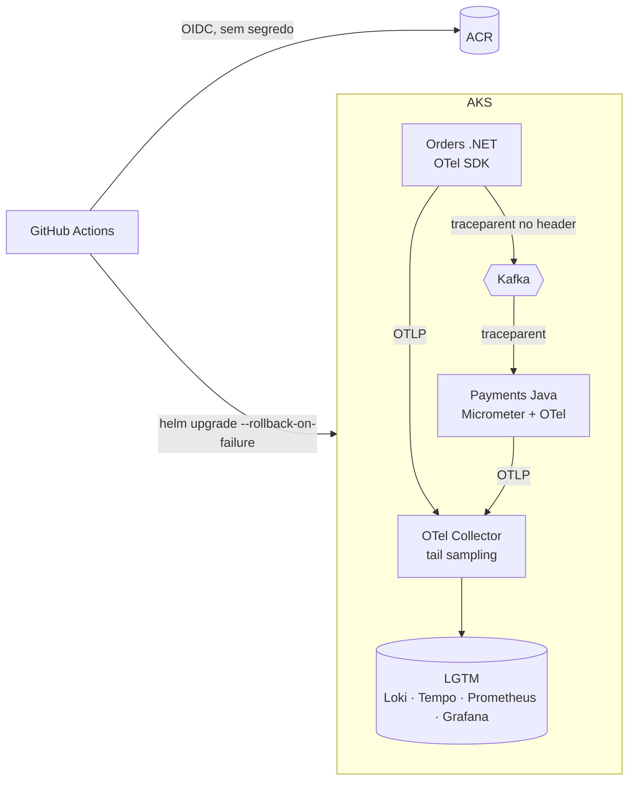

# Módulo 7: Operação — observabilidade, CI/CD e deploy sem downtime

**Objetivo:** operar o OrderFlow em produção com a mesma qualidade com que ele foi construído:
ver um pedido atravessar .NET, Kafka e Java num trace só, saber por métrica que algo está errado
antes do cliente, implantar sem segredo guardado e sem derrubar requisição, e ter o que ler às 3h
quando o alerta tocar.

**Pré-requisitos:** Módulos 1 e 1-J (os dois serviços), 2 e 3 (Kafka e outbox) e 4 a 6 (imagens,
Helm, Strimzi, AKS). As lições 7.1 a 7.3 rodam na sua máquina sem Kubernetes; da 7.4 em diante,
com o Kafka do Módulo 2.

**Tempo estimado:** 10 a 14 horas, mais o desafio.

**Certificação que ajuda:** AZ-400 (DevOps Engineer: pipelines, segurança de cadeia de
suprimentos, monitoramento).

## O que você constrói

- **Observabilidade nas duas stacks** com OpenTelemetry: traces, métricas e logs correlacionados
  pelo `trace_id`, com uma linha no `Program.cs` e uma dependência no `pom.xml`.
- **Propagação do trace pelo Kafka** entre .NET e Java, escrita à mão no .NET para você entender o mecanismo.
- **Métricas de negócio** (pedidos, aprovação de pagamentos, duração do gateway) por decorators,
  sem acoplar os casos de uso.
- **Grafana LGTM** atrás de um Collector, um painel RED + negócio + Kafka, e alertas por taxa de queima de SLO.
- **CI/CD**: build e testes das duas stacks em paralelo, imagens analisadas pelo Trivy antes do
  push, deploy com Helm 4 em dev e prod (com aprovação) por OIDC.
- **Deploy sem downtime**: as seis peças (rolling, readiness, preStop, PDB, migrations
  compatíveis, medição) e **runbooks** para os alertas.

## Lições

| # | Lição | Arquivos do código |
|---|---|---|
| 7.1 | [Observabilidade e OpenTelemetry: as peças antes do código](01-observabilidade-e-opentelemetry.md) | (conceitos) |
| 7.2 | [OpenTelemetry no .NET](02-otel-no-dotnet.md) | `src/OrderFlow.Orders.Api/Observabilidade/` |
| 7.3 | [OpenTelemetry no Java: agente ou Micrometer?](03-otel-no-java.md) | `java/payments/.../observabilidade/`, `pom.xml` |
| 7.4 | [O traceparent pelo Kafka, de .NET para Java e de volta](04-traceparent-pelo-kafka.md) | `KafkaTracing.cs`, `spring.kafka.*.observation-enabled` |
| 7.5 | [Grafana LGTM: o Collector, os painéis e os alertas](05-grafana-lgtm.md) | `deploy/observabilidade/` |
| 7.6 | [CI/CD com GitHub Actions e OIDC](06-cicd-github-actions.md) | `.github/workflows/` |
| 7.7 | [Deploy sem downtime e runbooks](07-deploy-sem-downtime-e-runbooks.md) | values dos charts, `docs/runbooks/` |
| 🎤 | [Perguntas de entrevista](perguntas-de-entrevista.md) | |
| 🧩 | [Desafio sem roteiro](desafio.md) | |

## Convenções que este módulo assume dos anteriores

Se algum nome divergir do que você tem, ajuste aqui e nos arquivos de `deploy/observabilidade/`.

| Item | Valor assumido | Vem do |
|---|---|---|
| Tópicos e chave | `orders.events`, `payments.events`, chave = `orderId` | Módulo 2 |
| Consumer groups | `payments` (lê `orders.events`), `orders` (lê `payments.events`) | Módulo 2 |
| Cliente Kafka | Confluent.Kafka (.NET), Spring Kafka com `KafkaTemplate`/`@KafkaListener` (Java) | Módulo 2 |
| Dockerfiles | `deploy/docker/orders.Dockerfile`, `deploy/docker/payments.Dockerfile`, contexto na raiz | Módulo 4 |
| Charts | `deploy/helm/orders`, `deploy/helm/payments`, com `image.repository`, `image.digest`, `podAnnotations`, e um `values-<ambiente>.yaml` por ambiente | Módulo 4 |
| Namespaces | `orderflow` (serviços), `kafka` (Strimzi, com Kafka Exporter ligado), `observabilidade` | Módulos 4 a 6 |
| Identidades | uma com `AcrPush`, uma por ambiente com acesso ao AKS, credenciais federadas para o GitHub | Módulo 6 |

## O que foi verificado (e o que não foi)

- **Workflows**: validados com `actionlint` e contra o schema oficial de workflows do GitHub
  (`check-jsonschema`). Versões das actions conferidas nos repositórios em out/2026. **Não**
  executados no GitHub: dependem da configuração de OIDC e dos environments.
- **YAML de `deploy/observabilidade/`**: `yamllint` sem erros; o manifesto do LGTM validado contra
  o schema do Kubernetes 1.37. Os values do Collector foram conferidos contra o `values.yaml` do
  chart 0.178.1, mas **não** renderizados com `helm template` (Helm indisponível no ambiente de escrita).
- **Código Java** (`observabilidade/`): compilado com `javac` contra stubs das APIs do Micrometer,
  OpenTelemetry, Logback e Spring, para conferir sintaxe e tipos; **não** compilado contra as
  bibliotecas reais (sem acesso ao Maven Central). Rode `./mvnw verify`.
- **Código .NET** (`Observabilidade/`): escrito e revisado contra a documentação dos pacotes
  OpenTelemetry 1.20.x, mas **não compilado** (sem SDK .NET no ambiente). O `KafkaTracing.cs`
  depende do `Confluent.Kafka` do Módulo 2. Rode `dotnet build`: se quebrar, é o primeiro bug a corrigir.

Próximo módulo: [8. A camada de tech lead/staff](../modulo-08/README.md).
