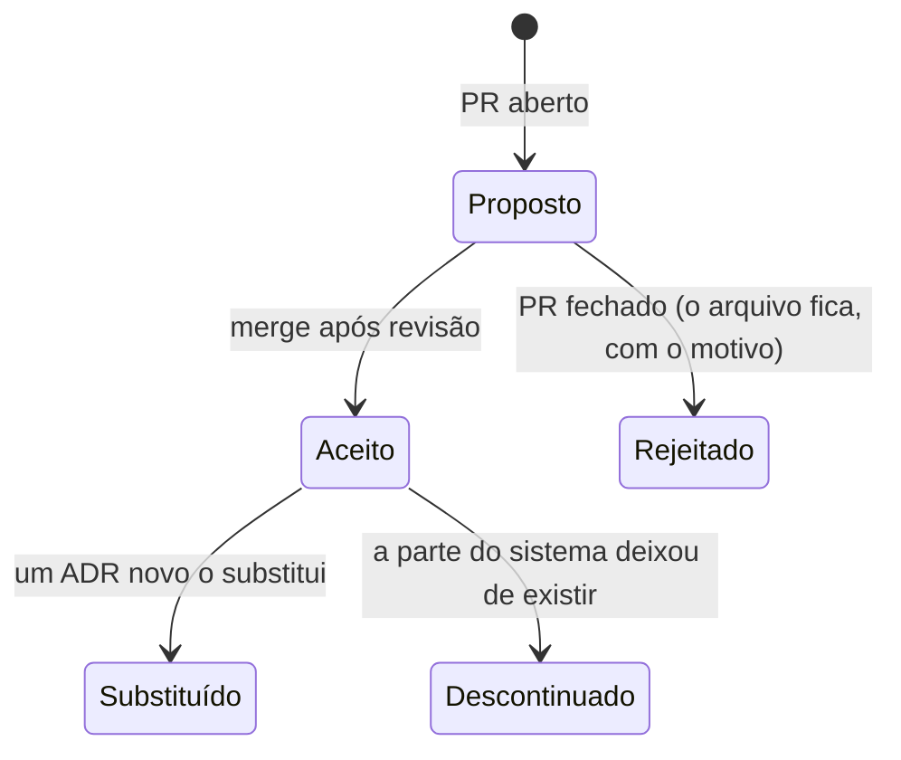
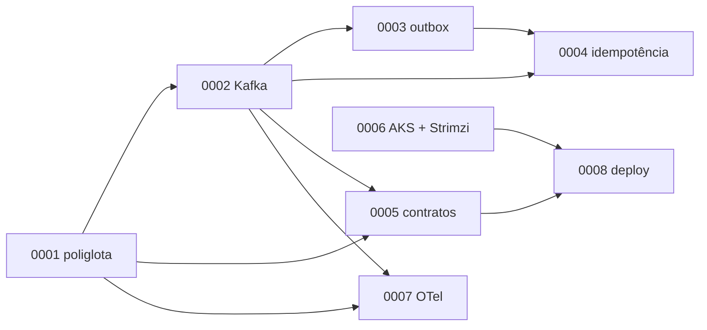

# 8.1 ADRs: registrar o porquê, não só o quê

Arquivos: `docs/adr/` (oito ADRs reais, um para cada decisão grande dos módulos 1 a 7)

## O problema que o ADR resolve

Daqui a um ano, alguém novo no time abre o OrderFlow e pergunta: "por que tem um serviço em Java
e outro em .NET? Por que outbox com polling, se Debezium é mais moderno? Por que não Argo CD?".
O código responde **o quê**. O Git responde **quando** e **quem**. Ninguém responde **por quê**,
e a pessoa faz uma de duas coisas ruins: reverte a decisão sem conhecer o motivo (e redescobre o
problema que ela resolvia), ou nunca mexe em nada por medo (e o sistema congela).

::: conceito ADR (Architecture Decision Record)
Um documento curto, um por decisão, que registra o **contexto**, a **decisão**, as **alternativas**
consideradas e as **consequências**, inclusive as ruins. Proposto por Michael Nygard em 2011. Vive
no repositório, ao lado do código, e é revisado em PR como código.
:::

::: analogia
É o prontuário médico da arquitetura. O médico novo não precisa concordar com o tratamento
anterior, mas precisa saber por que ele foi escolhido, o que já foi tentado e o que deu errado,
antes de mudar a medicação. Sem prontuário, cada plantonista recomeça do zero.
:::

## O que é uma decisão "digna de ADR"

Nem toda escolha merece. O filtro do OrderFlow: escreva um ADR quando a decisão é **cara de
desfazer** E **não é óbvia** para alguém competente que chega depois.

| Merece ADR | Não merece |
|---|---|
| Kafka em vez de fila simples (ADR 0002) | usar `record` para eventos |
| outbox com polling em vez de CDC (ADR 0003) | nome da tabela `outbox` |
| Micrometer em vez do agente Java (ADR 0007) | a versão exata do pacote do OTel |
| deploy por push com OIDC em vez de GitOps (ADR 0008) | o nome do workflow |

Regra prática: se numa revisão de design alguém perguntou "por que não X?" e a resposta levou
mais de dois minutos, escreva o ADR. A resposta já existe na sua cabeça; o ADR só a tira de lá.

## Anatomia de um bom ADR, pelo ADR 0003

Abra [`docs/adr/0003-outbox-transacional.md`](../adr/0003-outbox-transacional.md) ao lado.

| Seção | O que faz bem no 0003 | O erro comum |
|---|---|---|
| **Contexto** | descreve o *dual write* e as duas falhas possíveis, sem citar a solução | começar pela solução ("decidimos usar outbox porque...") |
| **Decisão** | uma frase afirmativa, e depois os detalhes que mudam o comportamento (`SKIP LOCKED`, produtor idempotente, limpeza) | ficar vago ("usaremos um padrão de mensageria confiável") |
| **Alternativas** | quatro, cada uma com o motivo concreto de rejeição; o CDC é rejeitado **"por enquanto"**, com o custo explícito (slot de replicação enchendo o disco) | listar alternativas espantalho que ninguém escolheria |
| **Consequências** | as negativas vêm com o mesmo peso: latência do polling, carga no banco, duplicatas | só listar vantagens. ADR sem consequência negativa é propaganda |
| **Revisitar quando** | três gatilhos **observáveis** (polling no topo das consultas caras, latência < 100 ms, Kafka Connect já operado por outro time) | "revisitar no futuro" |

::: porque O "Revisitar quando" é a seção mais valiosa
Ela transforma uma opinião congelada numa decisão viva. Quando o gatilho acontece (alguém vê o
polling no relatório de consultas lentas), o time não precisa reabrir a discussão do zero: o ADR
já diz que é hora de reavaliar, e o que pesava contra. Sem gatilho, ou a decisão nunca é revista,
ou é revista toda semana por quem não gosta dela.
:::

::: armadilha ADR escrito depois, para justificar
Escrever o ADR depois de implementar, para "documentar", tende a produzir um texto em que todas
as alternativas perdem de lavada. O ADR é mais útil **antes**, como `Proposto`, num PR: é a pauta
da revisão de design (lição 8.4). Os oito do OrderFlow foram escritos ao fim dos módulos porque o
curso é retrospectivo; num time, eles viriam primeiro.
:::

## Ciclo de vida e imutabilidade

Um ADR aceito **não se edita**. Se o OrderFlow trocar o polling por Debezium, nasce o ADR 0009
"Outbox com CDC via Debezium", que cita o 0003 no contexto ("os gatilhos 1 e 3 do ADR 0003
aconteceram"), e o 0003 passa a `Substituído por 0009`. Quem lê a história entende a evolução:
primeiro polling, por estes motivos; depois CDC, porque estas condições mudaram. Editar o 0003
apagaria exatamente essa informação.

## Leia os oito como um sistema

Os ADRs do OrderFlow se referenciam, e isso é intencional: decisões de arquitetura não são
independentes.

Puxe um fio: o 0001 (duas linguagens) torna o 0005 (contrato verificado no registro)
**obrigatório**, porque não há DLL compartilhada; o 0002 (*at-least-once*) e o 0003 (outbox pode
duplicar) tornam o 0004 (consumidor idempotente) obrigatório; o 0005 (compatibilidade) é o que
deixa o 0008 implantar um serviço de cada vez. Numa entrevista de staff, conseguir contar essa
cadeia vale mais que defender cada decisão isolada (lição 8.6).

::: checkpoint
Sem abrir os arquivos, responda em uma frase cada: (1) por que o OrderFlow usa Avro e não JSON Schema;
(2) qual gatilho faria trocar o polling por CDC; (3) por que o deploy não é GitOps ainda.
Depois confira nos ADRs 0005, 0003 e 0008.
:::

## Perguntas para responder sem olhar

::: pergunta
Quais seções um ADR precisa ter, e qual é a que mais se esquece?
???
Contexto, decisão, alternativas consideradas, consequências (positivas e negativas) e quando
revisitar. As mais esquecidas são as consequências negativas e o gatilho de revisão; sem elas, o
ADR vira justificativa em vez de registro de trade-off.
:::

::: pergunta
A decisão do ADR 0003 mudou. Você edita o arquivo?
???
Não. Escrevo um ADR novo que substitui o 0003, cito no contexto o que mudou (quais gatilhos
dispararam) e mudo o status do 0003 para "Substituído por". O histórico do porquê se mudou de
ideia é parte do valor.
:::

**Próxima:** [8.2 System design do OrderFlow em 10× e 100×](02-system-design-10x-100x.md).
