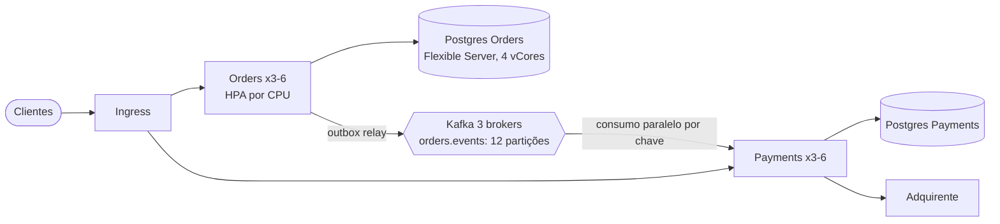
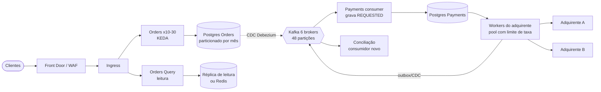

# 8.2 System design do OrderFlow em 10× e 100×

Esta lição faz o exercício que toda entrevista de staff faz: pegar um sistema que funciona e
perguntar **o que quebra primeiro** quando o volume cresce uma e duas ordens de grandeza. A
diferença para a entrevista: aqui o sistema é seu, e cada número sai do código que você escreveu.

## Método: números antes de caixas

O erro clássico é desenhar a arquitetura de 100× (sharding, cache, CQRS) antes de saber se o
volume pede. O método:

1. **Estimar a carga** em cada peça (requisições/s, mensagens/s, linhas/s, bytes/dia), na média e no **pico**.
2. **Achar o limite** de cada peça na configuração atual.
3. O **gargalo** é a peça cujo limite chega primeiro. Resolve-se esse, e repete.

## A carga, com hipóteses explícitas

Hipóteses de base (1×), que você ajustaria com dados reais de produto:

| Hipótese | Valor | De onde vem |
|---|---|---|
| Pedidos por dia | 20.000 | e-commerce médio brasileiro |
| Pico sobre a média | 10× (horário nobre) e mais 5× na Black Friday | padrão de varejo |
| Requisições HTTP por pedido | ~6 (1 `POST` + consultas de status pelo app) | o front consulta até ver "pago" |
| Mensagens Kafka por pedido | ~4 (`OrderCreated`, `PaymentApproved`, `OrderPaid`, eventual cancelamento) | ADR 0002 |
| Linhas gravadas por pedido | ~10 (pedido, itens, outbox, idempotência, `inbox_messages` (inbox), nos dois bancos) | ADRs 0003 e 0004 |
| Latência do adquirente | 300 ms (p50) | gateway real; o fake responde em microssegundos |

Daí, sem calculadora sofisticada (86.400 segundos num dia):

| | 1× | 10× | 100× |
|---|---|---|---|
| Pedidos/dia | 20 mil | 200 mil | 2 milhões |
| Pedidos/s, média | 0,23 | 2,3 | 23 |
| Pedidos/s, **pico** | 2,3 | 23 | 230 |
| Pedidos/s, Black Friday | 12 | 115 | 1.150 |
| HTTP req/s, pico | 14 | 140 | 1.400 |
| Mensagens Kafka/s, pico | 9 | 90 | 920 |
| Linhas Postgres/s, pico | 23 | 230 | 2.300 |
| Dados novos/dia (~5 KB/pedido com índices) | 100 MB | 1 GB | 10 GB |

::: previsao
Antes de continuar: olhando só esta tabela, qual peça do OrderFlow você acha que quebra primeiro?
Kafka, Postgres, a API HTTP, ou outra coisa?
???
Nenhuma das três óbvias. 920 mensagens/s é carga leve para um Kafka de três brokers (que aguenta
centenas de milhares). 1.400 req/s HTTP se resolvem com mais réplicas, porque a API é sem estado.
2.300 linhas/s é trabalho sério, mas possível, para um Postgres bem dimensionado.

O que quebra primeiro é **o consumidor do Payments chamando o adquirente**, e já em 10× na Black
Friday. A próxima seção mostra a conta.
:::

## O gargalo que não aparece na tabela: lei de Little

O consumer do Payments processa uma mensagem por vez **por partição** (é o que garante a ordem
por pedido), e cada mensagem espera o adquirente, 300 ms. Logo, cada partição faz no máximo:

```
1 mensagem / 0,3 s  ≈  3,3 pagamentos por segundo por partição
```

Com 12 partições em `orders.events`: **~40 pagamentos/s** de teto, não importa quantas réplicas
do Payments existam (réplicas além do número de partições ficam ociosas).

| Cenário | Precisa | Teto com 12 partições | Resultado |
|---|---|---|---|
| 10×, pico | 23/s | 40/s | ok, com 57% de uso |
| 10×, Black Friday | 115/s | 40/s | **lag cresce 75 mensagens/s**: em 1 hora, 270 mil pedidos esperando pagamento |
| 100×, pico | 230/s | 40/s | quebrado o dia todo |

::: conceito Lei de Little
Em qualquer sistema estável: **itens em andamento = taxa de chegada × tempo de permanência**
(L = λ × W). Para atender 1.150 pagamentos/s com 300 ms cada, o sistema precisa ter
1.150 × 0,3 ≈ **345 chamadas ao adquirente acontecendo ao mesmo tempo**. A pergunta de design
vira: onde moram essas 345 chamadas simultâneas?
:::

Três respostas, em ordem de custo:

| Opção | Como | Custo |
|---|---|---|
| Mais partições | 350 partições em `orders.events` | muda a distribuição das chaves (só se faz uma vez, com planejamento); 350 partições é muito metadado para pouco dado |
| **Paralelismo por chave dentro da partição** | o consumidor lê em lote e processa em paralelo mensagens de **chaves diferentes**, mantendo a ordem por chave (no Java, threads virtuais tornam 345 chamadas simultâneas baratas; existe a biblioteca Confluent Parallel Consumer para isso) | offset só avança até a menor mensagem concluída; mais código e testes |
| **Desacoplar o adquirente do consumidor** | o consumidor só grava "pagamento solicitado" (milissegundos) e confirma; um pool de workers chama o adquirente com concorrência controlada e publica o resultado pelo outbox | um estado a mais no domínio (`REQUESTED`), um processo a mais para operar |

Em 10×, a segunda opção resolve. Em 100×, a terceira, porque ela também resolve o **outro**
limite que aparece aqui: o adquirente tem limite de taxa contratual, e o pool de workers é o
lugar natural para respeitá-lo (e para trocar de adquirente quando um está fora).

## 10×: higiene, não redesenho

A conclusão honesta para 10× é que o desenho atual aguenta, com ajustes:



| Ponto | Ajuste | Por quê |
|---|---|---|
| Consumidor do Payments | paralelismo por chave | a conta de Little acima |
| Pool de conexões do Postgres | dimensionar: réplicas × pool ≤ `max_connections` com folga; PgBouncer se passar | 6 réplicas × pool padrão de 100 do Npgsql estoura o limite do banco |
| Tabelas de idempotência e `inbox_messages` (inbox) | job de expiração e índice pela data | crescem 1 GB/dia junto com o resto |
| Outbox | relay com `SKIP LOCKED` e lote; limpeza frequente | o `DELETE` em massa gera *bloat*; o autovacuum precisa acompanhar |
| Consultas de status | `GET /orders/{id}` com cache curto, ou o app escuta eventos (SSE) em vez de consultar | 5 de cada 6 requisições são consulta |
| Observabilidade | tail sampling (já feito) e retenção curta de traces | o custo de traces cresce linear com o tráfego e costuma ser o primeiro susto da fatura |

## 100×: onde o desenho muda



| Mudança | Gatilho | ADR que muda |
|---|---|---|
| Adquirente desacoplado do consumidor, com pool e limite de taxa, e um segundo adquirente | Little: 345 chamadas simultâneas; limite contratual | novo ADR (Payments) |
| Outbox por **CDC** (Debezium) | o polling vira uma das consultas mais caras; 2.300 linhas/s | 0003 é substituído (os gatilhos dele dispararam) |
| Postgres **particionado por mês** (pedidos, outbox, idempotência) | 10 GB/dia; apagar dados antigos vira `DROP PARTITION` em vez de `DELETE` | — |
| Leitura separada (réplica ou modelo de consulta alimentado por eventos) | 1.400 req/s, a maioria leitura | novo ADR (CQRS leve) |
| Kafka com 48+ partições e 6 brokers, ou serviço gerenciado | throughput ainda baixo, mas a operação do Kafka vira crítica | 0006 revisitado |
| Shard por cliente/região | **ainda não**: 2.300 linhas/s cabem num Postgres grande; sharding é o último recurso | — |

::: armadilha Desenhar 100× no dia 1
Cada item da tabela acima tem custo de operação permanente. Um time de 5 pessoas que monta CDC,
CQRS e dois adquirentes para 20 mil pedidos/dia gasta o ano operando infraestrutura em vez de
entregar produto. O valor do exercício não é construir a coluna de 100×: é **saber o que muda e
qual sinal avisa que chegou a hora**, que é exatamente o "Revisitar quando" dos ADRs.
:::

## Custos: onde o dinheiro vai, em cada escala

Preços mudam e dependem de região e contrato; use a calculadora de preços da Azure com os números
abaixo. O que não muda é **a estrutura** do custo:

| Componente | 1× | 10× | 100× | Comportamento |
|---|---|---|---|---|
| Nós do AKS | 3 nós pequenos (piso de disponibilidade) | 3–5 | 10–20 + pool dedicado para Kafka | degraus; o piso de 3 nós domina em 1× |
| Kafka (Strimzi) | 3 brokers (piso) | 3 brokers | 6 brokers, discos maiores | quase fixo até 100×; o custo real é **gente** para operar |
| Postgres gerenciado | 2 instâncias pequenas | médias, com alta disponibilidade | grandes + réplicas de leitura | sobe por degrau de vCore; armazenamento cresce linear |
| Observabilidade | quase nada | relevante | frequentemente **o maior item variável** | linear com tráfego: sem amostragem e retenção, cresce 100× |
| Adquirente | por transação | por transação | por transação, com volume para negociar taxa | linear, e é custo do negócio, não da TI |

::: porque A conclusão que impressiona numa entrevista
Em 1× e 10×, o custo é dominado por **pisos** (mínimo de nós e brokers para ter alta
disponibilidade), não pelo volume. Isso muda a pergunta de "como escalar" para "esta arquitetura
justifica o piso dela?". Para 20 mil pedidos/dia, um monólito modular com uma fila gerenciada
custaria uma fração. É a pergunta da lição 8.3.
:::

## Perguntas para responder sem olhar

::: pergunta
Por que mais réplicas do Payments não aumentam a vazão de pagamentos acima de certo ponto?
???
Porque o consumidor processa uma mensagem por vez por partição, e uma partição só é atribuída a
um membro do grupo. Réplicas além do número de partições ficam ociosas. A vazão máxima é
partições ÷ latência por mensagem; para passar disso, paralelizo por chave dentro da partição ou
desacoplo a chamada lenta do consumo.
:::

::: pergunta
Como você usa a lei de Little num system design?
???
Para converter vazão e latência em concorrência necessária: L = λ × W. 1.150 pagamentos/s com
300 ms dão ~345 chamadas simultâneas. Com isso dimensiono pools, partições, conexões e vejo se a
dependência externa (o adquirente) aceita essa concorrência.
:::

::: pergunta
Qual a primeira mudança de arquitetura que você faria no OrderFlow em 100×, e qual você adiaria ao máximo?
???
A primeira: tirar a chamada ao adquirente de dentro do consumidor Kafka (pool de workers com
limite de taxa), porque é o gargalo por lei de Little e porque o limite contratual do adquirente
exige controle de concorrência. Adiaria sharding do Postgres: particionamento por data, réplicas
de leitura e CDC resolvem 100× com muito menos custo de operação.
:::

**Próxima:** [8.3 Trade-offs: poliglota, Kafka × fila simples, outbox × CDC](03-trade-offs.md).
