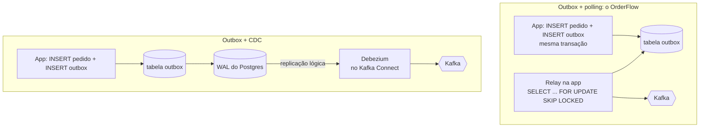

# 8.3 Trade-offs: poliglota vale a pena? Kafka ou fila simples? Outbox ou CDC?

Um sênior sabe implementar a decisão. Um staff sabe dizer **quando ela está errada**. Esta lição
pega as três decisões mais discutíveis do OrderFlow e argumenta contra elas com honestidade,
porque é isso que um entrevistador (ou um diretor que paga a conta) vai fazer.

O formato de cada uma: o que se ganha, o que se paga, e a pergunta que decide.

## 1. Poliglota: dois serviços, duas stacks. Vale a pena?

### O que se paga, concretamente, no OrderFlow

Não é teoria. Conte o que já existe em dobro no repositório:

| Coisa | .NET | Java |
|---|---|---|
| Pipeline de CI | job `orders` | job `payments` |
| Imagem base, scanner, atualização de CVE | chiseled | distroless + jlink |
| Tracing do Kafka | `KafkaTracing.cs` escrito à mão | `observation-enabled` |
| Métricas de negócio | `OrdersMetrics` + decorator | `Observation` + decorator |
| Nomes de métricas HTTP | `http_server_request_duration_seconds` | `http_server_requests_seconds` |
| Idempotência, ProblemDetails, probes | implementação .NET | implementação Spring |
| Conhecimento para o plantão | C#, ASP.NET, EF Core | Java, Spring, JPA |

Cada linha é trabalho que um time de uma stack só faria uma vez. O Módulo 7 inteiro foi mais
longo por causa disso.

### O que se ganha

- **Times independentes** com a stack em que são bons (o time de pagamentos veio de um banco Java).
- **Bibliotecas do domínio**: SDKs de adquirentes, antifraude e conciliação costumam existir
  primeiro (ou só) para Java.
- **Contrato forçado a ser explícito**: sem DLL compartilhada, o acoplamento escondido é impossível.
  Esse ganho é real, mas dá para obtê-lo numa stack só, com disciplina.

::: porque A pergunta que decide
"**A segunda stack é uma consequência de times diferentes, ou uma escolha de tecnologia?**"
Se dois times, com donos e roadmaps diferentes, já trabalham em stacks diferentes, forçar uma só
custa uma reescrita e talvez pessoas. Poliglota é a **consequência** aceitável. Se é um time só
escolhendo "a melhor ferramenta para cada serviço", quase sempre é custo sem retorno: cada stack
nova multiplica o custo de operação e reduz quem pode cobrir o plantão. O OrderFlow é poliglota
por objetivo de estudo (ADR 0001), e diz isso no ADR.
:::

::: armadilha "Microsserviços para poder usar a melhor linguagem"
É o argumento mais fraco a favor de microsserviços. O critério de corte de um serviço é
**autonomia de time e de deploy**, e limites de domínio. A linguagem vem depois. Para o tamanho
do OrderFlow (dois domínios, um time), um **monólito modular** com dois módulos (Pedidos e
Pagamentos), comunicando por eventos em memória ou por uma tabela outbox, entregaria quase todos
os ganhos com uma fração do custo, e pode ser separado depois, porque os limites já estão certos.
:::

## 2. Kafka ou fila simples?

| Critério | Kafka (o OrderFlow) | Fila (Azure Service Bus, RabbitMQ, SQS) |
|---|---|---|
| Modelo | **log** retido; o consumidor guarda a posição (offset) | **fila**; a mensagem some quando confirmada |
| Reprocessar o passado | sim: volte o offset, ou um consumidor novo lê tudo | não (a mensagem já foi apagada) |
| Vários consumidores do mesmo evento | natural (cada grupo lê tudo) | precisa de tópico/assinatura (*fan-out*) por consumidor |
| Ordem | por partição (por chave) | sessões (Service Bus) ou fila única; geralmente menos natural |
| Reentrega, atraso, DLQ | você constrói (retry topics, DLT) | **pronto**: contagem de entregas, DLQ, agendamento |
| Paralelismo | limitado pelo número de partições | qualquer número de consumidores competindo |
| Operação | alta (Strimzi) ou serviço caro (Confluent) | baixa (gerenciado e barato em volume pequeno) |
| Mensagem lenta | trava a partição (lição 8.2) | trava só aquele consumidor; os outros seguem |

::: previsao
O OrderFlow, com 20 mil pedidos/dia, sem nenhum consumidor além dos dois serviços, sem nenhum
caso de reprocessamento até hoje. Com essa descrição, qual das duas o critério acima recomenda?
???
A fila. Nenhuma das vantagens exclusivas do Kafka está em uso: não há replay, não há terceiro
consumidor, e o paralelismo por partição até atrapalha (lição 8.2). O Service Bus daria DLQ,
reentrega com contagem e sessões por `orderId` (ordem por pedido), gerenciado, com custo e
operação muito menores.

O ADR 0002 escolheu Kafka por dois motivos honestos: o objetivo de aprendizado, e a aposta de que
um consumidor de conciliação e o replay vão existir. Numa entrevista, a resposta forte é
reconhecer isso, não defender o Kafka como óbvio.
:::

### A pergunta que decide

"**Algum consumidor vai precisar ler o passado, ou vão existir vários consumidores independentes do
mesmo fato?**" Se sim (conciliação, analytics, um serviço novo que precisa do histórico, event
sourcing), Kafka. Se o evento é um comando para **um** destinatário fazer **uma** coisa, fila.
Muitos sistemas maduros têm os dois: Kafka para fatos de domínio (`OrderCreated`), fila para
trabalho (`ChargeCard`).

::: video Kafka in 100 Seconds (Fireship, em inglês)
https://www.youtube.com/watch?v=uvb00oaa3k8
Revisão rápida do modelo de log distribuído: o que o diferencia de uma fila em dois minutos.
:::

## 3. Outbox com polling ou CDC?

Os dois resolvem o *dual write* (ADR 0003). A diferença é **quem lê** as mudanças:

| Critério | Polling | CDC (Debezium) |
|---|---|---|
| Latência gravar → publicar | intervalo de polling (100 ms a 1 s) | dezenas de ms |
| Carga no banco | consultas constantes, `UPDATE`/`DELETE`, *bloat* | leitura do WAL, quase nada |
| Peças novas | nenhuma (código no próprio serviço) | Kafka Connect, conector, configuração de replicação |
| Modo de falha perigoso | relay parado: eventos acumulam, silenciosamente | **slot de replicação** sem consumidor: o Postgres retém WAL até encher o disco e parar o banco |
| Ordem | depende do relay (uma réplica por vez, ou particionar) | ordem do commit no WAL |
| Testar localmente | Postgres + o serviço | Postgres + Kafka + Connect |
| Portabilidade entre stacks | um relay por linguagem (dois no OrderFlow) | **um** conector serve aos dois serviços |

::: armadilha O modo de falha do CDC
O polling falha de um jeito que afeta o **seu** serviço (eventos atrasam). O CDC falha de um jeito
que afeta o **banco**: se o Debezium para e ninguém percebe, o slot de replicação segura o WAL, o
disco enche, e o Postgres para de aceitar escrita. Quem adota CDC precisa monitorar o tamanho do
WAL retido por slot (e o Postgres tem, desde a versão 13, um limite configurável para isso, `max_slot_wal_keep_size`,
que invalida o slot em vez de parar o banco, trocando um problema por outro: eventos perdidos).
:::

::: video Debezium - Change Data Capture Made Easy (em inglês)
https://www.youtube.com/watch?v=6VbRlQ0rL3I
Como o Debezium lê o log do banco e publica no Kafka, e o padrão outbox com CDC.
:::

::: video Outbox Pattern: Fixing event failures in an event-driven architecture (Drawing Boxes, em inglês)
https://www.youtube.com/watch?v=tQw99alEVHo
O problema do duplo registro e como o outbox resolve, com diagramas. Bom para rever antes da entrevista.
:::

### A pergunta que decide

"**Quem vai operar o Kafka Connect, e já existe alguém fazendo isso?**" Se o time de plataforma
já roda Connect para outros sistemas, o custo marginal do CDC é baixo e os ganhos (latência, carga,
um conector para as duas stacks) aparecem. Se seria a primeira vez, o polling é a escolha
responsável até o volume ou a latência pedirem, que é o "Revisitar quando" do ADR 0003. Em 100×
(lição 8.2), os gatilhos disparam.

## O padrão por trás das três

Repare na estrutura das três decisões: a opção "mais sofisticada" (poliglota, Kafka, CDC) tem
ganhos reais que **só aparecem em certas condições**, e custos de operação que aparecem **sempre**.
O trabalho de staff é nomear as condições e medir se elas existem. "Depende" é o começo da
resposta, não a resposta: a resposta é **do que depende**, e qual o número que muda a escolha.

## Perguntas para responder sem olhar

::: pergunta
Quando um sistema deveria ter serviços em linguagens diferentes?
???
Quando a diferença vem de times diferentes, com donos e roadmaps próprios, ou de uma dependência
que só existe numa stack. Como escolha de tecnologia de um time só, quase nunca: cada stack
multiplica pipelines, bibliotecas internas e o conhecimento exigido do plantão.
:::

::: pergunta
Dê um critério objetivo para escolher entre Kafka e uma fila como Service Bus.
???
Se algum consumidor precisa ler o passado (replay, consumidor novo, analytics) ou vários
consumidores independentes leem o mesmo fato, Kafka. Se a mensagem é trabalho para um destinatário,
com necessidade de reentrega, DLQ e paralelismo livre, fila. Muitos sistemas usam os dois.
:::

::: pergunta
Qual o risco operacional do CDC com Debezium que o outbox com polling não tem?
???
O slot de replicação lógica: se o conector para, o Postgres retém WAL até encher o disco e parar o
banco. Exige monitorar o WAL retido por slot, ou limitar com `max_slot_wal_keep_size` e aceitar
perder eventos quando o limite invalida o slot.
:::

**Próxima:** [8.4 Revisão de design e code review](04-revisao-de-design-e-code-review.md).
