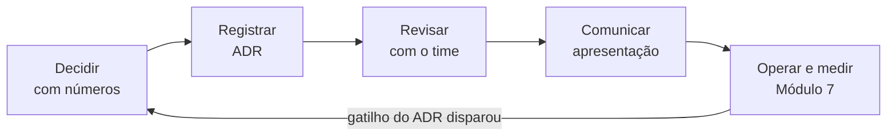

# Módulo 8: A camada de tech lead/staff

**Objetivo:** sair do "sei implementar" para o "sei decidir, registrar, defender e mudar de ideia
com critério". O OrderFlow vira material: oito decisões reais registradas em ADRs, o sistema
dimensionado em 10× e 100×, os trade-offs discutidos contra o próprio projeto, e o roteiro para
conduzir revisões, apresentar ao time e ser entrevistado para staff.

**Pré-requisitos:** Módulos 1 a 7 feitos ou lidos. Este módulo não tem código novo: ele usa o que
você construiu.

**Tempo estimado:** 6 a 8 horas, mais o desafio.

**Ajuda em:** entrevistas de sênior avançado, tech lead e staff (deep dive de projeto, system
design e comportamental).

## O que você constrói

- **Oito ADRs** do OrderFlow em [`docs/adr/`](../adr/README.md), um para cada decisão grande dos
  módulos 1 a 7, com alternativas, consequências negativas e gatilhos de revisão.
- **System design em 10× e 100×**, com a conta que acha o gargalo que ninguém esperava (lei de
  Little no consumidor que chama o adquirente), diagramas e a estrutura de custo.
- **Três trade-offs argumentados contra o projeto**: poliglota, Kafka × fila simples, outbox × CDC.
- **Roteiros** para revisão de design, code review, apresentação ao time e entrevista staff.

## Lições

| # | Lição | Material |
|---|---|---|
| 8.1 | [ADRs: registrar o porquê, não só o quê](01-adrs.md) | `docs/adr/` |
| 8.2 | [System design do OrderFlow em 10× e 100×](02-system-design-10x-100x.md) | estimativas, diagramas, custos |
| 8.3 | [Trade-offs: poliglota, Kafka × fila simples, outbox × CDC](03-trade-offs.md) | ADRs 0001, 0002, 0003 |
| 8.4 | [Conduzir revisão de design e code review](04-revisao-de-design-e-code-review.md) | modelo de proposta, ordem de revisão |
| 8.5 | [Apresentar o OrderFlow ao time](05-apresentar-ao-time.md) | roteiro de 25 minutos |
| 8.6 | [Roteiro de entrevista staff usando o OrderFlow](06-entrevista-staff.md) | narrativa, system design, comportamental |
| 🎤 | [Perguntas de entrevista](perguntas-de-entrevista.md) | |
| 🧩 | [Desafio sem roteiro](desafio.md) | o ADR 0009, revisado e defendido |

## O fio que liga o módulo

Cada lição é uma etapa desse ciclo. O desafio percorre o ciclo inteiro uma vez, com uma decisão nova.

## Uma observação sobre honestidade

Este módulo argumenta, mais de uma vez, que o OrderFlow é mais complexo do que o volume dele
pediria. Isso é de propósito. O projeto existe para estudar problemas de produção, e os ADRs dizem
isso. Saber dizer "esta arquitetura não se justifica neste volume, e este é o número que a
justificaria" é a habilidade que este módulo treina, e a que mais diferencia um staff de um sênior
que só sabe defender o que construiu.

Fim da trilha. Volte ao [mapa dos módulos](../README.md).
