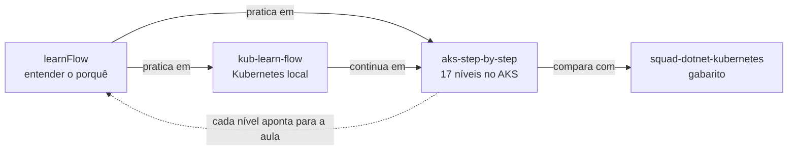

# Plataforma .NET em Produção

Curso que **ensina** a stack de uma API .NET de produção, peça por peça: ASP.NET 10 como monolito modular com DDD, OpenAPI (Swagger/Scalar), PostgreSQL, Dragonfly, Kafka, Kubernetes, Helm, Harbor, Argo CD, Terraform e Azure.

Não é mais um passo a passo. O passo a passo já existe e funciona: é o repositório [aks-step-by-step](https://github.com/JandersonSR/aks-step-by-step), que sobe uma API de CEP real no AKS em 17 degraus. Este curso é a camada que faltava em cima dele: **o que é cada peça, por que ela está ali, por que este comando e não outro, o que quebra e como você descobre.**

## Como os repositórios se encaixam

| Repositório | Papel no aprendizado |
|---|---|
| **learnFlow** (este site) | A aula: conceitos, porquês, vídeos, previsões, labs de quebra, perguntas e desafios |
| [kub-learn-flow](https://github.com/JandersonSR/kub-learn-flow) | Kubernetes na sua máquina (Minikube), sem custo: pod, deployment, service, ingress, configmap |
| [aks-step-by-step](https://github.com/JandersonSR/aks-step-by-step) | O laboratório: o código da API e um guia de comandos por nível (`niveis/NN-*.md`) |
| [squad-dotnet-kubernetes](https://github.com/JandersonSR/squad-dotnet-kubernetes) | O gabarito: o ambiente completo, com as decisões registradas em `docs/decisoes.md` |

## O sistema que você vai entender

Uma API de CEP com cache em três camadas (memória, Dragonfly, PostgreSQL), que publica um evento no Kafka a cada consulta, com um worker que consome esses eventos e escala pelo tamanho da fila. Tudo empacotado com Helm, imagens no Harbor, infraestrutura em Terraform e deploy por GitOps com Argo CD no AKS.

O domínio é simples de propósito: o esforço vai para entender a plataforma. No módulo 1 você ganha um segundo módulo com regra de negócio de verdade, para praticar DDD onde ele compensa.
