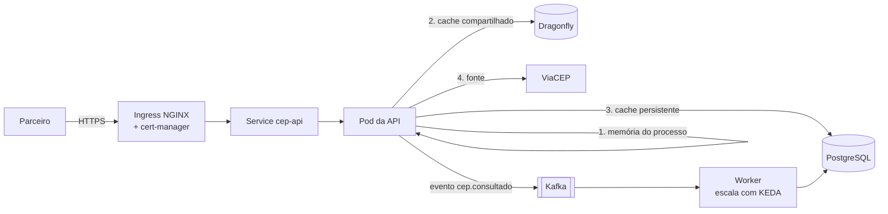
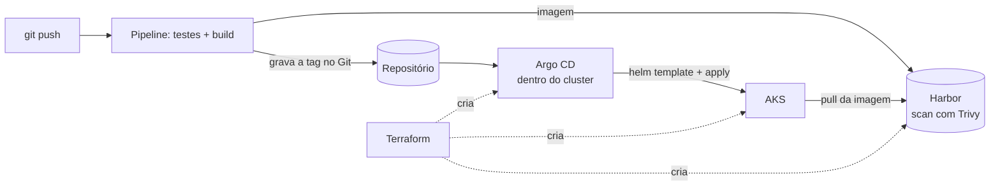

# Módulo 0: como estudar e a visão do sistema

**Objetivo:** entender o papel de cada peça da stack antes de mexer em qualquer uma, e descobrir onde você está hoje em cada uma delas.

Quem decora comandos trava no primeiro erro diferente do tutorial. Quem sabe **que problema cada peça resolve** consegue raciocinar quando algo quebra. Este módulo é o mapa.

## 1. Uma requisição atravessando o sistema

Antes de qualquer conceito, acompanhe o caminho de uma consulta `GET /v1/cep/01001000` em produção:

E o caminho do código até esse pod:

::: previsao
O mesmo CEP é consultado duas vezes seguidas, pelo mesmo parceiro, e as duas requisições caem em **pods diferentes**. Por quais caixas do primeiro diagrama passa cada uma? O Kafka recebe um ou dois eventos?
???
**Primeira:** memória do pod A (vazia) → Dragonfly (vazio) → PostgreSQL (vazio) → ViaCEP. A resposta é gravada no PostgreSQL e na memória (que inclui o Dragonfly). Um evento vai para o Kafka.

**Segunda, no pod B:** a memória do processo do pod B está vazia (cada pod tem a sua), mas o **Dragonfly** é compartilhado entre os pods, então ela para ali. Mais um evento vai para o Kafka.

São **dois eventos**: um por consulta respondida, não por CEP. É por isso que o worker consegue montar o ranking dos mais consultados.

Se você respondeu que a segunda parava na memória, faltou separar as duas camadas da memória: a do processo (L1, uma por pod) e a compartilhada (L2, o Dragonfly). Essa diferença é o assunto do módulo 4.
:::

## 2. Cada peça em uma frase, e o que acontece sem ela

| Peça | O problema que resolve | Sem ela |
|---|---|---|
| **ASP.NET 10** | Servir HTTP com desempenho, injeção de dependência, configuração e observabilidade prontas | Você escreveria tudo isso à mão |
| **Monolito modular + DDD** | Um único deploy com fronteiras internas claras entre partes do negócio | Ou uma bola de lama, ou microsserviços cedo demais |
| **OpenAPI (Swagger/Scalar)** | Um contrato da API que máquinas e pessoas leem | O parceiro descobre os campos por tentativa e erro |
| **PostgreSQL** | Dados que sobrevivem a reinício, com transação e consulta | Os dados somem quando o pod reinicia |
| **Dragonfly** | Cache compartilhado entre réplicas, compatível com Redis | Cada pod com seu cache; o banco recebe a mesma consulta N vezes |
| **Kafka** | Avisar outras partes do sistema sem esperar por elas nem conhecê-las | A API chama cada interessado direto e cai junto com ele |
| **Docker** | Empacotar a aplicação com tudo de que ela precisa | "Na minha máquina funciona" |
| **Kubernetes (AKS)** | Manter N cópias rodando, trocar versão sem parar, reiniciar o que morre | Você vira o processo que reinicia servidores |
| **Helm** | Um pacote versionado do deploy, com valores por ambiente e rollback | YAML copiado por ambiente e `sed` para trocar a tag |
| **Harbor** | Guardar imagens com controle de acesso e recusar as vulneráveis | Qualquer imagem chega ao cluster |
| **Argo CD** | O cluster puxa o estado desejado do Git e corrige desvios | O pipeline precisa da chave do cluster; ninguém sabe o que está rodando |
| **Terraform** | Criar a infraestrutura a partir de código revisável | Cliques no portal que ninguém consegue repetir |
| **Azure** | A nuvem onde tudo isso roda, com identidade, rede e serviços gerenciados | — |

::: analogia
Pense na linha de produção de uma fábrica. O **Terraform** constrói o galpão e instala as máquinas. O **Harbor** é o almoxarifado que só aceita peça inspecionada. O **Helm** é a ficha técnica da montagem, com as variações por modelo. O **Argo CD** é o supervisor que compara a linha com a ficha a cada poucos minutos e corrige o que estiver diferente. O **Kubernetes** é a própria linha, que repõe uma estação quando ela para. O **Kafka** é a esteira entre setores: quem produz coloca a peça na esteira e segue trabalhando, sem esperar o próximo setor.
:::

## 3. Vídeos para a primeira visão

Assista em velocidade 1,25 ou 1,5. O objetivo aqui é só o panorama; cada módulo aprofunda.

::: video Kubernetes explained in 15 mins (TechWorld with Nana, em inglês)
https://www.youtube.com/watch?v=VnvRFRk_51k
Os componentes principais do Kubernetes com diagramas simples. Base para os módulos 6 a 8.
:::

::: video Kafka in 100 Seconds (Fireship, em inglês)
https://www.youtube.com/watch?v=uvb00oaa3k8
O que é um log distribuído, tópico, partição e consumidor, em menos de dois minutos.
:::

::: video Terraform explained in 15 mins (em inglês)
https://www.youtube.com/watch?v=l5k1ai_GBDE
Infraestrutura como código, estado e o ciclo `plan` → `apply`.
:::

::: video ArgoCD Tutorial for Beginners (TechWorld with Nana, em inglês)
https://www.youtube.com/watch?v=MeU5_k9ssrs
O que é GitOps e por que o cluster puxa em vez de o pipeline empurrar.
:::

::: video Redis vs DragonflyDB (Better Stack, em inglês)
https://www.youtube.com/watch?v=OlsENj_LpEQ
Por que existe um "Redis compatível" e o que muda por baixo.
:::

## 4. Onde você está hoje

Dê uma nota de 0 a 3 para cada peça e anote num arquivo seu. Refaça no fim do curso.

- **0:** só conheço o nome
- **1:** sigo um tutorial e funciona
- **2:** consigo explicar por que cada coisa está ali e resolver o erro comum
- **3:** consigo escolher entre alternativas, defender a escolha e ensinar alguém

| Peça | Nota hoje | Nota no fim |
|---|---|---|
| ASP.NET 10 / C# | | |
| Monolito modular e DDD | | |
| OpenAPI | | |
| PostgreSQL e EF Core | | |
| Cache (Dragonfly/Redis) | | |
| Kafka | | |
| Docker e Kubernetes | | |
| Helm | | |
| Harbor | | |
| Argo CD | | |
| Terraform | | |
| Azure (AKS, Key Vault, identidade) | | |

Nível sênior é **2 em tudo e 3 em pelo menos três peças**. Staff é conseguir conectar as peças: saber, por exemplo, que um `readinessProbe` mal configurado derruba o deploy do Argo CD, que trava o pipeline.

## 5. Perguntas para responder sem olhar

::: pergunta
Por que existem **duas** camadas de memória (no processo e no Dragonfly) se o Dragonfly já é rápido?
???
A memória do processo não tem rede: é nanossegundos contra cerca de 1 ms do Dragonfly, e não depende dele estar de pé. O Dragonfly é compartilhado: evita que cada pod vá ao banco pela mesma chave. Uma camada cobre a latência; a outra, a duplicação entre réplicas. Se o Dragonfly cair, a API segue pela memória e pelo banco.
:::

::: pergunta
Por que a API publica no Kafka em vez de chamar o worker por HTTP?
???
Para não esperar e não depender dele. Se o worker estiver fora, lento ou sendo atualizado, a API responde igual e os eventos ficam no tópico até ele voltar. A API também não precisa saber quem consome: amanhã outro serviço pode ler o mesmo tópico sem mudar a API.
:::

::: pergunta
No fluxo de deploy, quem tem a credencial do cluster: o pipeline ou o Argo CD? Por que isso importa?
???
O Argo CD, que roda dentro do cluster. O pipeline só grava a nova tag no Git. Isso tira do pipeline (e de quem tem acesso a ele) a chave do cluster, e faz do Git o registro auditável do que está rodando: voltar uma versão é um `git revert`.
:::

**Próximo:** [Módulo 1: ASP.NET 10 como monolito modular com DDD](modulo-01/README.md).
