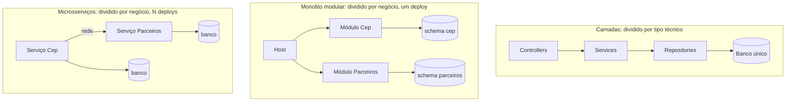

# 1.1 O problema: por que não microsserviços, e por que não só camadas

Toda arquitetura é uma resposta a um problema. Antes de olhar o código, entenda o problema que o monolito modular resolve, senão ele parece só "um monte de pastas".

## As três formas de organizar uma aplicação

::: conceito Monolito em camadas
Um projeto (ou poucos) dividido **por tipo técnico**: `Controllers/`, `Services/`, `Repositories/`, `Models/`. Tudo que é controller fica junto, tudo que é repositório fica junto.

É o padrão de quase todo tutorial e funciona bem enquanto o sistema é pequeno.
:::

O problema aparece com o tempo. Para mudar "como calculamos o frete", você mexe em quatro pastas. Nada impede o `PedidoService` de chamar o `ClienteRepository` direto, nem de fazer um `JOIN` com a tabela de outra área. Depois de dois anos, cada parte conhece todas as outras. É a famosa **bola de lama**: ninguém consegue mudar nada sem medo.

::: conceito Microsserviços
Cada parte do negócio vira **uma aplicação separada**, com banco próprio, deploy próprio, e conversa com as outras pela rede (HTTP, gRPC, mensageria).

A fronteira é física: o serviço de Pedidos simplesmente **não consegue** ler a tabela de Clientes.
:::

O custo é alto e chega no primeiro dia: rede que falha, consistência eventual, rastrear uma requisição por cinco serviços, versionar contratos, N pipelines, N bancos, N alertas. Para um time de 5 a 20 pessoas, esse custo costuma ser maior que o benefício.

::: conceito Monolito modular
**Um único deploy**, dividido internamente **por área de negócio** (módulos), com fronteiras que o compilador ajuda a garantir. Cada módulo tem suas classes internas, seu schema no banco e uma porta pública pequena.

É a fronteira do microsserviço, sem a rede no meio.
:::

::: analogia
Na linha de produção, o monolito em camadas é um galpão onde todas as furadeiras ficam juntas, todas as prensas juntas: para montar uma peça, ela atravessa o galpão inteiro. O monolito modular é um galpão com **células de montagem**, cada uma com suas máquinas e uma janela de entrega. Microsserviços são **fábricas separadas**, com caminhão entre elas.
:::

## Por que a API de CEP é um monolito modular

::: porque
O protótipo da squad registrou a decisão no ADR-002 ([`docs/decisoes.md`](https://github.com/JandersonSR/squad-dotnet-kubernetes/blob/main/docs/decisoes.md) do gabarito): **fatias verticais, monolito modular, SharedKernel mínimo**.

Os motivos que pesam numa empresa do porte de uma squad:

- **Um deploy, uma pipeline, um conjunto de alertas.** O time aprende Kubernetes, Kafka e Azure uma vez, não N vezes.
- **Chamada entre módulos é chamada de método.** Sem timeout, sem retry, sem serialização.
- **A fronteira já existe.** Se um módulo precisar escalar sozinho ou ser de outro time, ele já tem schema próprio e porta pública: extrair vira um trabalho de semanas, não de meses.
- **Refatorar entre módulos é seguro.** O compilador acha todos os usos; numa rede, você descobre em produção.

A alternativa descartada, microsserviços desde o início, pagaria o custo da rede antes de saber se alguma parte precisa escalar sozinha.
:::

::: armadilha
"Monolito modular" não é só criar pastas com nomes de negócio. Se o módulo A consegue instanciar as classes do módulo B, ou ler as tabelas dele, você tem um monolito em camadas com pastas diferentes. A fronteira precisa ser **garantida**: por `internal`, por projetos separados e por teste de arquitetura (lição 1.2).
:::

## Quando o monolito modular deixa de ser a resposta

Seja honesto com os sinais de que um módulo deveria virar serviço:

| Sinal | Exemplo |
|---|---|
| Escala muito diferente | Um módulo precisa de 40 pods e o resto de 2 |
| Ritmo de deploy diferente | Um time quer publicar 10 vezes por dia e o outro uma vez por semana, e um trava o outro |
| Tecnologia diferente | Um módulo precisa de Python para IA |
| Isolamento de falha | Um vazamento de memória num módulo derruba o processo inteiro |
| Conformidade | Dados de cartão precisam ficar num ambiente isolado |

Nenhum desses aparece no CEP. Quase nenhum aparece no início de um sistema.

## Vídeos

::: video Modular Monoliths • Simon Brown • GOTO 2018 (em inglês)
https://www.youtube.com/watch?v=5OjqD-ow8GE
A palestra clássica. A frase que fica: se você não consegue construir um monolito bem estruturado, microsserviços não vão resolver. Assista pelo menos os primeiros 20 minutos.
:::

::: video Modular Monoliths: How To Build One & Lessons Learned (Milan Jovanović, em inglês)
https://www.youtube.com/watch?v=Xo3rsiZYsJQ
Em .NET, com dois anos de experiência num sistema real: como dividir, como os módulos conversam, como isolar os dados.
:::

## Perguntas para responder sem olhar

::: pergunta
Um colega diz: "monolito modular é só microsserviço sem rede, então dá na mesma". O que ele acertou e o que errou?
???
**Acertou:** a fronteira entre módulos deve ser tão firme quanto a de um serviço (dados próprios, porta pública pequena).

**Errou:** "dá na mesma" ignora o que muda sem a rede. Sem rede não há falha parcial, timeout, retry, consistência eventual entre módulos (uma transação pode cobrir dois módulos, se você aceitar esse acoplamento), nem N pipelines. Em troca, o monolito modular perde o deploy independente, a escala independente e o isolamento de falha. São trade-offs diferentes, não a mesma coisa.
:::

::: pergunta
Cite dois sinais concretos de que um módulo deveria ser extraído para um serviço próprio.
???
Qualquer dois entre: escala muito diferente do resto; ritmo de deploy diferente que faz um time travar o outro; necessidade de outra tecnologia; uma falha do módulo derrubando o processo inteiro; exigência de isolamento por conformidade.
:::

::: pergunta
Por que, num monolito em camadas, o acoplamento cresce mesmo com um time disciplinado?
???
Porque nada impede. Qualquer service pode chamar qualquer repository, e qualquer consulta pode fazer `JOIN` com qualquer tabela. Sob prazo, o atalho sempre parece razoável naquele dia. Disciplina não escala; fronteira garantida pelo compilador e por teste escala.
:::

**Próxima:** [1.2 Anatomia do projeto](02-anatomia-do-projeto.md).
