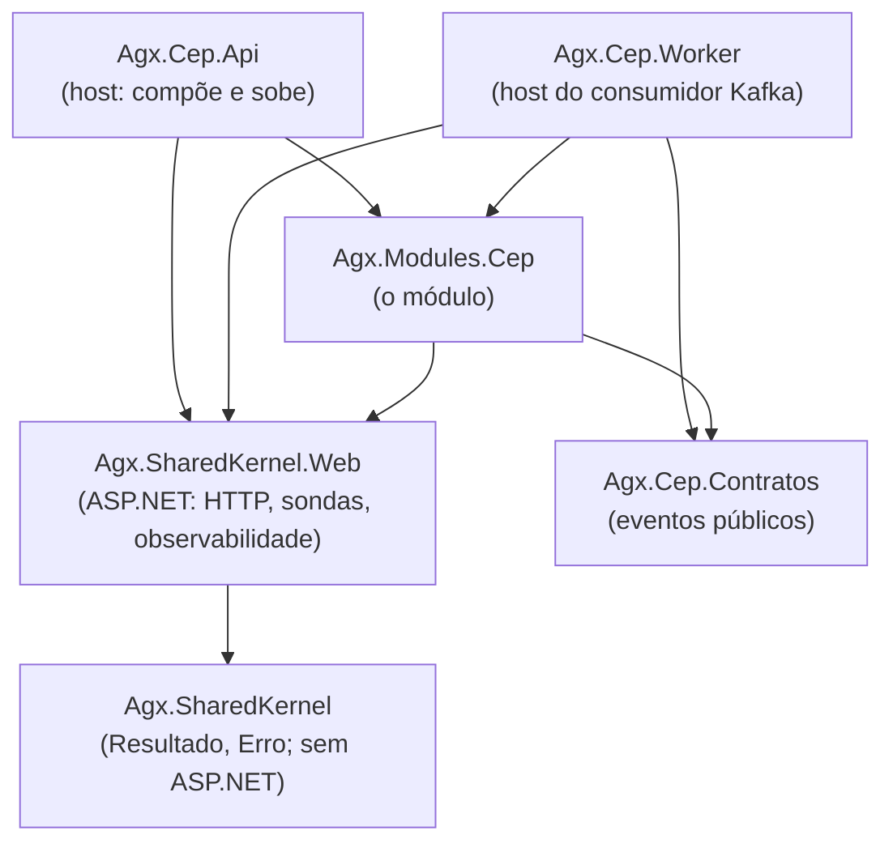

# 1.2 Anatomia do projeto: quem pode enxergar quem

Num monolito modular, a pergunta mais importante não é "onde fica cada arquivo". É **"quem pode depender de quem"**. Essa lição lê a solução do [aks-step-by-step](https://github.com/JandersonSR/aks-step-by-step/tree/main/src) por esse ângulo.

## Os projetos e as setas



Leia as setas como "conhece". Repare no que **não** tem seta:

- O `SharedKernel` não conhece ninguém. Ele é a base e não pode depender de nada do negócio.
- Os `Contratos` não conhecem o módulo. Quem consome o evento não precisa referenciar a implementação.
- Nenhum módulo conhece outro módulo. Hoje só existe um; quando o Parceiros chegar (lição 1.7), não haverá seta entre eles.

::: porque Por que o SharedKernel foi dividido em dois
O `Agx.SharedKernel` não referencia ASP.NET (veja o comentário no [`.csproj`](https://github.com/JandersonSR/aks-step-by-step/blob/main/src/Agx.SharedKernel/Agx.SharedKernel.csproj)). O motivo: o `Resultado<T>` e o catálogo de erros servem também a quem consome Kafka, onde um erro vira "tentar de novo" ou "mandar para a fila de mensagens mortas", não um status HTTP. O que é HTTP (ProblemDetails, sondas, rate limiting) fica no `SharedKernel.Web`.

A alternativa, um SharedKernel só, faria todo consumidor carregar ASP.NET e empurraria conceitos de HTTP para dentro das regras de negócio.
:::

::: armadilha
O SharedKernel é o lugar mais perigoso de um monolito modular. Tudo que entra nele vira dependência de todos os módulos. A regra prática: **só entra o que é igual para todos e quase nunca muda** (`Resultado`, `Erro`, abstração de tempo). "Utilitário que dois módulos usam" não é motivo; dois módulos podem ter cópias que evoluem separadas.
:::

## O contrato de um módulo: `IModulo`

Abra [`IModulo.cs`](https://github.com/JandersonSR/aks-step-by-step/blob/main/src/Agx.SharedKernel.Web/Modulos/IModulo.cs). Um módulo só sabe fazer duas coisas para o host:

```csharp
public interface IModulo
{
    void Registrar(IServiceCollection services, IConfiguration configuracao);
    void MapearEndpoints(IEndpointRouteBuilder versao);
}
```

E o host ([`Program.cs`](https://github.com/JandersonSR/aks-step-by-step/blob/main/src/Agx.Cep.Api/Program.cs)) só faz isto com eles:

```csharp
IModulo[] modulos = [new CepModulo()];
builder.Services.AddModulos(builder.Configuration, modulos);
// ...
app.MapGroup("/v1").MapModulos(modulos);
```

::: porque Por que o host não registra os serviços do módulo diretamente
Se o `Program.cs` tivesse `services.AddScoped<ConsultarCepHandler>()`, ele precisaria conhecer cada classe de cada módulo. Com `IModulo`, o host conhece **uma** classe por módulo (`CepModulo`) e o resto pode ser `internal`. Adicionar um módulo é uma linha no array.

Alternativa comum: escanear assemblies por reflexão e registrar tudo automaticamente. Funciona, mas esconde o que está registrado e deixa erros para o momento em que a aplicação sobe. A lista explícita é chata de propósito: você vê os módulos que o host compõe.
:::

## `internal`: a fronteira que o compilador garante

Quase tudo dentro do módulo é `internal`: o handler, o validador, o endpoint, o mapper, o publicador de eventos. Só é `public` o que alguém de fora realmente precisa.

::: previsao
Abra o `Program.cs` da API e acrescente, logo depois de `var app = builder.Build();`:

```csharp
var h = app.Services.GetRequiredService<Agx.Modules.Cep.Features.ConsultarCep.ConsultarCepHandler>();
```

Rode `dotnet build`. O que acontece, e em que momento (compilação ou execução)?
???
Erro de **compilação**:

```text
error CS0122: 'ConsultarCepHandler' is inaccessible due to its protection level
```

É exatamente isso que se quer: a fronteira quebra no seu editor, não em produção. Num monolito em camadas, essa linha compilaria e o acoplamento entraria sem ninguém notar.

Desfaça a alteração antes de seguir.
:::

## A exceção consciente: o Worker

Abra o [`.csproj` do módulo](https://github.com/JandersonSR/aks-step-by-step/blob/main/src/Modules/Agx.Modules.Cep/Agx.Modules.Cep.csproj). Ele tem:

```xml
<InternalsVisibleTo Include="Agx.Cep.Api.Tests" />
<InternalsVisibleTo Include="Agx.Cep.Worker" />
```

O teste enxergar o `internal` é comum e aceitável. O **Worker** enxergar é uma decisão com custo: ele usa o `RegistradorDeConsultas`, que é interno ao módulo.

::: porque Por que aceitar isso aqui
O Worker é, na prática, **outro host do mesmo módulo**: ele registra o módulo inteiro (`new CepModulo().Registrar(...)` no [`Program.cs` do Worker](https://github.com/JandersonSR/aks-step-by-step/blob/main/src/Agx.Cep.Worker/Program.cs)) e usa o mesmo banco e o mesmo schema. Não é um módulo vizinho bisbilhotando; é o mesmo módulo rodando em outro processo para escalar separado (com KEDA, no módulo 5).

O preço: se o Worker crescer e virar outra área de negócio, esse atalho vira acoplamento. O sinal de alerta seria o Worker passar a usar classes do módulo que não têm a ver com o consumo de eventos.
:::

## Lab de quebra: furar a fronteira sem o compilador perceber

`internal` protege as classes, mas não protege tudo. Existe um jeito de acoplar dois módulos que compila sem erro nenhum.

::: quebra
Imagine que já existe um módulo Parceiros, com schema `parceiros`. Escreva, **dentro do módulo Cep**, uma consulta que conte quantos parceiros ativos existem. Não referencie nenhum projeto novo.

Ela compila? Ela funciona? O que está errado?
:::

::: dica Dica 1
O `CepDbContext` tem `Database.ExecuteSqlAsync` e `Database.SqlQuery<T>`. Eles aceitam qualquer SQL.
:::

::: dica Dica 2
Os dois schemas estão no **mesmo banco PostgreSQL**. Nada impede `SELECT ... FROM parceiros."Parceiros"` a partir da conexão do módulo Cep.
:::

::: solucao
```csharp
var ativos = await db.Database
    .SqlQuery<int>($"""SELECT COUNT(*) AS "Value" FROM parceiros."Parceiros" WHERE "Ativo" """)
    .SingleAsync(ct);
```

Compila e funciona. E acabou de criar o pior tipo de acoplamento: o módulo Cep depende **da estrutura da tabela** de outro módulo. Se o time do Parceiros renomear uma coluna, o Cep quebra em produção, e nenhum teste do Parceiros vai avisar.

Como se defende:

1. **Usuário de banco por módulo**, com permissão só no próprio schema. A consulta acima passa a falhar com `permission denied for schema parceiros`. É a defesa mais forte, porque vale até para SQL escrito à mão.
2. **Revisão de código** com a regra explícita: nenhum SQL cita schema de outro módulo.
3. Se o Cep precisa de um dado do Parceiros, ele pede pela porta pública do Parceiros (lição 1.6).
:::

## Exercício: um teste que guarda a fronteira

`internal` é a primeira defesa. A segunda é um teste que falha quando alguém torna algo público sem pensar.

::: desafio
No projeto `tests/Agx.Cep.Api.Tests`, crie um teste que liste todos os tipos `public` do assembly `Agx.Modules.Cep` e compare com uma lista aprovada. Se alguém tornar um tipo público, o teste falha e obriga a pessoa a atualizar a lista, ou seja, a decidir de propósito.

**Critérios de aceite:**
- O teste passa com o código atual
- Mudar `ConsultarCepHandler` para `public` faz o teste falhar com uma mensagem que diz qual tipo apareceu
- Sem pacote novo: só reflexão e xUnit
:::

::: dica Dica 1
`typeof(CepModulo).Assembly.GetExportedTypes()` devolve só os tipos públicos.
:::

::: dica Dica 2
Compare dois conjuntos ordenados de nomes (`FullName`) e, na mensagem, mostre a diferença com `Except` nos dois sentidos.
:::

::: solucao
```csharp
using Agx.Modules.Cep;

namespace Agx.Cep.Api.Tests.Unidade;

public class FronteiraDoModuloCepTests
{
    // Mudou? Ótimo, desde que seja de propósito. Atualize a lista e explique no PR.
    private static readonly string[] Aprovados =
    [
        "Agx.Modules.Cep.CepModulo",
        "Agx.Modules.Cep.CepOptions",
        "Agx.Modules.Cep.Data.CepDbContext",
        "Agx.Modules.Cep.Data.EnderecoCache",
        "Agx.Modules.Cep.Data.EstatisticaCep",
        "Agx.Modules.Cep.Eventos.KafkaOptions",
        "Agx.Modules.Cep.Fontes.EnderecoFonte",
        "Agx.Modules.Cep.Fontes.IFonteCep",
    ];

    [Fact]
    public void Superficie_publica_do_modulo_e_a_aprovada()
    {
        var publicos = typeof(CepModulo).Assembly.GetExportedTypes()
            .Where(t => !t.Namespace!.Contains(".Migrations", StringComparison.Ordinal))
            .Select(t => t.FullName!)
            .Order()
            .ToArray();

        var novos = publicos.Except(Aprovados).ToArray();
        var sumiram = Aprovados.Except(publicos).ToArray();

        Assert.True(novos.Length == 0 && sumiram.Length == 0,
            $"Superfície pública mudou. Novos: [{string.Join(", ", novos)}]. Sumiram: [{string.Join(", ", sumiram)}]");
    }
}
```

Rode `dotnet test --filter FronteiraDoModuloCep`. Se a lista do seu clone estiver diferente, a mensagem do teste mostra a diferença: ajuste a lista e, para cada tipo público, responda **quem de fora usa esse tipo**.

Pergunta para investigar: por que `CepDbContext` e as entidades `EnderecoCache` e `EstatisticaCep` são públicos? Procure quem usa (no Rider ou VS: *Find Usages*; no terminal: `grep -rn CepDbContext src tests`). Se ninguém de fora do módulo precisar, torná-los `internal` encolhe a porta.

Para regras mais ricas ("Features não pode depender de Data de outro módulo"), existem bibliotecas como NetArchTest e ArchUnitNET. Comece pelo teste simples; ele pega a maioria dos casos.
:::

## Perguntas para responder sem olhar

::: pergunta
Qual a diferença de papel entre `Agx.SharedKernel` e `Agx.SharedKernel.Web`, e por que separar?
???
O primeiro tem o que vale em qualquer borda (`Resultado`, `Erro`, tipos de erro) e não referencia ASP.NET. O segundo tem o que é de HTTP (ProblemDetails, sondas, rate limiting, observabilidade). Separar permite que o consumidor Kafka use as mesmas regras de erro sem carregar ASP.NET, e impede que conceitos de HTTP entrem nas regras de negócio.
:::

::: pergunta
`internal` impede que um módulo leia as tabelas de outro? Se não, o que impede?
???
Não. SQL escrito à mão, ou outro `DbContext` mapeando a tabela, passa por cima do `internal`. Quem impede de verdade é um usuário de banco por módulo com permissão só no próprio schema, somado a revisão de código.
:::

::: pergunta
Por que o host recebe uma lista explícita de módulos em vez de descobri-los por reflexão?
???
Porque deixa visível o que está composto, falha cedo e não depende de convenção de nomes. A descoberta automática esconde o registro e só mostra erro quando a aplicação sobe.
:::

**Próxima:** [1.3 DDD estratégico](03-ddd-estrategico.md).
