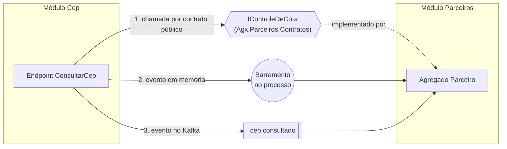

# 1.6 Como os módulos conversam sem se acoplar

Módulos isolados que não conversam não formam um sistema. A questão é **como** conversar sem que um passe a depender do interior do outro. Existem três formas, e cada uma tem um custo diferente.

## O cenário

Com o módulo Parceiros (lição 1.7), a consulta de CEP passa a depender de uma regra dele: **só responder se o parceiro ainda tem cota no dia**. O módulo Cep precisa de algo do Parceiros. Como?



## Forma 1: chamada síncrona por contrato público

O Parceiros publica um projeto pequeno só com interfaces e DTOs, e implementa a interface por dentro:

```csharp
// Agx.Parceiros.Contratos: o único projeto do Parceiros que outros módulos podem referenciar
public interface IControleDeCota
{
    Task<Resultado<int>> ConsumirAsync(Guid parceiroId, CancellationToken ct);
}
```

O módulo Cep referencia `Agx.Parceiros.Contratos`, nunca `Agx.Modules.Parceiros`. Quem liga a interface à implementação é o `ParceirosModulo.Registrar`, no host.

::: porque
Precisa da resposta **agora** para decidir: se a cota acabou, a consulta não pode acontecer. Isso é uma pergunta, não um aviso, e pergunta pede chamada síncrona.

Como é chamada de método no mesmo processo, não tem timeout nem falha de rede. E o Cep só conhece a interface: o Parceiros pode mudar tudo por dentro.
:::

::: armadilha
O contrato público é a parte mais difícil de mudar do módulo, porque outros dependem dele. Mantenha-o **pequeno e com tipos simples** (`Guid`, `int`, records próprios do contrato). Se o contrato expõe a entidade `Parceiro` inteira, a fronteira acabou.
:::

## Forma 2: evento em memória

O Cep avisa "uma consulta foi feita" num barramento dentro do processo, e quem quiser reage. O Cep não sabe quem escuta.

::: porque
Serve para **avisos**: algo aconteceu e outros podem querer saber, mas quem avisa não precisa da resposta. Desacopla mais que a chamada, porque o Cep nem sabe que o Parceiros existe.

O custo: se o processo cair entre salvar e publicar, o evento se perde. E fica mais difícil seguir o fluxo lendo o código ("quem trata esse evento?").
:::

## Forma 3: evento no Kafka

É o que o projeto já faz com o `CepConsultado` ([contrato](https://github.com/JandersonSR/aks-step-by-step/blob/main/src/Agx.Cep.Contratos/CepConsultado.cs)). O Worker consome e monta o ranking.

::: porque
Use quando quem reage está **em outro processo** (o Worker, outro serviço, outro time) ou precisa escalar separado. Os eventos ficam no tópico se o consumidor estiver fora, e vários consumidores podem ler o mesmo evento.

Custo: consistência eventual (o efeito acontece "logo", não "agora"), mensagens repetidas, ordem só por partição. Tudo isso é o módulo 5.
:::

## Qual escolher para a cota?

::: previsao
Um colega propõe: "o Parceiros consome o tópico `cep.consultado` do Kafka e soma a cota de cada parceiro. Assim o Cep nem precisa saber do Parceiros." Para a regra "não passar da cota", isso funciona? O que acontece numa rajada de 500 consultas em 2 segundos de um parceiro com 100 de cota restante?
???
**Não serve para essa regra.** Pelo Kafka, a contagem chega **depois** da consulta já ter sido respondida. Numa rajada, as 500 consultas são respondidas antes de o consumidor somar a cota, e o parceiro passa 400 do limite.

Kafka serve para o que pode ser **eventual**: o ranking dos mais consultados, um relatório de uso, um aviso ao comercial quando a cota acabar. Para **impedir** algo, a decisão precisa ser síncrona (forma 1), e com controle de concorrência no banco (lição 1.4).

Regra prática: **pergunta que bloqueia → chamada. Aviso que não bloqueia → evento.**
:::

| | Chamada por contrato | Evento em memória | Evento no Kafka |
|---|---|---|---|
| Precisa da resposta? | Sim | Não | Não |
| Quem chama conhece quem atende? | Só a interface | Não | Não |
| Consistência | Imediata | Imediata (mesmo processo) | Eventual |
| Se o processo cair no meio | A requisição falha inteira | O aviso pode se perder | O evento fica no tópico (se publicado) |
| Exemplo no projeto | `IControleDeCota` (lição 1.7) | `CotaEsgotada` para outro módulo | `CepConsultado` → Worker |

## E os dados? Nunca compartilhe tabela

Cada módulo tem seu schema (`cep`, `parceiros`). Nenhum módulo lê tabela de outro, nem com `JOIN` (lição 1.2, lab de quebra).

Se o Cep precisasse mostrar o **nome** do parceiro em cada resposta, as opções seriam:

1. Pedir pelo contrato (`IConsultaDeParceiros.ObterNome(id)`), com cache se for muito chamado.
2. Manter uma cópia própria, alimentada por eventos (`ParceiroRenomeado`). Mais rápido na leitura, eventual na atualização.

Copiar dado entre módulos parece desperdício, mas é o que permite cada um mudar o próprio schema sem coordenar com os outros.

::: armadilha
"Mas é o mesmo banco, um `JOIN` seria tão mais simples." É, hoje. Daqui a um ano, quando o Parceiros precisar sair para um serviço próprio, cada `JOIN` vira uma reescrita. A fronteira dos dados é a que mais custa recuperar depois de perdida.
:::

## Vídeo

::: video Getting Started with Modular Monoliths in .NET (Milan Jovanović, em inglês)
https://www.youtube.com/watch?v=5dilYMii9T4
Como os módulos se comunicam e como isolar os dados, com implementação em .NET. Curto e direto.
:::

Para ver um monolito modular completo em .NET, com DDD, eventos entre módulos e testes de arquitetura, estude o repositório [modular-monolith-with-ddd](https://github.com/kgrzybek/modular-monolith-with-ddd), de Kamil Grzybek. É grande: comece pelo README e pela pasta de um módulo só.

## Perguntas para responder sem olhar

::: pergunta
Quais as três formas de um módulo falar com outro, e qual a regra prática para escolher?
???
Chamada síncrona por contrato público, evento em memória e evento por mensageria (Kafka). Pergunta que precisa de resposta para decidir → chamada. Aviso que não bloqueia → evento; em memória se for no mesmo processo e perder um aviso é tolerável, Kafka se for para outro processo ou não puder se perder.
:::

::: pergunta
Por que o projeto de contratos de um módulo deve ser pequeno?
???
Porque é a parte que outros módulos referenciam e, portanto, a mais cara de mudar. Quanto menos ele expõe, mais o módulo pode mudar por dentro sem afetar ninguém. Expor entidades internas no contrato desfaz a fronteira.
:::

::: pergunta
O módulo A precisa do nome de um registro do módulo B em toda resposta. Quais as opções, já que `JOIN` está fora?
???
Pedir ao B pelo contrato público (com cache, se for muito chamado), ou manter no A uma cópia do nome alimentada por eventos do B. A primeira é sempre atual e acopla em tempo de execução; a segunda é mais rápida e independente, mas eventual.
:::

**Próxima:** [1.7 Desafio: o módulo Parceiros](07-desafio-modulo-parceiros.md).
