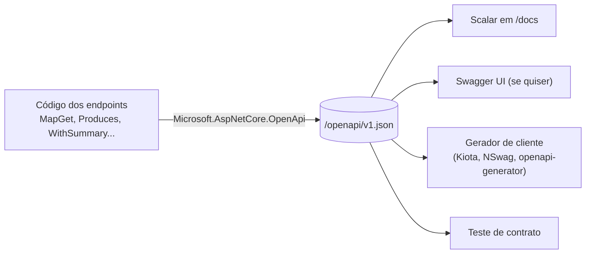

# 2.1 O contrato: OpenAPI, Swagger e Scalar

Quem integra com a sua API não lê o seu código. Lê a documentação, testa umas chamadas e escreve o cliente dele. Se a documentação estiver errada ou incompleta, ele descobre em produção. Por isso a API precisa de um **contrato**: uma descrição precisa, que máquinas conseguem ler.

::: conceito OpenAPI
Um formato padrão (JSON ou YAML) que descreve uma API HTTP: as rotas, os parâmetros, os corpos de requisição e de resposta, os status possíveis e os cabeçalhos. É só um arquivo. A partir dele, ferramentas geram documentação navegável, clientes em várias linguagens, mocks e testes.
:::

Uma confusão comum, que vale desfazer de uma vez:

| Nome | O que é |
|---|---|
| **OpenAPI** | A especificação (o formato do arquivo). Antes de 2016 se chamava "Swagger Specification" |
| **Swagger UI** | Uma página web que lê um arquivo OpenAPI e mostra a API com botão "Try it out" |
| **Swashbuckle** | Biblioteca .NET que gerava o arquivo OpenAPI e servia o Swagger UI. Era o padrão dos templates até o .NET 8 |
| **Microsoft.AspNetCore.OpenApi** | O gerador oficial da Microsoft, embutido no ASP.NET Core desde o .NET 9 |
| **Scalar, ReDoc** | Outras páginas que leem o mesmo arquivo, com visual e recursos diferentes |



## Por que o Swagger "sumiu" do .NET 9

::: porque
No .NET 9, o template de Web API deixou de trazer o Swashbuckle. O projeto estava com manutenção irregular, e a Microsoft passou a gerar a especificação com um pacote próprio, `Microsoft.AspNetCore.OpenApi`, que entende Minimal APIs nativamente. A **interface** (Swagger UI, Scalar ou outra) virou uma escolha separada.

O aks-step-by-step usa o gerador oficial e o **Scalar** como interface (veja o [`Program.cs`](https://github.com/JandersonSR/aks-step-by-step/blob/main/src/Agx.Cep.Api/Program.cs)):

```csharp
builder.Services.AddOpenApi("v1");
// ...
if (app.Configuration.GetValue<bool>("Documentacao:Habilitada"))
{
    app.MapOpenApi();                    // serve /openapi/v1.json
    app.MapScalarApiReference("/docs");  // a página que lê esse arquivo
}
```

Se o time preferir o Swagger UI, dá para usá-lo lendo o mesmo `/openapi/v1.json`. O ponto é que gerar o contrato e mostrar o contrato são coisas separadas.
:::

## Documentação ligada só onde faz sentido

::: previsao
O `appsettings.json` tem `Documentacao:Habilitada: false` e o `appsettings.Development.json` tem `true`. O `values.yaml` do chart deixa `"false"`, e o `values-dev.yaml` liga.

Em produção, o que responde `GET /openapi/v1.json`? E `GET /docs`?
???
As duas rotas respondem **404**, em `application/problem+json`, como qualquer rota que não existe: o `if` nem chega a mapear os endpoints.

Por que desligar em produção:

- **Superfície de ataque menor.** O arquivo é um mapa completo da API, com rotas que talvez nem estejam documentadas para parceiros.
- **Controle do que é publicado.** A documentação que o parceiro recebe deve ser uma versão revisada, não o que estiver no último deploy.

A alternativa, comum em APIs públicas, é deixar a especificação aberta de propósito. Para uma API B2B com parceiros conhecidos, o projeto preferiu entregar o arquivo por fora.
:::

## Code-first ou contract-first?

Existem dois jeitos de chegar ao contrato:

| | Code-first | Contract-first |
|---|---|---|
| Como funciona | Escreve o código; o arquivo OpenAPI é gerado | Escreve o arquivo OpenAPI primeiro; o código implementa |
| Vantagem | Contrato e código nunca divergem; menos trabalho | O contrato é discutido e aprovado antes de qualquer código; times trabalham em paralelo |
| Risco | O contrato vira "o que o código faz", inclusive os acidentes | O código pode divergir do arquivo se nada verificar |
| No projeto | **Este** | — |

::: porque
O projeto é code-first porque o mesmo time escreve e consome a especificação, e o contrato muda pouco. Para que os "acidentes" do código não vazem para o contrato, a lição 2.4 propõe um teste que compara a especificação gerada com uma versão aprovada: qualquer mudança aparece no PR.

Contract-first compensa quando vários times ou empresas precisam combinar o contrato antes de começar, como numa API de parceiros que ainda vai ser construída.
:::

## Vídeos

::: video 4 Options to Replace Swagger in .NET 9 APIs (IAmTimCorey, em inglês)
https://www.youtube.com/watch?v=Tx49o-5tkis
O que mudou no .NET 9 e as opções de interface: Swagger UI, Scalar, ReDoc e outras.
:::

::: video Swagger sumiu do .NET 9? Como configurar Swagger, ReDoc e Scalar (Diogo Costa Dev)
https://www.youtube.com/watch?v=g7xruk-RWpQ
As mesmas opções, configuradas passo a passo.
:::

Documentação oficial: [OpenAPI no ASP.NET Core](https://learn.microsoft.com/aspnet/core/fundamentals/openapi/overview).

## Perguntas para responder sem olhar

::: pergunta
Qual a diferença entre OpenAPI, Swagger UI e Scalar?
???
OpenAPI é o formato do arquivo que descreve a API. Swagger UI e Scalar são páginas web que leem esse arquivo e mostram a API de forma navegável. O mesmo arquivo serve a qualquer uma delas, e também a geradores de cliente e testes.
:::

::: pergunta
Por que o projeto não expõe a documentação em produção?
???
Para não publicar um mapa completo da API para qualquer um e para controlar qual versão da documentação os parceiros recebem. Em produção, `/openapi/v1.json` e `/docs` nem são mapeados e respondem 404.
:::

::: pergunta
Qual o principal risco do code-first, e como o projeto se protege?
???
O contrato passa a refletir tudo o que o código faz, inclusive mudanças acidentais. A proteção é um teste que compara a especificação gerada com uma versão aprovada no repositório, de modo que qualquer mudança apareça no PR para alguém decidir.
:::

**Próxima:** [2.2 Descrevendo bem cada endpoint](02-descrevendo-endpoints.md).
