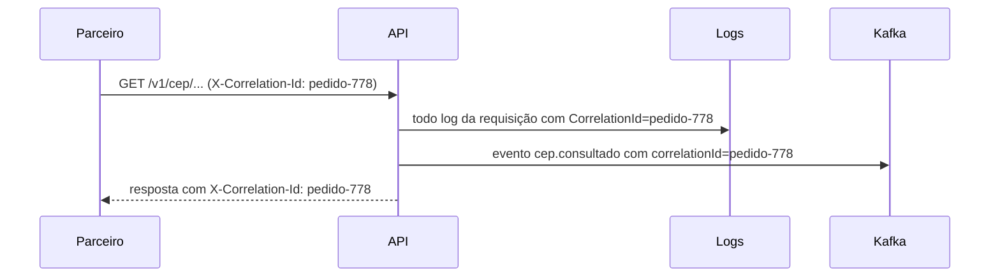

# 2.3 Erros, cabeçalhos e correlação como parte do contrato

O contrato não é só o corpo do 200. Os erros, os cabeçalhos e os limites também são promessas, e quem integra escreve código em cima delas. Esta lição junta o que a [lição 1.5](../modulo-01/05-erros-e-resultado.md) mostrou sobre erros com o resto do que a API promete.

## Um formato de erro para tudo

Toda resposta de erro sai em `application/problem+json` ([RFC 9457](https://www.rfc-editor.org/rfc/rfc9457)), com dois campos a mais que o projeto acrescenta:

```json
{
  "type": "https://tools.ietf.org/html/rfc9110#section-15.5.5",
  "title": "CEP não encontrado",
  "status": 404,
  "instance": "/v1/cep/99999999",
  "codigo": 2001,
  "correlationId": "4bf92f3577b34da6a3ce929d0e0e4736"
}
```

::: porque
- **Um formato para todos os erros**, inclusive os que nenhum handler gerou (rota inexistente, método errado, 429). O parceiro escreve **um** tratador de erro, não um por endpoint.
- **Padrão de mercado.** Bibliotecas de cliente em várias linguagens já entendem ProblemDetails.
- **`codigo`** para a máquina decidir; **`title`** para a pessoa ler; **`correlationId`** para o suporte achar a requisição.

Quem garante que até o 404 de rota sai nesse formato é o `AddProblemDetailsPadrao` + `UseStatusCodePages` (veja a [lição 1.5](../modulo-01/05-erros-e-resultado.md)).
:::

## Correlação: o fio que liga parceiro, log e evento

Abra o [`Correlacao.cs`](https://github.com/JandersonSR/aks-step-by-step/blob/main/src/Agx.SharedKernel.Web/Http/Correlacao.cs). O fluxo:



Se o parceiro manda o cabeçalho, a API usa o dele. Se não manda, usa o trace id do OpenTelemetry. De qualquer jeito, o id volta na resposta.

::: porque
Quando o parceiro abre um chamado ("a consulta do pedido 778 falhou às 14h"), o suporte busca `pedido-778` nos logs e acha a requisição, os logs do handler e o evento no Kafka. Sem correlação, a investigação é olhar horários e torcer.

Aceitar o id **do parceiro** (e não só gerar um) permite que ele ligue a chamada ao sistema dele.
:::

::: previsao
Um parceiro manda `X-Correlation-Id` com o valor `abc\nERRO senha=123` (com uma quebra de linha no meio). O que a API faz com isso? Por que o código não aceita qualquer valor?
???
A API **ignora o valor** e gera um id novo: o `EhValido` só aceita até 64 caracteres, entre letras, dígitos, `-` e `_`. O teste `Requisicao_ComCorrelationIdInvalido_GeraUmNovo` cobre isso.

O motivo é **log forging**: o valor vai para todos os logs e para um cabeçalho de resposta. Com uma quebra de linha, um atacante consegue escrever linhas falsas no log ("ERRO senha=123") e confundir uma investigação, ou injetar cabeçalhos. Todo valor vindo de fora que vai para log precisa ser limitado.
:::

## Os cabeçalhos que o projeto promete

| Cabeçalho | Quando | Para que |
|---|---|---|
| `X-Correlation-Id` | Toda resposta | Ligar a chamada aos logs e eventos |
| `X-Cache: HIT \| MISS \| STALE` | 200 da consulta | Dizer se o dado veio de cache, da fonte, ou de cache vencido porque a fonte está fora |
| `X-Cache-Camada: memoria \| banco \| fonte` | 200 da consulta | Diagnóstico: em que camada estava (módulo 4) |
| `Retry-After` | 429 | Quantos segundos esperar antes de tentar de novo |

::: armadilha
Cabeçalho também é contrato. Se um parceiro escreveu "quando vier `STALE`, mostrar um aviso de dado desatualizado", renomear para `X-Cache-Status` quebra a integração dele sem nenhum erro de compilação, de nenhum lado. Repare no comentário do `OrigemDoDadoExtensions.ParaCabecalho`: quando a camada de memória entrou (nível 14), o valor `HIT` foi mantido para memória e banco, justamente para o contrato não mudar.
:::

## Limites também são contrato

O rate limiting ([`LimiteDeRequisicoes.cs`](https://github.com/JandersonSR/aks-step-by-step/blob/main/src/Agx.SharedKernel.Web/Http/LimiteDeRequisicoes.cs)) responde **429** com `Retry-After` e ProblemDetails, com `codigo: 1429`.

::: porque
- **429 e não 503**: 503 diz "o servidor está com problema"; 429 diz "você passou do seu limite". O cliente reage diferente: no 429, ele espera o `Retry-After`; no 503, talvez tente outro caminho.
- **`Retry-After`**: sem ele, o cliente tenta de novo imediatamente, em loop, e piora a situação.
- **Partição por IP hoje**, como diz o comentário no código. Quando houver autenticação (módulo 8), a partição passa a ser o parceiro do token. Por IP, dois parceiros atrás do mesmo NAT dividem a cota.
:::

::: quebra
Suba a API com um limite baixo: `LIMITE_REQUISICOES=5 docker compose up`. Depois:

```bash
for i in $(seq 1 10); do curl -s -o /dev/null -w "%{http_code} " localhost:8080/v1/cep/01001000; done; echo
curl -si localhost:8080/v1/cep/01001000 | grep -i -E "retry-after|HTTP/"
```

Quantos 200 e quantos 429? O que diz o `Retry-After`? Espere esse tempo e rode de novo.
:::

::: solucao
Os 5 primeiros dentro da mesma janela de 1 segundo passam (200); os seguintes recebem 429 até a janela virar. Como o laço é rápido, você deve ver algo como `200 200 200 200 200 429 429 429 429 429`. O `Retry-After` vem com `1` (a janela é de 1 segundo, arredondada para cima).

Repare que o 429 sai em ProblemDetails com `codigo: 1429` e `correlationId`, como todos os outros erros. É o `OnRejected` do rate limiter escrevendo pelo mesmo `IProblemDetailsService`.

É uma janela fixa (`FixedWindowRateLimiter`): no limite entre duas janelas, um cliente consegue passar até o dobro do limite em pouco tempo. Para suavizar, existem `SlidingWindowRateLimiter` e `TokenBucketRateLimiter`. A escolha é um bom assunto de ADR.
:::

## Perguntas para responder sem olhar

::: pergunta
Por que aceitar o `X-Correlation-Id` do parceiro, e por que validá-lo?
???
Aceitar permite que ele ligue a chamada ao sistema dele e que o suporte ache tudo pelo id que ele informar. Validar (tamanho e caracteres) evita log forging e injeção de cabeçalho, porque o valor vai para os logs e para a resposta.
:::

::: pergunta
Por que o rate limiting responde 429 e não 503, e por que manda `Retry-After`?
???
429 diz que o cliente passou do limite dele; 503 diz que o servidor está com problema, e o cliente reage diferente a cada um. O `Retry-After` diz quanto esperar, evitando que o cliente tente de novo imediatamente em loop.
:::

::: pergunta
Renomear um cabeçalho de resposta quebra quem integra? Como você descobriria?
???
Quebra, se alguém lê o cabeçalho, e nenhum compilador avisa, de nenhum lado. Você só descobre se o cabeçalho estiver no contrato (especificação, testes de contrato) e se a mudança for tratada como incompatível, com versão nova ou período de transição com os dois nomes.
:::

**Próxima:** [2.4 Versionar e evoluir sem quebrar ninguém](04-versionamento.md).
