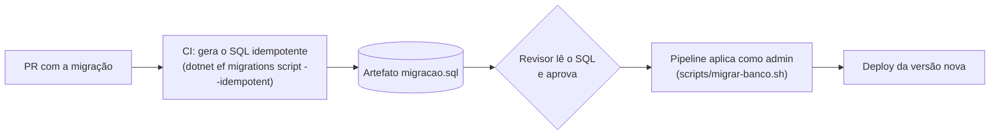

# 3.2 Migrações que não derrubam ninguém

::: conceito Migração
Uma mudança de schema versionada: criar tabela, acrescentar coluna, criar índice. No EF Core, cada migração é uma classe gerada a partir da diferença entre o modelo C# e o último estado conhecido (o *snapshot*). O banco guarda, na tabela `__EFMigrationsHistory`, quais migrações já foram aplicadas.
:::

## Três jeitos de aplicar, e por que o projeto usa o terceiro

| Jeito | Como | Problema |
|---|---|---|
| A aplicação migra ao subir | `Database.MigrateAsync()` no `Program.cs` | Oito pods subindo juntos tentam migrar ao mesmo tempo; a aplicação precisa ter permissão de alterar o schema |
| Job no cluster (hook do Helm) | O que o nível 3 fazia | Melhor, mas ainda usa a imagem da aplicação com permissão de DDL, e ninguém lê o SQL antes |
| **Script revisado no pipeline** | Nível 9 em diante | — |



::: porque
- **Uma pessoa lê o SQL que vai rodar em produção.** O revisor vê `DROP COLUMN` antes de ele acontecer, não depois.
- **A aplicação não precisa de poder de DDL** (lição 3.3).
- **Roda uma vez, antes do deploy.** A versão nova só sobe com o schema que ela espera.
- **Idempotente**: o script confere no histórico o que já foi aplicado. Rodar duas vezes não faz mal, o que torna o pipeline seguro de repetir.

O comando local `--migrar` do `Program.cs` continua existindo só para o `docker compose`.
:::

::: checkpoint
Gere o script e leia:

```bash
bash scripts/gerar-script-migracao.sh artefatos/migracao.sql
less artefatos/migracao.sql
```

Repare que cada migração vem dentro de um bloco que só executa se o `MigrationId` não estiver em `cep."__EFMigrationsHistory"`. É isso que o torna idempotente.
:::

## O CI que pega a migração esquecida

O pipeline roda `dotnet ef migrations has-pending-model-changes`. Se alguém mudou uma entidade e esqueceu de gerar a migração, o build reprova. Sem isso, o código novo subiria esperando uma coluna que não existe, e o erro apareceria só na primeira consulta em produção.

## O problema: a versão anterior continua rodando

Durante um deploy com rolling update, **as duas versões rodam ao mesmo tempo** por alguns minutos. E depois de um `helm rollback` ou `git revert`, a versão anterior volta a rodar com o schema novo. Toda migração precisa funcionar com **as duas versões** da aplicação.

::: previsao
Você quer renomear a propriedade `Localidade` para `Cidade` na entidade `EnderecoCache`. Muda o nome no C#, roda `dotnet ef migrations add RenomearLocalidade`, faz o deploy.

O que o EF gera na migração? O que acontece com os pods da versão anterior durante o rolling update? E com os dados?
???
O EF **não sabe** que é um renome: ele vê uma propriedade que sumiu e outra que apareceu. A migração gerada é **`DropColumn("Localidade")` + `AddColumn("Cidade")`**, e o próprio comando avisa que a operação pode causar perda de dados.

Se ninguém ler o SQL:

1. **Os dados da coluna se perdem.** Aqui é cache e se reconstrói; numa tabela de negócio, é um incidente.
2. **Os pods da versão anterior quebram** assim que a migração roda: eles fazem `SELECT ... "Localidade"`, e a coluna não existe mais. Todas as consultas desses pods falham até o rolling update terminar.
3. **O rollback não salva**: a versão anterior volta e continua procurando `Localidade`.

É exatamente o tipo de erro que a revisão do SQL no pipeline existe para pegar. E mesmo trocando por `RenameColumn` à mão (o que preserva os dados), o item 2 continua: a versão anterior procura o nome velho.
:::

## Expand/contract: mudar o schema em passos compatíveis

::: conceito Expand/contract
Fazer uma mudança incompatível em vários deploys, cada um compatível com o anterior. Primeiro **expande** (acrescenta o novo sem tirar o velho), depois migra o uso, por fim **contrai** (remove o velho quando ninguém mais usa).
:::

O renome de `Localidade` para `Cidade`, do jeito seguro:

| Deploy | Migração | A aplicação | Funciona com a versão anterior? |
|---|---|---|---|
| 1. Expandir | `ADD COLUMN "Cidade"` (anulável) | Grava nas **duas** colunas; lê de `Cidade`, e se vier nula, de `Localidade` | Sim: a anterior ignora a coluna nova |
| 2. Copiar | `UPDATE ... SET "Cidade" = "Localidade" WHERE "Cidade" IS NULL` (em lotes, se a tabela for grande) | Igual ao deploy 1 | Sim |
| 3. Migrar o uso | — | Lê e grava só `Cidade` | Sim: a anterior (deploy 2) também grava `Cidade` |
| 4. Contrair | `DROP COLUMN "Localidade"` | Igual ao deploy 3 | Sim: ninguém mais lê `Localidade` |

::: porque
Quatro deploys parecem exagero para um renome. Mas em cada um deles **o rollback é seguro** e **nenhum pod quebra no meio do rolling update**. Em sistemas com deploy contínuo, é o único jeito de mudar schema sem janela de manutenção.

A alternativa, uma janela de manutenção com a aplicação parada, é aceitável em sistemas internos que podem parar à noite. Para uma API de parceiros, não.
:::

::: armadilha
Os passos "pesados" (o `UPDATE` de milhões de linhas, criar índice em tabela grande) travam a tabela se feitos de uma vez. No PostgreSQL, índice em produção se cria com `CREATE INDEX CONCURRENTLY`, que não pode rodar dentro de transação. Por isso, às vezes, a migração precisa de SQL escrito à mão (`migrationBuilder.Sql(...)`) e de sair do script transacional.
:::

::: video LISA19 - Expand Contract Pattern for Continuous Delivery of Databases (USENIX, em inglês)
https://www.youtube.com/watch?v=Eh05k_O0Jjo
O padrão expand/contract explicado com exemplos de entrega contínua de banco de dados.
:::

Documentação oficial: [aplicar migrações](https://learn.microsoft.com/ef/core/managing-schemas/migrations/applying) (repare na seção que desaconselha migrar na subida da aplicação em produção).

## Desafio: o plano antes do código

::: desafio
O time decidiu que `EnderecoCache.Uf` (texto, 2 letras) vai virar uma referência para uma tabela nova `cep."Ufs"` (código IBGE, sigla, nome). Escreva o plano em expand/contract: quantos deploys, a migração de cada um, o que a aplicação lê e grava em cada um, e o que acontece se você precisar fazer rollback depois de cada deploy.

**Critérios de aceite:**
- Nenhum deploy deixa a versão anterior quebrada
- O rollback depois de qualquer deploy é seguro
- Fica claro em que deploy os dados antigos são copiados, e como, se a tabela tiver 50 milhões de linhas
:::

::: solucao Um plano possível
1. **Expandir:** criar `Ufs` e popular com as 27 UFs; acrescentar `UfId` anulável em `Enderecos`, sem chave estrangeira obrigatória ainda. A aplicação continua igual.
2. **Gravar nos dois:** a aplicação grava `Uf` e `UfId`; lê `Uf`. Rollback seguro: a anterior ignora `UfId`.
3. **Copiar:** preencher `UfId` a partir de `Uf` em lotes de, por exemplo, 10 mil linhas, com pausa entre lotes, fora do script transacional (um job ou script separado). Ao terminar, criar a chave estrangeira como `NOT VALID` e validar depois (`VALIDATE CONSTRAINT`), para não travar a tabela.
4. **Ler do novo:** a aplicação lê `UfId` (com `JOIN` em `Ufs`, dentro do mesmo módulo, então é permitido) e continua gravando os dois.
5. **Parar de gravar o velho:** a aplicação grava só `UfId`. Rollback para o deploy 4 é seguro: o 4 lê `UfId` e grava os dois. A coluna `Uf` deixa de ser atualizada, mas ninguém mais a lê.
6. **Contrair:** `DROP COLUMN "Uf"`, quando nenhuma versão no ar ou candidata a rollback lê `Uf`.

Se o seu plano ficou com menos passos, confira o critério de rollback em cada um: é ali que os atalhos costumam quebrar.
:::

## Perguntas para responder sem olhar

::: pergunta
Por que o projeto não aplica as migrações na subida da aplicação?
???
Porque vários pods subindo juntos disputariam a migração, a aplicação precisaria de permissão de alterar o schema, e ninguém leria o SQL antes de ele rodar em produção. O script idempotente revisado e aplicado pelo pipeline, antes do deploy, resolve os três.
:::

::: pergunta
O que o EF gera quando você renomeia uma propriedade, e por que isso é perigoso?
???
Um `DropColumn` seguido de `AddColumn`, porque ele não distingue renome de remoção mais criação. Perde os dados da coluna e quebra a versão anterior da aplicação, que ainda procura o nome velho durante o rolling update e depois de um rollback.
:::

::: pergunta
Explique expand/contract em três frases.
???
Uma mudança incompatível de schema vira uma sequência de deploys compatíveis. Primeiro acrescenta o novo sem remover o velho e faz a aplicação usar os dois; depois migra os dados e o uso para o novo. Por último remove o velho, quando nenhuma versão em uso ou candidata a rollback depende dele.
:::

**Próxima:** [3.3 Menor privilégio](03-menor-privilegio.md).
