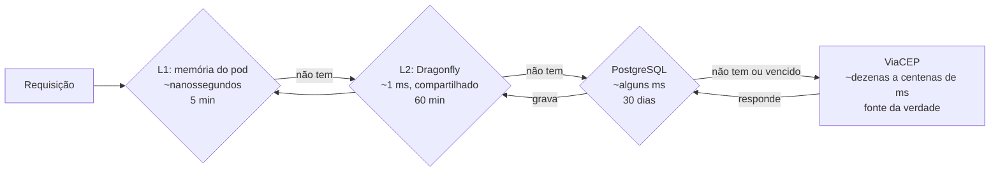

# 4.1 Por que três camadas de cache

## O problema que o cache resolve aqui

No teste de carga do nível 8, os CEPs mais consultados iam ao PostgreSQL **a cada requisição**. O banco do laboratório, um plano pequeno, virou gargalo antes da API. Escalar pods é barato; escalar o banco é caro. Uma consulta de CEP muda raramente, então a mesma resposta pode ser servida muitas vezes sem ir ao banco.

::: conceito Cache
Uma cópia de um dado, guardada mais perto de quem precisa, para responder mais rápido e poupar a origem. É sempre uma **cópia**: pode estar desatualizada, pode sumir, e o sistema precisa funcionar se ela sumir.
:::

## As três camadas e o que cada uma resolve

| Camada | Resolve | Validade | Por que essa validade |
|---|---|---|---|
| **L1**: memória do processo | Latência: sem rede nenhuma | 5 min | Cada pod tem a sua. Curta, para as réplicas não passarem muito tempo com versões diferentes do mesmo CEP |
| **L2**: Dragonfly | Duplicação: uma consulta ao banco serve todos os pods | 60 min (`Cep__MemoriaEmMinutos`) | Compartilhada e barata de esvaziar: o banco reabastece |
| **Banco**: tabela `cep.Enderecos` | Proteger a fonte externa e sobreviver à queda dela | 30 dias (`Cep__ValidadeEmDias`) | Endereço muda raramente; o ViaCEP é um serviço gratuito de terceiros |

::: porque Por que uma tabela no banco também é cache
A tabela `Enderecos` foi o **primeiro** cache do projeto (antes do Dragonfly existir): ela segura a fonte externa. E ela tem um papel que a memória não tem: guarda o dado mesmo vencido, para o caso de o ViaCEP cair. É daí que vem o `X-Cache: STALE`: "a fonte está fora, aqui vai o último endereço que eu conhecia".

A memória (L1 e L2) **nunca** recebe dado vencido. Se recebesse, o dado `STALE` ficaria 60 minutos no Dragonfly, e quando a fonte voltasse a API continuaria servindo o velho sem tentar atualizar.
:::

::: previsao
Um CEP muda (uma rua foi renomeada) e o ViaCEP já tem o novo nome. Ele está no L1 de todos os pods, no Dragonfly e na tabela, consultado há 2 minutos. **Por quanto tempo, no pior caso**, algum parceiro ainda recebe o nome antigo?
???
**30 dias.** Siga as camadas:

- L1 vence em até 5 minutos, mas o dado vem de novo do L2.
- L2 vence em até 60 minutos, mas aí o handler vai ao banco.
- O banco considera o registro válido por 30 dias e **não** consulta a fonte enquanto ele for válido.

A validade que manda no "quão desatualizado pode estar" é a **mais longa da cadeia**, não a primeira. Para CEP, aceitável. Para um saldo, um estoque ou um preço, seria inaceitável, e o desenho teria de ser outro (validades curtas, invalidação ativa quando o dado muda, ou nenhum cache).
:::

## Cache-aside e as alternativas

O padrão do projeto é o mais comum:

| Padrão | Como funciona | Quando usar |
|---|---|---|
| **Cache-aside** (o do projeto) | A aplicação procura no cache; se não tem, busca na origem e grava no cache | Leitura muito maior que escrita, e a origem é lenta ou cara |
| Read-through | O próprio cache busca na origem quando não tem | Igual ao anterior, com uma biblioteca que faz isso por você |
| Write-through | Toda escrita vai ao cache e à origem juntas | O dado é escrito pela própria aplicação e precisa estar sempre fresco no cache |
| Write-behind | Escreve no cache e grava na origem depois | Muita escrita; aceita perder dados se o cache cair antes de gravar |

O CEP é escrito por um terceiro (os Correios, via ViaCEP) e lido milhões de vezes: cache-aside encaixa.

::: video Caching Strategies Made Easy (FullStack Blackboard, em inglês)
https://www.youtube.com/watch?v=XgYGXq4O_6s
Cache-aside, read-through e write-behind com diagramas, para comparar com o que o projeto faz.
:::

::: armadilha
"Vamos colocar um Redis" não é decisão de arquitetura; é ferramenta. A decisão é: **que dado, por quanto tempo pode ficar desatualizado, quem aceita isso e o que acontece quando o cache some**. Sem essas respostas escritas, o cache vira a causa de bugs que ninguém consegue reproduzir ("na minha máquina aparece o valor novo").
:::

## Perguntas para responder sem olhar

::: pergunta
O que cada camada de cache resolve na API de CEP?
???
L1 (memória do pod): latência, sem rede. L2 (Dragonfly): duplicação entre réplicas, uma consulta ao banco serve todos os pods. Banco: protege a fonte externa e guarda o dado mesmo vencido para quando a fonte cair.
:::

::: pergunta
Por que dado `STALE` não sobe para a memória?
???
Porque ficaria até 60 minutos no Dragonfly, e quando a fonte voltasse a API continuaria servindo o dado velho sem tentar atualizar. Só dado válido (do banco dentro da validade, ou da fonte) sobe.
:::

::: pergunta
Num cache em várias camadas, qual validade determina o quão desatualizado um dado pode estar?
???
A mais longa da cadeia (aqui, os 30 dias do banco), porque as camadas de cima se reabastecem da de baixo enquanto ela considerar o dado válido.
:::

**Próxima:** [4.2 HybridCache por dentro e a debandada](02-hybridcache-e-debandada.md).
