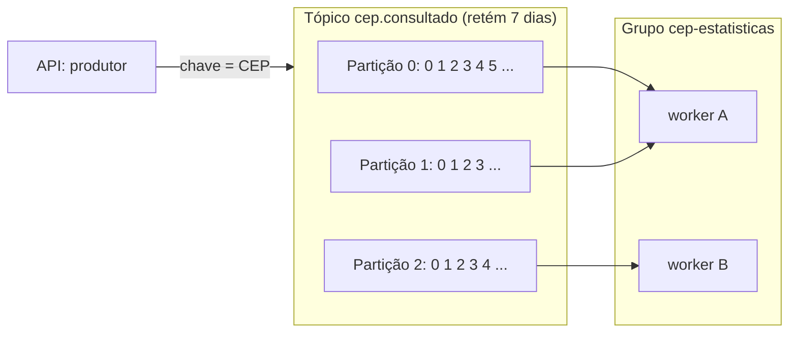

# 5.1 Kafka do zero: um log, não uma fila

Quem vem de RabbitMQ ou de filas em geral costuma tratar o Kafka como "uma fila mais rápida". Esse é o erro que gera os bugs mais confusos. O Kafka é um **log**.

::: conceito Log
Uma sequência de registros, **só de acréscimo**, em ordem. Novos registros entram no fim; os antigos não mudam e não somem quando alguém lê. Cada registro tem uma posição, o **offset**. Quem lê guarda até onde leu, e pode voltar e ler de novo.
:::

## As peças



| Peça | O que é | No projeto |
|---|---|---|
| **Tópico** | Um nome para um conjunto de eventos do mesmo tipo | `cep.consultado` |
| **Partição** | Um pedaço do tópico; cada uma é um log independente, com seus próprios offsets | 3 |
| **Offset** | A posição de um registro dentro da partição | Cada evento ganha o próximo número da sua partição |
| **Chave** | Decide em que partição a mensagem cai (mesma chave → mesma partição) | O CEP |
| **Grupo de consumidores** | Consumidores que dividem as partições entre si. Cada partição é lida por **um** membro do grupo | `cep-estatisticas` |
| **Offset confirmado** | Até onde o grupo já processou, guardado no próprio Kafka | O worker confirma depois de gravar no banco |
| **Retenção** | Quanto tempo os registros ficam, lidos ou não | 7 dias |

::: porque Por que a chave da mensagem é o CEP
O Kafka garante ordem **só dentro de uma partição**. Com a chave igual ao CEP, todas as consultas do mesmo CEP vão para a mesma partição e são lidas em ordem, pelo mesmo consumidor. Isso também evita que dois workers processem o mesmo CEP ao mesmo tempo (lição 3.4).

Se a chave fosse vazia, as mensagens seriam espalhadas entre as partições: mais equilíbrio de carga, nenhuma ordem por CEP.
:::

::: previsao
O grupo `cep-estatisticas` tem 3 partições para dividir. O KEDA sobe **5** réplicas do worker. Quantas réplicas trabalham? E se outro time criar um grupo novo, `faturamento`, lendo o mesmo tópico: ele recebe os eventos que o worker já processou?
???
**Três trabalham, duas ficam paradas.** Cada partição é atribuída a um único membro do grupo; com 5 membros e 3 partições, dois membros ficam sem partição. Por isso o `worker.keda.max` do chart é **3**: mais réplicas não aumentam o paralelismo, só o custo. Para ir além, é preciso aumentar as partições.

**Sim, o grupo novo recebe tudo** que ainda estiver retido (até 7 dias), desde o começo se ele começar com `earliest`. Cada grupo tem seus próprios offsets. Ler não apaga nada. É o que permite um novo consumidor nascer meses depois e reprocessar a última semana, e é a diferença central para uma fila.
:::

## Kafka ou fila (RabbitMQ, Service Bus)?

| | Kafka | Fila tradicional |
|---|---|---|
| O que acontece ao ler | Nada: o registro fica até a retenção vencer | A mensagem sai da fila quando é confirmada |
| Vários consumidores independentes | Natural: cada grupo lê tudo | Precisa de uma fila por consumidor (exchange/tópico) |
| Reprocessar o passado | Sim, voltando o offset | Não: a mensagem já foi embora |
| Ordem | Por partição | Por fila, e se perde com vários consumidores em paralelo |
| Paralelismo | Limitado ao número de partições | Quantos consumidores você quiser |
| Mensagem individual com erro | Bloqueia a partição se você não tratar | Volta para a fila ou vai para uma fila de mortas, sem bloquear as outras |
| Bom para | Fatos que vários sistemas querem saber; volume alto; reprocessamento | Tarefas a executar uma vez, cada uma independente (enviar e-mail, gerar PDF) |

::: porque Por que Kafka aqui
`CepConsultado` é um **fato** ("uma consulta aconteceu"), e o nível 15 já prevê vários interessados: estatística, auditoria, faturamento por parceiro. Cada um lê no próprio ritmo, e um novo pode nascer depois e ler a última semana. Com uma fila, cada interessado precisaria de uma fila própria, e um interessado novo não teria o passado.

Se o problema fosse "processar este PDF uma vez", uma fila seria mais simples.
:::

::: armadilha
"Evento" e "comando" não são a mesma coisa. **Evento** é um fato no passado, que o produtor publica sem saber quem lê (`CepConsultado`, `CotaEsgotada`). **Comando** é um pedido para alguém fazer algo (`EnviarEmailDeCota`). Publicar comandos no Kafka como se fossem eventos acopla o produtor a um consumidor específico, e o produtor passa a esperar um resultado que o log não devolve.
:::

## O Kafka 4 não tem ZooKeeper

Versões antigas precisavam de um cluster ZooKeeper ao lado, para guardar os metadados. Desde o Kafka 4, o modo **KRaft** é o único: os próprios nós do Kafka guardam os metadados com um protocolo de consenso. Menos uma peça para operar. Tutoriais com `zookeeper` no `docker-compose` estão desatualizados.

## Lab: ver as partições com os próprios olhos

::: checkpoint
Com o `docker compose up`, faça algumas consultas e leia o tópico mostrando a partição e o offset de cada mensagem:

```bash
for cep in 01001000 20040020 01310100 01001000 01001000; do curl -s localhost:8080/v1/cep/$cep > /dev/null; done

docker compose exec kafka /opt/kafka/bin/kafka-console-consumer.sh \
  --bootstrap-server localhost:9092 --topic cep.consultado --from-beginning \
  --property print.key=true --property print.partition=true --property print.offset=true \
  --timeout-ms 5000
```

Confira: as três mensagens com chave `01001000` estão **na mesma partição**, com offsets crescentes? E os outros CEPs?

Depois, veja o grupo do worker:

```bash
docker compose exec kafka /opt/kafka/bin/kafka-consumer-groups.sh \
  --bootstrap-server localhost:9092 --describe --group cep-estatisticas
```

As colunas `CURRENT-OFFSET` (onde o grupo está), `LOG-END-OFFSET` (o fim da partição) e `LAG` (a diferença) são a base de tudo o que o KEDA faz na lição 5.4.
:::

## Vídeos

::: video Kafka in 100 Seconds (Fireship, em inglês)
https://www.youtube.com/watch?v=uvb00oaa3k8
Se você não viu no módulo 0, comece por aqui.
:::

::: video How do Kafka Consumer Groups and Consumer Offsets work in Apache Kafka? (Conduktor, em inglês)
https://www.youtube.com/watch?v=9o5LAbPNc28
Grupos e offsets com animações. É a parte que mais confunde quem vem de filas.
:::

Para aprofundar, a trilha [Kafka e Event Hubs com .NET](trilha:kafka-e-event-hubs-com-net) aqui no learnFlow, e a certificação [Confluent Kafka Developer e Administrator](trilha:cert-confluent-kafka-developer-e-administrator).

## Perguntas para responder sem olhar

::: pergunta
O Kafka garante a ordem das mensagens de um tópico?
???
Só dentro de cada partição. Para ter ordem por entidade (por CEP, por pedido), a chave da mensagem deve ser o identificador dela, para todas as mensagens daquela entidade caírem na mesma partição.
:::

::: pergunta
Por que mais réplicas do consumidor que partições não ajuda?
???
Porque, dentro de um grupo, cada partição é lida por um único consumidor. Os excedentes ficam sem partição. Para mais paralelismo, é preciso mais partições.
:::

::: pergunta
Qual a diferença fundamental entre Kafka e uma fila como o RabbitMQ?
???
No Kafka, ler não remove: os registros ficam até a retenção vencer, cada grupo de consumidores tem seus próprios offsets e pode reprocessar o passado. Numa fila, a mensagem sai quando é confirmada. Kafka encaixa em fatos que vários sistemas querem saber; fila, em tarefas a executar uma vez.
:::

**Próxima:** [5.2 O produtor](02-produtor.md).
