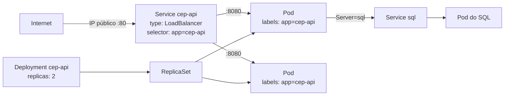

# 6.2 Do contêiner ao pod: os objetos do Kubernetes

O Kubernetes é **declarativo**: você não manda "suba 2 contêineres". Você declara "quero 2 réplicas desta imagem", e os controladores do cluster trabalham o tempo todo para que o estado real fique igual ao declarado. Se um pod morre, alguém percebe a diferença e cria outro. Todo o resto deriva dessa ideia.

::: video What is Kubernetes | Kubernetes explained in 15 mins (TechWorld with Nana, em inglês)
https://www.youtube.com/watch?v=VnvRFRk_51k
Se não viu no módulo 0, veja agora: os objetos desta lição, com diagramas.
:::

## O caminho de uma requisição

O [nível 1 do aks-step-by-step](https://github.com/JandersonSR/aks-step-by-step/blob/main/niveis/01-aks-minimo.md) sobe a API com um único arquivo (veja com `git show $(git log --format=%h --grep='^nivel-01' | tail -1):k8s/k8s.yaml`). O caminho:



| Objeto | O que é | Quem cuida dele | Pratique no kub-learn-flow |
|---|---|---|---|
| **Pod** | Um ou mais contêineres que rodam juntos, com o mesmo IP. A menor unidade que o Kubernetes agenda | O kubelet do nó | [Módulo 01](https://github.com/JandersonSR/kub-learn-flow/blob/main/Modulos/01-Setup-e-Primeiro-Deploy/Content.md) |
| **Deployment** | "Quero N réplicas desta especificação de pod", com atualização gradual e volta | O controlador de Deployments, via ReplicaSet | [Módulo 03](https://github.com/JandersonSR/kub-learn-flow/blob/main/Modulos/03-Deployments-Scale-Rollout-Rollback/Content.md) |
| **ReplicaSet** | Mantém exatamente N pods de uma versão. O Deployment cria um por versão | O controlador de ReplicaSets | Módulo 03 |
| **Service** | Um nome e um IP estáveis na frente de pods que vêm e vão, escolhidos por **rótulos** | kube-proxy e o DNS do cluster | [Módulo 04](https://github.com/JandersonSR/kub-learn-flow/blob/main/Modulos/04-Services-ClusterIP-NodePort/Content.md) |
| **Namespace** | Uma divisão lógica do cluster: nomes, permissões e cotas por namespace | — | [Módulo 02](https://github.com/JandersonSR/kub-learn-flow/blob/main/Modulos/02-YAML-Namespaces-e-Labels/Content.md) |
| **ConfigMap / Secret** | Configuração e segredos fora da imagem, entregues como variável de ambiente ou arquivo | — | [Módulo 06](https://github.com/JandersonSR/kub-learn-flow/blob/main/Modulos/06-ConfigMaps-e-Secrets/Content.md) |
| **Job** | Um pod que roda até terminar com sucesso (a migração do nível 1) | O controlador de Jobs | — |
| **Ingress** | Regras HTTP (host, caminho, TLS) na frente de vários Services | Um controlador de Ingress (NGINX) | [Módulo 05](https://github.com/JandersonSR/kub-learn-flow/blob/main/Modulos/05-Ingress/Content.md) |

## Rótulos: a cola de tudo

O Service não aponta para pods por nome. Ele procura pods **com certos rótulos**. O Deployment também acha "os seus" pods por rótulo.

```yaml
# Service                         # Template do pod no Deployment
spec:                             template:
  selector: { app: cep-api }        metadata:
                                      labels: { app: cep-api }
```

::: previsao
Alguém digita errado o seletor do Service: `selector: { app: cep-apí }` (com acento). O `kubectl apply` aceita? Os pods sobem? O que acontece quando você chama o IP público?
???
O `kubectl apply` **aceita**: é um YAML válido. Os pods sobem normalmente e ficam `Running 1/1`. Mas o Service não encontra **nenhum** pod com o rótulo `app=cep-apí`, então a lista de destinos dele (os *endpoints*) fica vazia, e a chamada ao IP público falha (conexão recusada ou tempo esgotado, dependendo do balanceador).

O diagnóstico:

```bash
kubectl get endpoints cep-api          # vazio, ou "<none>"
kubectl get pods --show-labels         # app=cep-api, sem acento
kubectl describe svc cep-api           # Selector: app=cep-apí
```

"Service sem endpoints" é uma das causas mais comuns de "subiu tudo e não responde". O primeiro comando a rodar é o `get endpoints`.
:::

## Descoberta por DNS

Repare na connection string do nível 1: `Server=sql`. O DNS do cluster resolve o nome de um Service:

| Nome | Funciona de onde |
|---|---|
| `sql` | Do mesmo namespace |
| `sql.default` | De qualquer namespace (serviço `sql` no namespace `default`) |
| `sql.default.svc.cluster.local` | O nome completo, de qualquer lugar do cluster |

É por isso que o Dragonfly é `dragonfly.cache.svc.cluster.local` e o Kafka é `cep-kafka-kafka-bootstrap.kafka.svc.cluster.local`: estão em outros namespaces.

## Tipos de Service

| Tipo | Quem alcança | No projeto |
|---|---|---|
| `ClusterIP` (padrão) | Só de dentro do cluster | A API a partir do nível 5, atrás do Ingress; Dragonfly; Kafka |
| `NodePort` | Uma porta alta em cada nó | Usado no Minikube para testar |
| `LoadBalancer` | Um IP público criado pela nuvem | A API nos níveis 1 a 4 |

::: porque Por que o projeto trocou LoadBalancer por Ingress no nível 5
Um `LoadBalancer` cria **um IP público por Service**, sem TLS e sem regra por domínio ou caminho. Com várias APIs, seriam vários IPs, cada um com seu certificado para gerenciar. Um Ingress é **um** ponto de entrada para muitos Services, com TLS automático pelo cert-manager. O módulo 8 trata disso.
:::

## Secret não é cofre

::: armadilha
Um Secret do Kubernetes guarda os valores em **base64**, que é codificação, não criptografia: `echo <valor> | base64 -d` mostra a senha. Quem tem permissão de ler Secrets no namespace lê as senhas. É por isso que o projeto leva a connection string para o Key Vault no nível 6, montada no pod pelo driver CSI, e por isso nenhum Secret vai para o Git.
:::

## Lab: o cluster se corrigindo sozinho

::: quebra
No Minikube:

```bash
kubectl create deployment web --image=nginx --replicas=3
kubectl get pods -l app=web -w            # deixe rodando num terminal
```

Em outro terminal, apague um dos pods (`kubectl delete pod <um dos pods web>`). Depois apague o **ReplicaSet** (`kubectl delete rs -l app=web`). O que aparece no primeiro terminal em cada caso? E se você apagar o Deployment?
:::

::: solucao
- **Apagar um pod:** em segundos aparece um pod novo, com outro nome. O ReplicaSet viu 2 onde declarou 3 e criou outro.
- **Apagar o ReplicaSet:** os 3 pods morrem, e um ReplicaSet novo aparece com 3 pods novos. O Deployment viu que não existia ReplicaSet para a sua especificação e criou outro.
- **Apagar o Deployment:** tudo some e nada volta. Ele era o topo da cadeia; nada mais declara que esses pods devem existir.

É o "estado declarado contra estado real" em ação. Lembre disso quando alguém disser "apaguei o pod e ele voltou": voltou porque algo acima declara que ele deve existir.

Limpeza: `kubectl delete deployment web`.
:::

## Perguntas para responder sem olhar

::: pergunta
Como um Service sabe para quais pods mandar tráfego?
???
Pelo seletor de rótulos: ele manda para os pods prontos que têm os rótulos do seletor. Se nenhum pod tiver os rótulos, a lista de endpoints fica vazia e o Service não responde.
:::

::: pergunta
Qual a relação entre Deployment, ReplicaSet e Pod?
???
O Deployment declara a especificação e o número de réplicas e cria um ReplicaSet por versão; o ReplicaSet mantém exatamente N pods daquela versão. Numa atualização, o Deployment cria um ReplicaSet novo e reduz o antigo aos poucos.
:::

::: pergunta
Um Secret do Kubernetes é seguro para guardar senhas?
???
Só parcialmente: os valores ficam em base64, não criptografados para quem lê o objeto. Quem pode ler Secrets no namespace lê as senhas. Para segredos sensíveis, um cofre (Key Vault) montado no pod, controle de acesso restrito e criptografia em repouso no cluster.
:::

**Próxima:** [6.3 Sondas, recursos e encerramento](03-sondas-e-encerramento.md).
