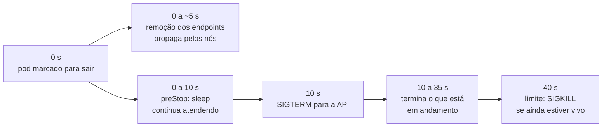

# 6.3 Sondas, recursos e um encerramento sem perder requisições

Um pod `Running` não quer dizer que a aplicação está bem. O processo pode estar de pé e travado, ou de pé e ainda carregando, ou de pé e sem conseguir falar com o banco. As **sondas** são como o Kubernetes pergunta à aplicação como ela está, e cada uma tem uma consequência diferente.

## As três sondas

Do [`deployment.yaml`](https://github.com/JandersonSR/aks-step-by-step/blob/main/charts/cep-api/templates/deployment.yaml):

```yaml
startupProbe:
  httpGet: { path: /healthz/live, port: http }
  periodSeconds: 2
  failureThreshold: 30        # até 60 s para subir
readinessProbe:
  httpGet: { path: /healthz/ready, port: http }
  periodSeconds: 5
  failureThreshold: 3
livenessProbe:
  httpGet: { path: /healthz/live, port: http }
  periodSeconds: 10
  failureThreshold: 3
```

| Sonda | Pergunta | Se falhar | No projeto, olha |
|---|---|---|---|
| **Startup** | "Já terminou de subir?" | Continua esperando até o limite; depois disso, reinicia o contêiner. Enquanto ela não passa, as outras não rodam | `/healthz/live` |
| **Readiness** | "Pode receber tráfego agora?" | **Tira o pod do Service** (sai dos endpoints). Não reinicia | `/healthz/ready`: o processo **e o banco** |
| **Liveness** | "Está vivo ou travado?" | **Reinicia o contêiner** | `/healthz/live`: só o processo |

::: porque Por que o banco está na readiness e não na liveness
Se o banco cair, a API não consegue responder consultas novas. Tirar o pod do tráfego (readiness) é certo: o Service manda para outros pods, se algum estiver bem. Reiniciar o pod (liveness) não traz o banco de volta, e com todos os pods reiniciando juntos, a recuperação fica mais lenta e mais barulhenta.

A regra: **liveness só olha o que um reinício resolve.** Dependências externas nunca entram na liveness. Os checks com a tag `Pronto` e `Vivo` no código ([`SondasExtensions.cs`](https://github.com/JandersonSR/aks-step-by-step/blob/main/src/Agx.SharedKernel.Web/Http/SondasExtensions.cs) e o `AddDbContextCheck` no `CepModulo`) implementam essa separação.
:::

::: porque Por que existe a startup probe
Sem ela, a liveness começaria a contar desde o primeiro segundo. Um pod que demora 40 s para subir (num nó novo, puxando a imagem, com ReadyToRun ainda aquecendo) seria morto pela liveness antes de terminar, e entraria em laço de reinício. A startup dá até 60 s (30 tentativas a cada 2 s) só para subir, e depois entrega o controle para a liveness, que pode ser mais exigente.
:::

::: previsao
Alguém coloca o check do banco também na **liveness**. Numa terça-feira, o PostgreSQL gerenciado faz uma manutenção de 2 minutos. O que acontece com os 4 pods da API? E quando o banco volta?
???
Depois de 3 falhas (30 s), **os 4 pods são reiniciados**. Durante os reinícios, nenhum pod está pronto, e as respostas viram erro **mesmo para quem poderia ser atendido pelo cache em memória**. Se a manutenção passar de alguns ciclos, os pods entram em `CrashLoopBackOff`, com esperas cada vez maiores entre tentativas.

Quando o banco volta, os pods ainda estão esperando o próximo ciclo de reinício, e voltam aos poucos, todos de memória fria (o L1 se perdeu), indo juntos ao banco que acabou de voltar.

Com o desenho do projeto, os pods só saem do tráfego por 2 minutos e voltam sozinhos assim que a readiness passa, com o cache em memória intacto.
:::

## Recursos: requests e limits

```yaml
resources:
  requests: { cpu: 100m, memory: 128Mi }
  limits: { cpu: 500m, memory: 256Mi }
```

| | Request | Limit |
|---|---|---|
| O que é | O que o pod tem **reservado** | O máximo que ele pode usar |
| Usado por | O agendador, para escolher um nó com espaço; o HPA, como base da porcentagem de CPU | O kernel, na hora de executar |
| CPU acima do limite | — | O contêiner é **estrangulado** (*throttling*): fica mais lento, não morre |
| Memória acima do limite | — | O contêiner é **morto** (`OOMKilled`) e reiniciado |

::: armadilha
O `cpu: 70` do HPA é **70% do request** de CPU (100m), não do limite nem do nó. Sem request de CPU, o HPA não tem base de cálculo e não funciona. E um request de memória muito menor que o uso real faz o agendador colocar pods demais num nó, que depois ficam sem memória de verdade.
:::

## Encerrar sem perder requisições

Quando um pod vai embora (deploy novo, HPA reduzindo, nó sendo drenado), duas coisas começam **ao mesmo tempo e sem coordenação**: o pod é retirado da lista de destinos do Service, e o processo recebe o aviso para encerrar. A remoção da lista leva alguns segundos para chegar a todos os nós. Se o processo parar antes disso, requisições ainda chegam a um pod que não atende.

O projeto resolve com três números que se encaixam:



| Número | Onde | Para quê |
|---|---|---|
| `preStop: { sleep: { seconds: 10 } }` | `deployment.yaml` | Esperar a remoção dos endpoints chegar a todos os nós, ainda atendendo |
| `ShutdownTimeout = 25 s` | [`Program.cs`](https://github.com/JandersonSR/aks-step-by-step/blob/main/src/Agx.Cep.Api/Program.cs) | Depois do sinal, terminar as requisições em andamento |
| `terminationGracePeriodSeconds: 40` | `deployment.yaml` | O teto: 10 + 25 = 35, com 5 s de folga. Passou disso, o processo é morto sem aviso |

::: previsao
Alguém "simplifica" o chart e remove o `preStop`. Num deploy com tráfego constante, o que o parceiro vê?
???
Uma rajada curta de erros (**502 ou 503**, ou conexões recusadas) a cada pod que sai. O processo recebe o SIGTERM no mesmo instante em que começa a ser removido do Service; o ASP.NET para de aceitar conexões novas, mas por alguns segundos os outros nós ainda mandam tráfego para ele.

Num deploy com rolling update, isso acontece uma vez por pod velho. Em testes de carga, aparece como uma pequena fração de erros a cada deploy, que "ninguém consegue explicar". O nível 8 do aks-step-by-step mede isso com o k6.
:::

::: armadilha
Os três números precisam ser mudados juntos. Aumentar o `ShutdownTimeout` para 60 s sem aumentar o `terminationGracePeriodSeconds` faz o Kubernetes matar o processo aos 40 s, no meio das requisições que você queria proteger. Num ADR, escreva a conta.
:::

## Perguntas para responder sem olhar

::: pergunta
Qual a diferença de consequência entre readiness e liveness?
???
Readiness falhando tira o pod do tráfego do Service, sem reiniciar. Liveness falhando reinicia o contêiner. Por isso dependências externas entram na readiness e nunca na liveness.
:::

::: pergunta
O que acontece quando um contêiner passa do limite de CPU? E do de memória?
???
CPU: é estrangulado, fica mais lento, mas continua rodando. Memória: é morto pelo kernel (`OOMKilled`) e reiniciado.
:::

::: pergunta
Por que o pod da API tem um `preStop` de 10 segundos?
???
Porque a remoção do pod dos endpoints do Service e o sinal de encerramento acontecem ao mesmo tempo, e a remoção leva alguns segundos para propagar. O `preStop` mantém o pod atendendo durante esse tempo; só depois a aplicação recebe o SIGTERM e termina as requisições em andamento.
:::

**Próxima:** [6.4 Diagnóstico](04-diagnostico.md).
