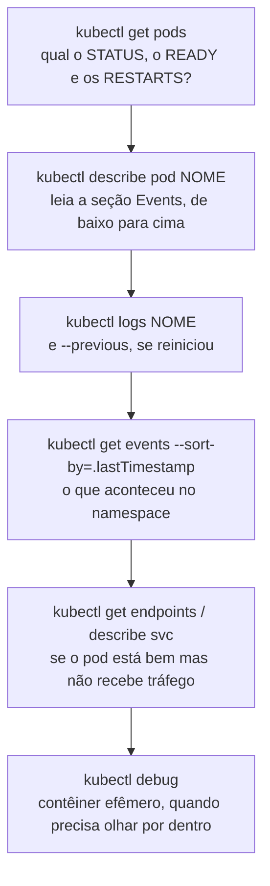

# 6.4 Diagnóstico: do sintoma à causa

Quem sabe Kubernetes de verdade não decora soluções. Segue sempre o mesmo caminho, do geral para o específico, até a causa aparecer. Esta lição ensina esse caminho e treina com os cinco estados de erro que você vai ver na vida real.

## A escada do diagnóstico



| Comando | Responde |
|---|---|
| `kubectl get pods -o wide` | Estado, prontidão, reinícios, em que nó está |
| `kubectl describe pod <pod>` | **Events**: agendamento, download da imagem, sondas falhando, OOM. É onde está a resposta na maioria dos casos |
| `kubectl logs <pod>` | O que a aplicação escreveu. Com `--previous`, o log do contêiner **anterior**, que já morreu: essencial em `CrashLoopBackOff` |
| `kubectl get events -n <ns> --sort-by=.lastTimestamp` | A linha do tempo do namespace inteiro |
| `kubectl get endpoints <svc>` | Se o Service está achando pods prontos |
| `kubectl top pod` | Uso real de CPU e memória (precisa do metrics-server) |
| `kubectl debug -it <pod> --image=busybox --target=<contêiner>` | Um contêiner com ferramentas, compartilhando o processo do pod, para quando a imagem não tem shell |

## Os cinco estados que você vai ver

| Estado | Significa | Onde olhar | Causas comuns |
|---|---|---|---|
| `Pending` | Nenhum nó aceitou o pod | `describe` → Events: `FailedScheduling` | Requests maiores que o espaço livre; volume que não monta; afinidade impossível |
| `ImagePullBackOff` / `ErrImagePull` | O nó não conseguiu baixar a imagem | `describe` → Events: o nome exato da imagem e o erro | Nome ou tag errados; sem permissão no registry; registry recusando (Harbor com bloqueio, módulo 10) |
| `CrashLoopBackOff` | O contêiner sobe e morre, e o Kubernetes espera cada vez mais entre tentativas | `logs --previous` | Exceção na subida (configuração faltando, `ValidateOnStart` reprovando, sem acesso ao Key Vault); liveness errada |
| `OOMKilled` (em `Last State`) | Passou do limite de memória e foi morto | `describe` → `Last State: Terminated, Reason: OOMKilled` | Limite baixo demais; vazamento de memória |
| `Running` com `0/1` | O processo está de pé, mas a readiness falha | `describe` → Events: `Readiness probe failed` | Dependência fora (o banco, no caso da API); caminho ou porta da sonda errados |

## Labs: provocar cada estado

Os labs usam imagens públicas pequenas, para isolar o Kubernetes da aplicação. No Minikube, num namespace próprio:

```bash
kubectl create namespace lab
kubectl config set-context --current --namespace=lab
```

::: quebra Lab 1: Pending
```bash
kubectl run guloso --image=nginx --overrides='{"spec":{"containers":[{"name":"guloso","image":"nginx","resources":{"requests":{"cpu":"50"}}}]}}'
kubectl get pods
```

Por que o pod não sai de `Pending`? Ache a causa sem olhar a dica.
:::

::: dica Dica
`kubectl describe pod guloso`, seção Events. Compare o request com `kubectl describe node | grep -A5 Allocatable`.
:::

::: solucao
Events mostra algo como `0/1 nodes are available: 1 Insufficient cpu`. O pod pediu **50 CPUs** de request; nenhum nó tem isso livre, e o agendador não o coloca em lugar nenhum. Não é erro da aplicação: ela nem começou.

Na vida real, a causa costuma ser mais sutil: o HPA criou pods até encher os nós, e os novos ficam `Pending` até o cluster autoscaler criar um nó (minutos). O nível 8 do aks-step-by-step trata disso.
:::

::: quebra Lab 2: ImagePullBackOff
```bash
kubectl run fantasma --image=nginx:essa-tag-nao-existe
kubectl get pods -w        # Ctrl+C depois de ver o estado mudar
```

Qual a mensagem exata do erro, e em que lugar ela aparece?
:::

::: solucao
`ErrImagePull` e depois `ImagePullBackOff`. No `describe pod fantasma`, os Events mostram a imagem exata que o nó tentou baixar e o erro do registry (`not found` ou `manifest unknown`). Com registry privado, o erro seria de autorização (`unauthorized` ou `pull access denied`), e a causa estaria na permissão do cluster no registry, não no nome.
:::

::: quebra Lab 3: CrashLoopBackOff
```bash
kubectl run quebrado --image=busybox -- sh -c 'echo "falta a variável ConnectionStrings__Cep"; exit 1'
kubectl get pods -w
kubectl logs quebrado
kubectl logs quebrado --previous
```

Repare na coluna `RESTARTS` e no tempo entre as tentativas. O que o `logs` mostra, com e sem `--previous`?
:::

::: solucao
O contêiner sai com código 1, o Kubernetes reinicia, ele sai de novo. O estado alterna entre `Error` e `CrashLoopBackOff`, com esperas que crescem (10 s, 20 s, 40 s... até 5 minutos). O `logs` mostra a mensagem do contêiner atual ou do último; o `--previous` garante que você leia o que o contêiner **anterior** escreveu antes de morrer, que é onde está a causa.

Na API, o caso clássico é a configuração: o `ValidateOnStart` das opções (`CepOptions`, `LimiteDeRequisicoesOptions`) reprova uma configuração inválida **na subida**, e o log diz exatamente qual campo. É melhor falhar na subida, com mensagem clara, do que subir e falhar na primeira requisição.
:::

::: quebra Lab 4: OOMKilled
```bash
kubectl run memoria --image=polinux/stress \
  --overrides='{"spec":{"containers":[{"name":"memoria","image":"polinux/stress","resources":{"limits":{"memory":"100Mi"}},"command":["stress"],"args":["--vm","1","--vm-bytes","250M","--vm-hang","1"]}]}}'
kubectl get pods -w
kubectl describe pod memoria | grep -A5 "Last State"
```
:::

::: solucao
O contêiner tenta alocar 250 MB com limite de 100 MiB. O kernel o mata, e o `describe` mostra `Last State: Terminated`, `Reason: OOMKilled`, `Exit Code: 137`. Repetindo, vira `CrashLoopBackOff`.

Repare que o **log da aplicação não mostra nada**: o processo foi morto de fora, sem chance de escrever. Por isso, em `CrashLoopBackOff` sem log de erro, o segundo lugar a olhar é o `Last State` do `describe`.
:::

::: quebra Lab 5: rodando, mas fora do ar
```bash
kubectl create deployment web --image=nginx
kubectl patch deployment web --type=json -p='[{"op":"add","path":"/spec/template/spec/containers/0/readinessProbe","value":{"httpGet":{"path":"/pronto","port":80},"periodSeconds":5}}]'
kubectl expose deployment web --port=80
kubectl get pods
kubectl get endpoints web
```

O pod está `Running`. O Service responde? Por quê?
:::

::: solucao
O pod fica `Running` com **`0/1`**: o nginx responde 404 para `/pronto`, a readiness falha, e o pod nunca entra nos endpoints. O `get endpoints web` vem vazio, e qualquer chamada ao Service falha, mesmo com o nginx perfeitamente de pé.

No `describe pod`, os Events mostram `Readiness probe failed: HTTP probe failed with statuscode: 404`. Na API real, a mesma cena aparece quando o banco está fora: a readiness inclui o banco, de propósito.
:::

## Olhar por dentro de um pod sem shell

Com a imagem chiseled da API, `kubectl exec ... sh` não funciona (lição 6.1). Para olhar por dentro:

```bash
kubectl debug -it <pod-da-api> --image=busybox --target=api
# dentro do contêiner efêmero:
ps                                  # vê o processo dotnet (compartilha o espaço de processos)
wget -qO- localhost:8080/healthz/ready
```

O contêiner efêmero entra no pod com as ferramentas que você escolher, enxerga os processos e a rede do contêiner alvo, e some quando você sai. A imagem de produção continua sem shell.

Limpeza dos labs: `kubectl delete namespace lab` e `kubectl config set-context --current --namespace=default`.

## Perguntas para responder sem olhar

::: pergunta
Um pod está em `CrashLoopBackOff`. Quais são os dois primeiros lugares que você olha?
???
`kubectl logs <pod> --previous`, para ler o que o contêiner anterior escreveu antes de morrer; e `kubectl describe pod`, em `Last State` (para ver `OOMKilled` ou o código de saída) e nos Events (sondas falhando, por exemplo).
:::

::: pergunta
O pod está `Running 1/1`, mas o Service não responde. Por onde você começa?
???
`kubectl get endpoints <svc>`: se estiver vazio, o seletor do Service não bate com os rótulos dos pods, ou os pods não estão prontos. Depois `kubectl describe svc` para conferir seletor e portas (`targetPort` errado é outra causa comum).
:::

::: pergunta
Como investigar dentro de um pod cuja imagem não tem shell?
???
Com `kubectl debug -it <pod> --image=busybox --target=<contêiner>`, que adiciona um contêiner efêmero com ferramentas, compartilhando processos e rede com o contêiner alvo, sem mudar a imagem de produção.
:::

**Próxima:** [Perguntas de entrevista do módulo](perguntas-de-entrevista.md).
