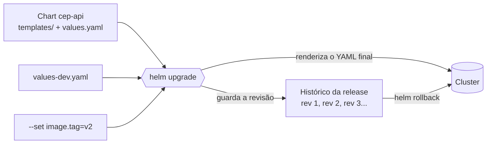

# 7.1 O problema: por que não só YAML

Nos níveis 1 e 2 do [aks-step-by-step](https://github.com/JandersonSR/aks-step-by-step/blob/main/niveis/01-aks-minimo.md), a API sobe com um arquivo `k8s/k8s.yaml` e este comando:

```bash
sed "s/SEU_ACR/$ACR/g" k8s/k8s.yaml | kubectl apply -f -
```

Funciona. Agora imagine três ambientes (dev, homologação, produção), cada um com réplicas, limites de memória, domínio e configuração diferentes, e uma migração de banco que precisa rodar **antes** da API nova subir. Liste mentalmente o que dói:

1. **Valores por ambiente.** Três cópias do YAML que divergem com o tempo, ou um `sed` cada vez maior.
2. **"Qual versão está rodando?"** O `kubectl apply` não guarda histórico. Para voltar, você precisa saber qual arquivo foi aplicado da última vez.
3. **Ordem.** A migração é um Job. Job é imutável: para rodar de novo, apague à mão (`kubectl delete job`, como no [nível 2](https://github.com/JandersonSR/aks-step-by-step/blob/main/niveis/02-azure-sql.md)). E nada garante que ela termine antes da API subir.
4. **Remover.** Apagar tudo que foi instalado exige lembrar cada recurso.

::: conceito Helm
Um **gerenciador de pacotes** para Kubernetes. Três ideias:

- **Chart:** uma pasta com templates de YAML e um arquivo de valores padrão. É o pacote, com versão.
- **Values:** os valores que preenchem os templates. Cada ambiente passa os seus.
- **Release:** uma instalação de um chart num namespace, com nome. O Helm guarda o histórico de cada release: cada `upgrade` vira uma revisão numerada, e dá para voltar a qualquer uma.
:::



::: analogia
O chart é a **ficha técnica** de um produto com variações: o mesmo desenho, com campos para comprimento, cor e acabamento. Os values são o **pedido** de cada cliente. A release é o **lote fabricado**, com número de série: se o lote 3 saiu com defeito, você sabe exatamente como o lote 2 foi feito e refaz igual.
:::

## Onde o Helm guarda o histórico

::: previsao
Você roda `helm upgrade --install cep-api charts/cep-api -n cep` três vezes, com tags diferentes. O Helm não tem servidor próprio no cluster (o Tiller do Helm 2 deixou de existir). Onde ficam guardadas as três revisões, para o `helm rollback` funcionar até de outro computador?
???
**Em Secrets do Kubernetes, no próprio namespace da release.** Rode:

```bash
kubectl get secrets -n cep -l owner=helm
```

Você vai ver algo como `sh.helm.release.v1.cep-api.v1`, `...v2`, `...v3`. Cada Secret tem o chart, os valores e o YAML renderizado daquela revisão, compactados.

Consequências práticas:

- Quem tem permissão de ler Secrets no namespace consegue ver os valores de todas as revisões. **Nunca passe senha por `--set`**: ela fica guardada no histórico. Por isso o chart lê a connection string do Key Vault ou de um Secret criado fora do Helm.
- Apagar esses Secrets apaga a memória do Helm sobre a release, não os recursos.
:::

## Helm, Kustomize ou YAML puro?

Helm não é a única resposta. A comparação honesta:

| | YAML puro | Kustomize | Helm |
|---|---|---|---|
| Como varia por ambiente | Cópias ou `sed` | Patches sobre uma base, sem template | Templates com valores |
| Histórico e rollback | Não | Não | Sim, por release |
| Ordem (hooks) | Não | Não | Sim (`pre-install`, `pre-upgrade`...) |
| Lógica (if, loops) | Não | Quase nenhuma, de propósito | Sim, com a linguagem de templates do Go |
| Distribuir para terceiros | Difícil | Razoável | Padrão de mercado (Bitnami, ingress-nginx, cert-manager...) |
| Embutido no `kubectl` | — | Sim (`kubectl apply -k`) | Não |
| Risco | Divergência entre cópias | Muitos patches ficam difíceis de seguir | Template com lógica demais vira programa difícil de ler |

::: porque Por que o projeto usa Helm
O chart `cep-api` precisa de **lógica condicional de verdade**: com Key Vault ou com Secret, com Ingress ou com LoadBalancer, com ou sem worker, com ou sem HPA. Em Kustomize, cada combinação vira uma camada de patches. E o projeto queria **rollback por release** antes de ter GitOps (o Argo CD só chega no nível 11).

Além disso, Harbor, cert-manager, Argo CD e Strimzi, que o projeto instala, são distribuídos como charts Helm. Saber Helm é obrigatório de qualquer forma.

A alternativa, Kustomize, seria a melhor escolha para um app com pouca variação entre ambientes e sem necessidade de distribuir o pacote.
:::

::: armadilha
Quando o Argo CD assume o deploy (nível 11), ele **renderiza** o chart (equivalente ao `helm template`) e aplica o YAML ele mesmo. A partir daí, `helm list` e `helm history` não mostram mais nada sobre essa aplicação: o histórico passa a ser o do Git e o do Argo CD. Muita gente se assusta com isso na primeira vez.
:::

## Vídeos

::: video What is Helm in Kubernetes? Helm and Helm Charts explained (TechWorld with Nana, em inglês)
https://www.youtube.com/watch?v=-zuxi1a0LIC
O que é um chart, como os templates funcionam e para que serve o histórico de releases. Atenção: o vídeo é da época do Helm 2 e fala do Tiller, que não existe mais.
:::

::: video Aprenda como Criar e Configurar Helm Charts Personalizados no Kubernetes (Prof. Gustavo Leitão, em português)
https://www.youtube.com/watch?v=NLz027OCkIU
Criando um chart do zero, em português, com os comandos básicos.
:::

## Perguntas para responder sem olhar

::: pergunta
Quais são as três ideias centrais do Helm, em uma frase cada?
???
Chart: o pacote versionado, com templates e valores padrão. Values: o que preenche os templates, diferente por ambiente. Release: uma instalação nomeada do chart num namespace, com histórico de revisões para voltar.
:::

::: pergunta
Por que não se deve passar senha por `--set`?
???
Porque os valores de cada revisão ficam guardados em Secrets da release no namespace (`sh.helm.release.v1.<nome>.vN`). Quem lê Secrets ali lê a senha, em todas as revisões. Segredo vem de fora do Helm: Key Vault com CSI, ou um Secret criado separadamente.
:::

::: pergunta
Em que situação você escolheria Kustomize em vez de Helm?
???
App com pouca variação entre ambientes, sem necessidade de lógica condicional, de hooks ou de distribuir o pacote para outros times. Kustomize é mais simples de ler, vem no `kubectl` e não esconde o YAML atrás de templates.
:::

**Próxima:** [7.2 Anatomia do chart](02-anatomia-do-chart.md).
