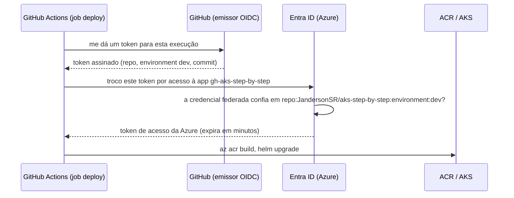
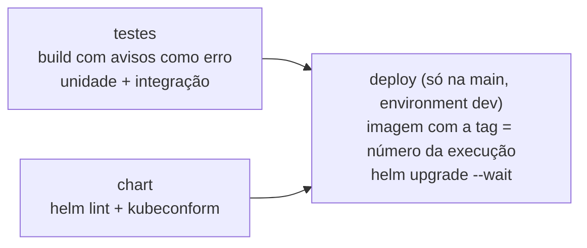

# 8.1 CI/CD sem nenhuma senha

O jeito antigo de um pipeline publicar na Azure: criar um *service principal*, gerar um segredo (uma senha), colar no GitHub como *secret*. Funciona, e tem três problemas: o segredo **expira** (e o pipeline quebra num dia aleatório), pode **vazar** (num log, num fork, num ex-funcionário que copiou), e ninguém sabe ao certo **onde mais** ele foi usado.

## A troca de tokens (OIDC e credencial federada)

::: conceito Federação de identidade
Em vez de o pipeline guardar uma senha da Azure, ele prova **quem é** com um token assinado pelo próprio GitHub, emitido na hora para aquela execução. A Azure foi configurada para **confiar** em tokens do GitHub com um conteúdo específico (este repositório, este environment) e devolve um token de acesso de curta duração. Nenhum segredo de longa duração existe.
:::



A configuração do [nível 4](https://github.com/JandersonSR/aks-step-by-step/blob/main/niveis/04-ci-cd.md):

```bash
az ad app federated-credential create --id $APP_ID --parameters "{
  \"name\": \"github-dev\",
  \"issuer\": \"https://token.actions.githubusercontent.com\",
  \"subject\": \"repo:$REPO:environment:dev\",
  \"audiences\": [\"api://AzureADTokenExchange\"]
}"
```

::: porque O `subject` é a regra de quem pode entrar
`repo:JandersonSR/aks-step-by-step:environment:dev` quer dizer: **só** jobs deste repositório, rodando no environment `dev`, conseguem trocar o token. Um fork, outro repositório, ou um job do mesmo repositório sem `environment: dev` recebem um token do GitHub com outro `subject`, e a Azure recusa.

Isso combina com uma proteção do GitHub: no environment `dev`, dá para exigir **aprovação** antes de cada deploy, e restringir quais branches podem usá-lo. A credencial federada e a regra do environment juntas fazem "só a `main`, com aprovação, publica".
:::

::: previsao
Um colega abre um PR e quer que o pipeline faça deploy de um ambiente temporário. Ele copia o job `deploy` para rodar em PRs, **sem** a linha `environment: dev`. O login na Azure funciona?
???
**Não.** O token do GitHub para esse job tem um `subject` como `repo:JandersonSR/aks-step-by-step:pull_request`, que não bate com a credencial federada. O `azure/login` falha com `AADSTS700213: No matching federated identity record found`.

É exatamente o comportamento desejado: código de um PR (que pode vir de qualquer pessoa) não pode ganhar acesso à Azure só porque alguém editou o YAML do pipeline. Se um ambiente por PR for necessário, ele ganha a **sua própria** credencial federada, com papéis restritos a um resource group descartável.
:::

## Permissões mínimas

O pipeline recebe só o necessário (passo 2 do nível 4):

| Papel | Escopo | Para quê |
|---|---|---|
| Contributor | Só o ACR | O `az acr build` agenda uma tarefa no registry |
| Azure Kubernetes Service Cluster User Role | Só o cluster | Baixar as credenciais para o `helm upgrade` |

::: armadilha
"Dá Contributor na assinatura que resolve" resolve hoje e cria o maior risco do ambiente: quem controla o pipeline (qualquer pessoa com permissão de editar o YAML na `main`) passa a poder apagar qualquer recurso da assinatura. O escopo do papel é tão importante quanto o papel.
:::

## Variáveis, não segredos

`AZURE_CLIENT_ID`, `AZURE_TENANT_ID` e `AZURE_SUBSCRIPTION_ID` ficam como **variáveis** do repositório, não como *secrets*. São identificadores: sem o token OIDC de uma execução autorizada, eles não dão acesso a nada. Tratá-los como segredo dá uma falsa sensação de que são eles que protegem o ambiente.

## A ordem dos jobs



::: porque A tag é o número da execução, não `latest`
Com `latest`, "o que está rodando?" não tem resposta: a mesma tag aponta para imagens diferentes ao longo do tempo, e o Kubernetes pode nem baixar a nova (a imagem `latest` já está no nó). Com a tag igual ao número da execução, cada deploy tem uma imagem imutável, o `/info` mostra qual é, e voltar uma versão é republicar uma tag conhecida.
:::

O nível 11 muda a última etapa: o pipeline deixa de ter acesso ao cluster e passa só a gravar a tag no Git, e o Argo CD puxa (módulo 11).

::: video Connect to Azure from a GitHub Action with OpenID Connect (OIDC) (em inglês)
https://www.youtube.com/watch?v=IKuw9T6vZYU
A configuração da credencial federada passo a passo, do lado do Entra ID e do GitHub.
:::

## Perguntas para responder sem olhar

::: pergunta
Por que usar credencial federada (OIDC) em vez de um segredo de service principal no pipeline?
???
Porque não existe segredo de longa duração para expirar, vazar ou ser reutilizado. O pipeline prova quem é com um token emitido pelo GitHub para aquela execução, e a Azure devolve um acesso de curta duração só se o token bater com a regra configurada.
:::

::: pergunta
O que o `subject` da credencial federada controla?
???
Quais execuções podem trocar o token: no projeto, só jobs deste repositório rodando no environment `dev`. Forks, outros repositórios e jobs sem o environment são recusados.
:::

::: pergunta
Por que a imagem é publicada com o número da execução e não com `latest`?
???
Para cada deploy ter uma imagem imutável e identificável: dá para saber exatamente o que roda em cada pod e voltar para uma versão conhecida. Com `latest`, a mesma tag aponta para imagens diferentes e o nó pode nem baixar a nova.
:::

**Próxima:** [8.2 A porta de entrada](02-ingress-e-tls.md).
