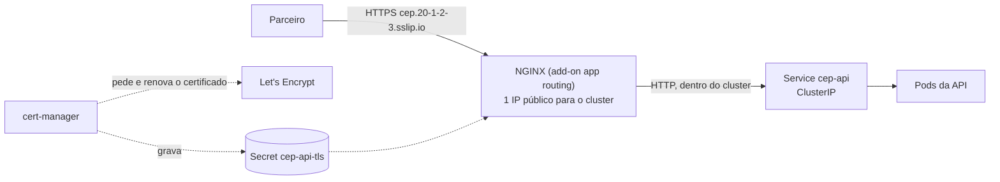

# 8.2 A porta de entrada: Ingress, TLS e o IP real do cliente

Até o nível 4, a API tem um IP público próprio (Service `LoadBalancer`), em HTTP puro. Um parceiro precisa de um **nome fixo** e de **TLS**. E com mais serviços no cluster, cada `LoadBalancer` seria mais um IP público pago e mais um certificado para cuidar.

## Um ponto de entrada para todo o cluster

::: conceito Ingress e controlador de Ingress
O **Ingress** é um objeto com regras HTTP: "requisições para o host `cep.exemplo.com` vão para o Service `cep-api`", com qual certificado TLS. Quem cumpre essas regras é um **controlador de Ingress**, um proxy (aqui, um NGINX) com um único IP público, que recebe todo o tráfego e encaminha para o Service certo.
:::



| Peça | Papel |
|---|---|
| Add-on **app routing** do AKS | Um NGINX gerenciado pela Azure, com o IP de entrada |
| **cert-manager** | Vê a anotação no Ingress, pede o certificado ao Let's Encrypt, prova que controla o domínio, grava o certificado num Secret e renova antes de vencer |
| `ClusterIssuer letsencrypt` | A configuração de "de quem pedir certificados" para o cluster inteiro |
| **sslip.io** | Um DNS público que resolve qualquer nome que contenha um IP (`cep.20-1-2-3.sslip.io` → `20.1.2.3`). Domínio sem comprar domínio, para laboratório |

O [`ingress.yaml`](https://github.com/JandersonSR/aks-step-by-step/blob/main/charts/cep-api/templates/ingress.yaml) liga tudo:

```yaml
metadata:
  annotations:
    cert-manager.io/cluster-issuer: letsencrypt
    nginx.ingress.kubernetes.io/ssl-redirect: "true"
spec:
  ingressClassName: webapprouting.kubernetes.azure.com
  tls:
    - hosts: ["cep.20-1-2-3.sslip.io"]
      secretName: cep-api-tls
```

::: porque Por que o TLS termina no NGINX
O certificado e a criptografia ficam num lugar só, para todos os serviços do cluster. A API dentro do cluster fala HTTP, sem precisar carregar certificado. Dentro do cluster, o tráfego até o pod não é criptografado: para a maioria dos casos, aceitável; para exigências fortes de conformidade, existem malhas de serviço (*service mesh*) com mTLS entre pods.
:::

::: video Kubernetes Ingress Tutorial for Beginners (TechWorld with Nana, em inglês)
https://www.youtube.com/watch?v=80Ew_fsV4rM
Ingress, controlador de Ingress e regras por host e caminho.
:::

## O IP real do cliente

Com o NGINX na frente, quem abre a conexão com a API **é o NGINX**, não o parceiro. O IP do parceiro chega só no cabeçalho `X-Forwarded-For`, e o protocolo original (HTTPS) no `X-Forwarded-Proto`.

::: previsao
O `values.yaml` tem `ASPNETCORE_FORWARDEDHEADERS_ENABLED: "true"`. Imagine que alguém remova essa linha. O rate limiting da API particiona por `RemoteIpAddress` (lição 2.3), com limite de 100 requisições por segundo. Num dia normal, com 30 parceiros fazendo 10 requisições por segundo cada, o que acontece?
???
Sem os cabeçalhos encaminhados, o `RemoteIpAddress` de **toda** requisição é o IP do NGINX. Para o rate limiting, existe **um cliente só**, fazendo 300 requisições por segundo, e 200 delas por segundo recebem **429**, de todos os parceiros, sem nenhum ter passado do próprio limite.

Pior: o problema não aparece no teste local (sem NGINX) nem com pouco tráfego. E os logs mostram todas as requisições vindo do mesmo IP, o que esconde quem está de fato abusando.

A variável liga o middleware de cabeçalhos encaminhados do ASP.NET, que troca o `RemoteIpAddress` pelo valor do `X-Forwarded-For` e o esquema pelo `X-Forwarded-Proto`. Em ambientes com proxies que você não controla, configure também quais proxies são confiáveis, para um cliente não forjar o próprio IP mandando o cabeçalho.
:::

## Domínio próprio

O sslip.io serve para laboratório. Com domínio próprio, o caminho do gabarito é uma zona no Azure DNS delegada ao subdomínio, e o add-on cria os registros sozinho (seção "Domínio próprio" do [nível 5](https://github.com/JandersonSR/aks-step-by-step/blob/main/niveis/05-ingress-https.md)).

::: armadilha O limite do Let's Encrypt
O Let's Encrypt limita quantos certificados um mesmo domínio pode emitir por semana. Num laboratório que cria e destrói o ambiente várias vezes por dia, esse limite chega rápido, e o certificado para de sair sem um erro óbvio no Ingress. Para testar o fluxo, use o emissor de **staging** (certificado não confiável, sem limite apertado) e troque para o de produção quando estiver tudo certo. O diagnóstico está em `kubectl describe certificaterequest,order,challenge -n cep`.
:::

## Perguntas para responder sem olhar

::: pergunta
Por que trocar o Service `LoadBalancer` por Ingress?
???
Um `LoadBalancer` cria um IP público por serviço, sem TLS e sem regras por domínio. O Ingress dá um ponto de entrada único para o cluster inteiro, com regras por host e caminho e TLS automático pelo cert-manager.
:::

::: pergunta
O que o cert-manager faz?
???
Lê a anotação no Ingress, pede o certificado a um emissor (o Let's Encrypt), prova o controle do domínio, grava o certificado num Secret que o controlador de Ingress usa, e renova antes de vencer.
:::

::: pergunta
Por que a API precisa processar os cabeçalhos `X-Forwarded-*` quando está atrás do NGINX?
???
Porque quem conecta na API é o NGINX: sem processar os cabeçalhos, o IP de todos os clientes seria o do NGINX e o esquema seria HTTP. Isso quebra o rate limiting por IP (todos dividem o mesmo limite), os logs e a geração de URLs com HTTPS.
:::

**Próxima:** [8.3 Segredos fora do cluster](03-key-vault-e-identidade.md).
