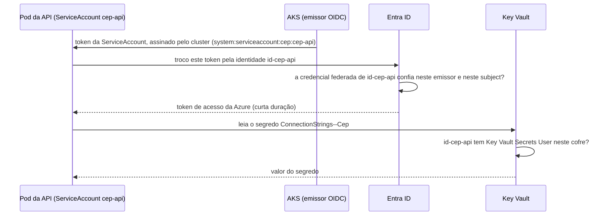

# 8.3 Segredos fora do cluster: Key Vault e Workload Identity

Até o nível 5, a connection string vive num Secret do Kubernetes. A lição 6.2 mostrou o problema: quem tem `kubectl get secret` no namespace lê a senha, não há registro de quem leu, e trocar a senha exige mexer no cluster. O nível 6 leva o segredo para o **Azure Key Vault**, e o mais interessante é **como o pod prova que pode ler**, sem nenhuma senha para acessar o cofre.

## O problema do "segredo para ler o segredo"

Para ler o cofre, o pod precisa se autenticar na Azure. Se fosse com uma senha, onde ficaria essa senha? Num Secret do Kubernetes, e voltamos ao começo. A resposta é a mesma da lição 8.1: **federação de identidade**, agora entre o cluster e a Azure.

## A cadeia de confiança

Quem faz a troca e a leitura não é a API: é o **driver CSI** do Secrets Store, que monta o segredo como arquivo.

| Peça | Onde | Papel |
|---|---|---|
| ServiceAccount `cep-api` | [`serviceaccount.yaml`](https://github.com/JandersonSR/aks-step-by-step/blob/main/charts/cep-api/templates/serviceaccount.yaml) | A identidade do pod **no cluster**, anotada com o `client-id` da identidade da Azure que ela representa |
| Rótulo `azure.workload.identity/use: "true"` | `deployment.yaml` | Faz o webhook injetar no pod o token e as variáveis que a troca precisa |
| Identidade gerenciada `id-cep-api` | Azure | A identidade **na Azure**, com só o papel `Key Vault Secrets User` neste cofre |
| Credencial federada | Na identidade | "Confio em tokens deste cluster para `system:serviceaccount:cep:cep-api`" |
| `SecretProviderClass` | [`secretproviderclass.yaml`](https://github.com/JandersonSR/aks-step-by-step/blob/main/charts/cep-api/templates/secretproviderclass.yaml) | O que buscar no cofre e com qual identidade |
| Driver CSI | Add-on do AKS | Monta cada segredo como arquivo em `/mnt/secrets` e relê o cofre a cada 2 minutos |
| `AddKeyPerFile("/mnt/secrets")` | `Program.cs` | Cada arquivo vira uma chave de configuração; `ConnectionStrings__Cep` vira `ConnectionStrings:Cep` |

::: porque O nome com `--` no cofre e `__` no arquivo
O Key Vault não aceita `:` nem `_` em nomes de segredo. Por isso o segredo se chama `ConnectionStrings--Cep`, e o `objectAlias` no `SecretProviderClass` monta o arquivo como `ConnectionStrings__Cep`, que o .NET entende como a chave `ConnectionStrings:Cep`. Detalhe pequeno, que custa uma tarde de quem não conhece.
:::

::: previsao
A identidade, o cofre e o papel estão certos. Mas, ao instalar o chart, alguém usou o namespace **`cep-hml`** em vez de `cep`. O pod sobe? Em que estado fica, e que erro aparece?
???
O pod fica preso em **`ContainerCreating`**. O volume CSI não monta, porque a troca de token falha: o token da ServiceAccount agora diz `system:serviceaccount:cep-hml:cep-api`, e a credencial federada só confia em `system:serviceaccount:cep:cep-api`. O `kubectl describe pod` mostra um evento `FailedMount` com um erro do Entra ID como `AADSTS70021: No matching federated identity record found`.

O **subject** inclui namespace e nome da ServiceAccount. Cada ambiente (dev, homologação) precisa da sua credencial federada, e, de preferência, da sua identidade e do seu cofre.
:::

## Trocar a senha sem reiniciar nada

O nível 6 prova a rotação com o `/info`:

1. A connection string no cofre muda (com `Application Name=cep-api-v2`).
2. Em até 2 minutos, o driver CSI relê o cofre e reescreve o arquivo em `/mnt/secrets`.
3. O `AddKeyPerFile(..., reloadOnChange: true)` percebe a mudança (com `DOTNET_USE_POLLING_FILE_WATCHER`, porque o arquivo montado é trocado de um jeito que o vigia padrão não vê).
4. O próximo `DbContext` lê a connection string nova (lição 3.1).
5. O `/info` passa a mostrar `cep-api-v2`, sem nenhum pod reiniciado.

::: porque Por que arquivo e não variável de ambiente
O driver CSI também consegue sincronizar o segredo para um Secret do Kubernetes e entregar como variável de ambiente. Mas variável de ambiente só é lida quando o processo sobe: a rotação exigiria reiniciar os pods. E o segredo voltaria a existir como Secret no cluster, que é o que se queria evitar. Arquivo montado + recarga em tempo de execução dá rotação sem reinício.
:::

::: armadilha
Rotação sem reinício só funciona se **toda** a cadeia reler: o driver (rotação ligada no add-on), a configuração (`reloadOnChange`), e o código (ler a configuração a cada uso, não guardar a connection string num campo estático na subida). Um único `IOptions<T>` capturado como singleton na subida, em vez de `IOptionsMonitor<T>` ou leitura por escopo, quebra a cadeia em silêncio.
:::

::: video Protecting Secrets in AKS with the Key Vault CSI Driver and Workload Identity (em inglês)
https://www.youtube.com/watch?v=Xr6mHiki9yc
A mesma cadeia do nível 6, montada e explicada.
:::

## Perguntas para responder sem olhar

::: pergunta
Como o pod prova para a Azure que pode ler o Key Vault, sem nenhuma senha?
???
Com o token da própria ServiceAccount, assinado pelo emissor OIDC do cluster. A identidade gerenciada tem uma credencial federada que confia nesse emissor e nesse subject (namespace e ServiceAccount); a Azure troca o token por um acesso de curta duração, e a identidade só tem o papel de ler segredos naquele cofre.
:::

::: pergunta
Por que o segredo é montado como arquivo, e não como variável de ambiente?
???
Para a rotação funcionar sem reiniciar: o driver CSI reescreve o arquivo, a configuração recarrega e o próximo uso pega o valor novo. Variável de ambiente só é lida na subida, e sincronizar para um Secret traria o segredo de volta para o cluster.
:::

::: pergunta
A API foi instalada em outro namespace e o pod ficou em `ContainerCreating`. Qual a causa provável?
???
O subject da credencial federada inclui o namespace e o nome da ServiceAccount. Em outro namespace, o token tem outro subject, a troca falha e o volume CSI não monta (evento `FailedMount` no `describe`). Cada ambiente precisa da sua credencial federada.
:::

**Próxima:** [8.4 Observabilidade](04-observabilidade.md).
