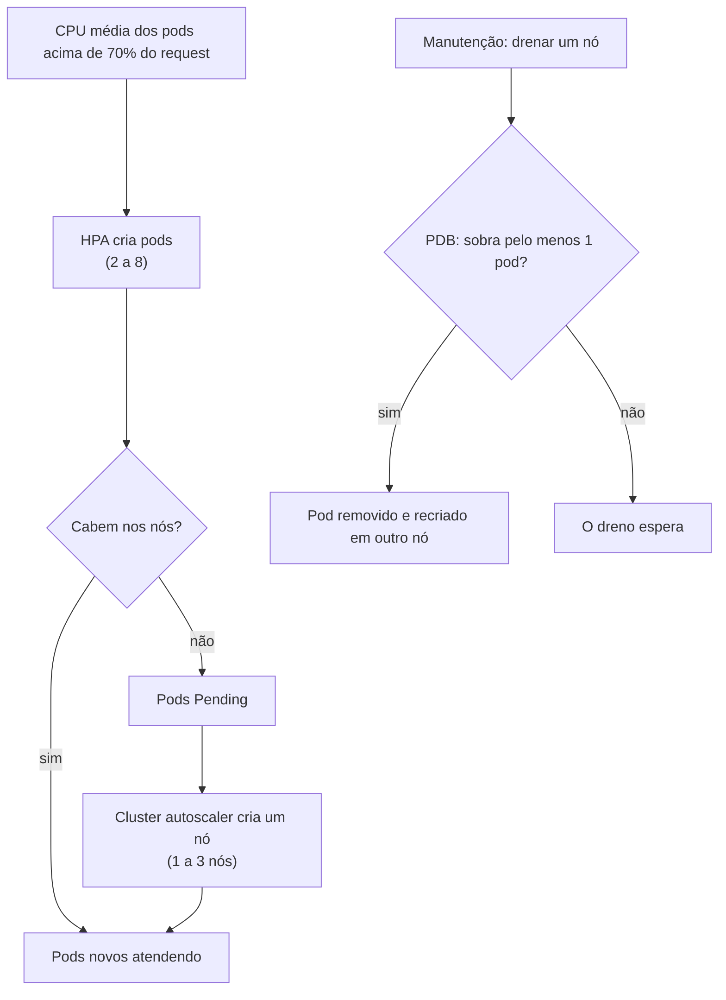

# 8.5 Escala e manutenção sem perder requisições

Duas réplicas fixas desperdiçam de madrugada e não aguentam um pico. E a cada manutenção do AKS (atualização de versão, troca de nó), os pods são movidos, e requisições em andamento podem se perder. O [nível 8](https://github.com/JandersonSR/aks-step-by-step/blob/main/niveis/08-escala.md) resolve com quatro peças que se completam.

## As quatro peças



| Peça | Onde | O que faz |
|---|---|---|
| **HPA** | [`escala.yaml`](https://github.com/JandersonSR/aks-step-by-step/blob/main/charts/cep-api/templates/escala.yaml) | A cada 15 s, mede a CPU dos pods e ajusta as réplicas entre 2 e 8 para manter 70% do request |
| **Cluster autoscaler** | AKS (`--enable-cluster-autoscaler --min-count 1 --max-count 3`) | Pod `Pending` por falta de espaço → cria um nó. Nó sobrando por um tempo → remove |
| **PodDisruptionBudget** | `escala.yaml` | Em interrupções voluntárias (dreno de nó), garante que sobre pelo menos 1 pod da API |
| **`topologySpreadConstraints`** | `deployment.yaml` | Espalha as réplicas por nós diferentes, para a queda de um nó não levar todas |

::: porque A janela de 5 minutos para reduzir
```yaml
behavior:
  scaleDown: { stabilizationWindowSeconds: 300 }
```

Subir rápido, descer devagar. Tráfego real oscila: sem a janela, o HPA reduziria assim que a CPU caísse por um minuto, e subiria de novo no minuto seguinte, criando e matando pods sem parar (e cada pod novo começa com o cache em memória vazio). Esperar 5 minutos de calma antes de reduzir troca um pouco de custo por estabilidade.
:::

::: previsao
Num pico, o HPA quer ir de 2 para 8 pods. Cada pod pede 100m de CPU e 128Mi de memória; o nó D2as_v4 tem 2 vCPUs, mas parte já está ocupada pelo sistema, pelo Dragonfly, pelo Kafka e pelo Argo CD. Conte o tempo: quanto leva, no pior caso, para os 8 pods estarem atendendo?
???
São etapas que se somam:

1. **O HPA perceber:** a métrica é coletada a cada ~15 s e precisa refletir a média; conte 30 s a 1 min.
2. **Os pods que cabem subirem:** puxar a imagem (se o nó já tem, rápido), subir o .NET com ReadyToRun, passar a readiness: dezenas de segundos.
3. **Os que não cabem ficarem `Pending`** e o **cluster autoscaler criar um nó:** criar a VM, entrar no cluster, puxar a imagem do zero: **3 a 5 minutos**.

No pior caso, **5 minutos ou mais** até os 8 pods. Durante esse tempo, os pods existentes aguentam o tranco, com mais latência. Por isso escala automática não substitui **folga**: o `min` do HPA e o tamanho dos nós devem aguentar o pico típico sem depender de criar nó. O autoscaler de nós é para o pico raro, não para o de todo dia.

E lembre da lição 3.4: 8 pods × pool de conexões contra o limite do banco.
:::

::: armadilha O PDB que trava a manutenção
Um PDB com `minAvailable: 1` num Deployment de **uma** réplica impede o dreno do nó: tirar o único pod violaria o PDB, e a atualização do AKS fica esperando. Por isso o template só cria o PDB quando o HPA está ligado ou há mais de uma réplica (`{{- if or .Values.hpa.enabled (gt (int .Values.replicas) 1) }}`). Um detalhe de uma linha que evita uma janela de manutenção travada às 3h da manhã.
:::

## Provar com carga: k6

O [`tests/load/cep.js`](https://github.com/JandersonSR/aks-step-by-step/blob/main/tests/load/cep.js) tem três cenários (`base`, `constante`, `pico`) e **reprova** o teste se o p95 passar de 300 ms ou os erros passarem de 1%.

::: porque Por que o teste de carga tem critério de reprovação
Um teste de carga que só "gera gráfico" vira um ritual que ninguém lê. Com limites explícitos, ele vira um teste: passa ou não passa, e pode rodar no pipeline antes de uma mudança grande. Os números (300 ms, 1%) são o **objetivo de nível de serviço** (SLO) do laboratório escrito em código.
:::

Três experimentos que valem a tarde (seção 3 e 4 do nível 8):

1. **Pico:** `CENARIO=pico` e, em outro terminal, `kubectl get hpa,pods -n cep -w`. Veja o HPA subir e, se encher, o nó novo.
2. **Deploy durante carga:** `CENARIO=constante` e publique uma versão. O `http_req_failed` deve terminar em 0%: é o `maxUnavailable: 0` + `preStop` da lição 6.3 provados.
3. **Linha de base local:** `docker compose up` e `k6 run tests/load/cep.js`, para ter com o que comparar.

::: checkpoint
Repita o experimento 2 **sem** o `preStop` (comente as linhas no chart, num branch). Compare o `http_req_failed`. Se aparecerem erros, você acabou de medir o valor de 3 linhas de YAML, e tem um ótimo exemplo para a apresentação do módulo 6.
:::

## Perguntas para responder sem olhar

::: pergunta
Como o HPA e o cluster autoscaler se completam?
???
O HPA cria pods conforme a CPU. Quando os pods novos não cabem nos nós, ficam `Pending`, e o cluster autoscaler cria um nó para eles. Quando sobra capacidade por um tempo, o autoscaler remove nós.
:::

::: pergunta
Para que serve um PodDisruptionBudget, e quando ele atrapalha?
???
Garante que interrupções voluntárias, como o dreno de um nó numa manutenção, deixem pelo menos N pods no ar. Atrapalha quando é impossível de cumprir, como `minAvailable: 1` com uma réplica só: o dreno fica travado.
:::

::: pergunta
Por que escala automática não substitui folga de capacidade?
???
Porque leva tempo: perceber a carga, subir pods e, se precisar, criar nós (minutos). Durante esse tempo, quem atende é a capacidade que já existe. A folga mínima deve aguentar o pico típico; a escala automática cobre o pico raro.
:::

**Próxima:** [Perguntas de entrevista do módulo](perguntas-de-entrevista.md).
