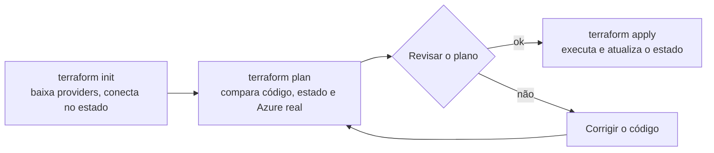

# 9.1 Infraestrutura como código e o ciclo plan/apply

Os níveis 1 a 9 do aks-step-by-step criam o ambiente com dezenas de comandos `az`. Funciona uma vez. Agora tente: recriar em outra região, ter um ambiente de homologação igual ao de dev, ou descobrir o que mudou depois que alguém "só ajustou uma coisinha no portal". O ambiente existe só na memória de quem rodou os comandos.

::: conceito Infraestrutura como código (IaC)
Descrever a infraestrutura em arquivos de texto, versionados no Git, que uma ferramenta usa para criar e manter os recursos de verdade. Mudar infraestrutura passa a ser mudar um arquivo, abrir PR, revisar e aplicar, como em qualquer código.
:::

::: video Terraform explained in 15 mins (em inglês)
https://www.youtube.com/watch?v=l5k1ai_GBDE
O que é IaC, como o Terraform funciona e o papel do estado.
:::

## Imperativo contra declarativo

| | Comandos `az` (imperativo) | Terraform (declarativo) |
|---|---|---|
| Você descreve | **Os passos**: "crie um cluster", "ligue o add-on", "dê este papel" | **O resultado**: "deve existir um cluster com estes add-ons e este papel" |
| Rodar de novo | Pode falhar ("já existe") ou duplicar | Não faz nada se já está igual |
| Mudar uma coisa | Você descobre qual comando muda aquilo | Muda a linha; a ferramenta calcula o que fazer |
| Saber o que mudou | Histórico do terminal de alguém | `git log` e `terraform plan` |

## As peças, com exemplos do projeto

```hcl
# Provider: o plugin que sabe falar com a Azure
terraform {
  required_providers {
    azurerm = { source = "hashicorp/azurerm", version = "~> 4.0" }
  }
}

# Data source: LÊ algo que existe e o Terraform não gerencia
data "azurerm_resource_group" "rg" {
  name = var.resource_group
}

# Resource: algo que o Terraform CRIA e mantém
resource "azurerm_key_vault" "kv" {
  name                       = "kv-${local.nome}"
  resource_group_name        = data.azurerm_resource_group.rg.name
  rbac_authorization_enabled = true
  # ...
}

# Variável: entrada; output: saída que outras camadas e scripts usam
variable "nos_max" { type = number, default = 3 }
```

| Peça | O que é | No projeto |
|---|---|---|
| **Provider** | Plugin para uma plataforma (Azure, Kubernetes, Helm, Harbor) | `azurerm`, `helm`, `kubernetes`, `harbor`, `random` |
| **Resource** | Um recurso criado e mantido pelo Terraform | `azurerm_kubernetes_cluster`, `azurerm_key_vault`, `helm_release` |
| **Data source** | Leitura de algo que já existe | O resource group (a squad não cria grupos no trabalho) |
| **Variável / output** | Entrada e saída do módulo | `nos_max`, `resource_group`; `key_vault_name`, `pg_servidor` |
| **Local** | Um valor calculado dentro do módulo | `local.nome` com o sufixo aleatório |

::: porque Por que o resource group é lido, e não criado
O comentário no [`bootstrap.sh`](https://github.com/JandersonSR/aks-step-by-step/blob/main/infra/00-bootstrap/bootstrap.sh) explica: no trabalho, a squad não tem permissão para criar resource groups, só para usar o que recebeu. O código reflete a realidade de permissões da empresa, em vez de supor que quem roda é dono da assinatura. Infra como código boa é a que roda **com as permissões que o time de fato tem**.
:::

## O ciclo: init, plan, apply



O `plan` é o coração da segurança do Terraform. Ele mostra, antes de qualquer mudança, cada recurso com um símbolo:

| Símbolo | Significa | Atenção |
|---|---|---|
| `+` | Será criado | — |
| `~` | Será alterado no lugar | Leia **quais** atributos |
| `-` | Será destruído | Sempre confira |
| `-/+` | Será **destruído e recriado** | O mais perigoso: um banco recriado é um banco vazio |

::: previsao
Você muda o `sku_name` do PostgreSQL de `B_Standard_B1ms` para `B_Standard_B2s` e roda `plan`. Depois, numa outra mudança, troca o `administrator_login` de `cepadmin` para `admin_cep`. O que você espera ver em cada plano? Qual delas faz você parar e chamar alguém?
???
**Trocar o SKU** costuma aparecer como `~` (alteração no lugar): a Azure redimensiona o servidor, com uma reinicialização curta. Aceitável numa janela combinada.

**Trocar o login de administrador**, em muitos recursos, é um atributo que não pode ser alterado depois de criado, e o plano mostra **`-/+` com o aviso `forces replacement`**: o servidor seria **destruído e recriado**, vazio. Aqui o cache se reconstrói; num banco de negócio, é perda de dados.

A regra prática: **leia todo `-/+` e todo `-` antes de digitar `yes`**, e procure o `forces replacement` no detalhe para saber qual atributo causou. É exatamente por isso que o plano vai na descrição do PR (o entregável do módulo).
:::

## Drift: quando o ambiente diverge do código

::: conceito Drift
Diferença entre o que o código descreve e o que existe de fato, causada por mudanças feitas fora do Terraform (no portal, com `az`, por outro processo).
:::

::: quebra
Com o ambiente do nível 10 de pé, mude algo **pelo portal**: por exemplo, acrescente uma tag `teste=manual` no Key Vault. Depois rode:

```bash
terraform -chdir=infra/10-azure plan
```

O que o plano mostra? E o que acontece se você rodar `apply`?
:::

::: solucao
O plano mostra o Key Vault com `~` e a tag `teste` sendo **removida**: o código diz que as tags são `projeto` e `ambiente`, e o Terraform vai deixar a Azure igual ao código. O `apply` apaga a tag manual.

É o comportamento certo, e é o que torna o código a fonte da verdade. Mas também é uma armadilha: alguém que corrigiu algo urgente pelo portal, à noite, e não levou a correção para o código, vai ver a correção desfeita no próximo `apply` de outra pessoa. A regra do time: **mudança de infra feita fora do código vira PR no mesmo dia**, ou é desfeita.

Para atributos que mudam por fora de propósito, existe `lifecycle { ignore_changes = [...] }`. O projeto usa isso na zona do PostgreSQL, que a Azure escolhe sozinha (lição 9.3).
:::

## Perguntas para responder sem olhar

::: pergunta
Qual a diferença entre um `resource` e um `data source`?
???
`resource` é algo que o Terraform cria e mantém (e destrói no `destroy`). `data source` só lê algo que já existe, sem gerenciar: no projeto, o resource group, que a squad não pode criar.
:::

::: pergunta
O que significa `-/+` num plano, e por que é perigoso?
???
O recurso será destruído e recriado, porque um atributo que mudou não pode ser alterado no lugar (o plano diz `forces replacement`). Para recursos com dados, como um banco, significa recomeçar vazio.
:::

::: pergunta
O que é drift, e o que o Terraform faz com ele?
???
É o ambiente real diferente do código, por mudanças feitas fora do Terraform. O `plan` mostra a diferença e o `apply` desfaz, deixando o ambiente igual ao código. Por isso mudança manual precisa virar código, ou será desfeita.
:::

**Próxima:** [9.2 O estado](02-estado.md).
