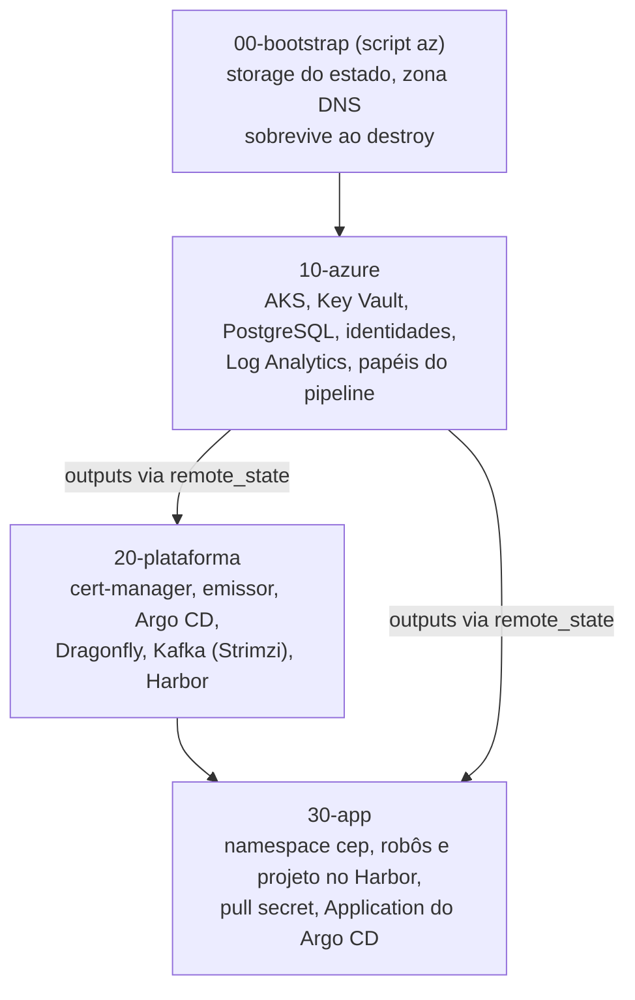

# 9.3 Camadas, dependências e o dia a dia

## Por que não um Terraform só

O ambiente completo tem recursos da Azure (cluster, cofre, banco), coisas instaladas **dentro** do cluster (cert-manager, Argo CD, Kafka, Harbor) e a configuração da aplicação (namespace, robôs do Harbor, a `Application` do Argo CD). O projeto divide isso em camadas, cada uma com seu próprio estado:



::: porque Por que separar
- **Dependência de provider:** a camada 20 usa os providers `helm` e `kubernetes`, que precisam do **endereço e das credenciais de um cluster**. Num Terraform só, esse cluster ainda não existe quando os providers são configurados, o que gera erros difíceis de entender no primeiro `apply` e em qualquer recriação do cluster. Separando, a camada 20 só roda quando a 10 já entregou um cluster.
- **Planos pequenos:** um `plan` da camada 30 lista só o que é da aplicação. Revisar 15 linhas é revisão; revisar 300 é carimbo.
- **Ritmos diferentes:** a camada 10 muda raramente; a 30 muda a cada recurso novo da aplicação. Separar diminui o risco de uma mudança pequena tocar o cluster.
- **Raio de estrago:** um erro na 30 não destrói o banco da 10.

O custo: aplicar em ordem, e passar valores de uma camada para a outra.
:::

## Como uma camada lê a outra

```hcl
# infra/20-plataforma/versions.tf
data "terraform_remote_state" "azure" {
  backend = "azurerm"
  config = {
    resource_group_name  = var.estado_resource_group
    storage_account_name = var.estado_storage_account
    container_name       = "tfstate"
    key                  = "cep/10-azure.tfstate"
    use_azuread_auth     = true
  }
}
# depois: data.terraform_remote_state.azure.outputs.<nome do output>
```

A camada 20 lê os **outputs** do estado da 10 (o endereço do cluster, o nome do cofre). Só o que a 10 declarou como output fica visível: o output é o contrato entre as camadas, como o contrato público de um módulo na lição 1.6.

::: previsao
Alguém clona o repositório numa máquina nova e roda `terraform apply` direto na camada 20, sem ter rodado a 10 (o estado da 10 está vazio, nunca foi aplicado neste ambiente). O que acontece?
???
O `terraform_remote_state` não encontra os outputs (o estado da 10 não existe ou está vazio) e o plano falha com um erro de atributo inexistente, algo como `This object does not have an attribute named "..."`. Nada é criado.

É o comportamento seguro: a dependência entre camadas falha cedo, antes de qualquer mudança. Por isso o [`scripts/criar.sh`](https://github.com/JandersonSR/aks-step-by-step/blob/main/scripts/criar.sh) aplica as camadas sempre na ordem 10 → 20 → 30, e o `destruir.sh` na ordem inversa.
:::

## Detalhes que evitam dores de cabeça

::: porque Sufixo aleatório nos nomes
```hcl
resource "random_string" "sufixo" { length = 5, special = false, upper = false }
locals { nome = "cep${random_string.sufixo.result}" }
```

ACR, Key Vault e storage exigem nome **único no mundo inteiro**. E o Key Vault apagado fica em *soft delete* por alguns dias, com o nome reservado. Sem sufixo, recriar o laboratório no dia seguinte falharia com "nome já em uso". O sufixo é gerado uma vez e guardado no estado: o nome não muda a cada `apply`.
:::

::: porque `ignore_changes` só onde a nuvem decide
```hcl
lifecycle {
  ignore_changes = [zone] # a Azure escolhe a zona; sem isto todo plan mostraria diferença
}
```

A Azure escolhe a zona de disponibilidade do PostgreSQL. Sem o `ignore_changes`, todo `plan` mostraria uma alteração para "voltar" a zona, e um plano que sempre tem diferença ensina o time a não ler o plano. Use para o que a plataforma muda sozinha, nunca para esconder um drift que deveria ser corrigido.
:::

::: porque `.terraform.lock.hcl` vai para o Git
O `.gitignore` exclui o estado, mas **inclui** o arquivo de trava de providers. Ele fixa as versões exatas dos providers baixados no `init`: o pipeline e o colega usam o mesmo `azurerm` que você testou. Sem ele, um `init` numa semana diferente pode trazer uma versão nova do provider com comportamento diferente.
:::

## O dia a dia: infra com revisão

O pipeline tem um job `terraform` que roda `fmt -check` e `validate` em cada camada a cada push. Um fluxo completo de mudança:

1. Branch, mudança no `.tf` (ex.: `nos_max = 4`).
2. `terraform fmt -recursive infra` e `terraform -chdir=infra/10-azure plan`.
3. PR com o plano na descrição; o CI valida formatação e sintaxe.
4. Revisão do **plano**, não só do diff do código.
5. Merge e `apply`.

::: desafio O entregável do módulo
No seu fork do aks-step-by-step, com o ambiente do nível 10 de pé:

1. Mude `nos_max` de 3 para 4 e acrescente uma tag `dono = "<seu nome>"` no `local.tags`.
2. Rode o `plan` das camadas afetadas.
3. Abra um PR com o plano colado na descrição e uma frase para cada recurso listado: o que muda e se há risco.

**Critérios de aceite:**
- O plano não tem nenhum `-/+` nem `-`
- Você consegue explicar por que a tag nova aparece em **vários** recursos e o `nos_max` em um só
- O `terraform fmt -check` passa
:::

::: dica Dica
Todos os recursos que usam `tags = local.tags` mudam juntos. O `nos_max` só aparece no bloco de autoscaling do pool de nós do `azurerm_kubernetes_cluster`.
:::

::: solucao
O plano deve listar com `~` todos os recursos que recebem `tags = local.tags` (o cofre, o banco, o workspace, a identidade e o cluster) mudando só as tags, e o cluster também com o `max_count` do pool de nós indo de 3 para 4. Mudança de tag é alteração no lugar, sem recriação. Se algum recurso aparecer com `-/+`, pare: algum atributo que você não pretendia mudou, e o `forces replacement` no detalhe diz qual.

Repare no efeito colateral de mudar um `local` usado em todo lugar: uma linha no código, todos os recursos que usam `local.tags` no plano. É mais um motivo para ler o plano inteiro.
:::

::: video Terraform in 100 Seconds (Fireship, em inglês)
https://www.youtube.com/watch?v=tomUWcQ0P3k
Revisão rápida do ciclo, boa para rever antes da apresentação.
:::

## Perguntas para responder sem olhar

::: pergunta
Por que o ambiente é dividido em camadas com estados separados?
???
Porque os providers `helm` e `kubernetes` precisam de um cluster que só existe depois da camada da Azure; e porque planos menores são revisáveis, camadas com ritmos de mudança diferentes ficam isoladas, e um erro numa camada não destrói recursos de outra.
:::

::: pergunta
Como uma camada usa valores criados por outra?
???
Com `data "terraform_remote_state"`, lendo os outputs do estado da outra camada. Só os outputs declarados ficam visíveis: eles são o contrato entre as camadas.
:::

::: pergunta
Para que serve o `ignore_changes`, e qual o risco de abusar dele?
???
Para ignorar atributos que a plataforma muda sozinha (como a zona escolhida pela Azure), evitando planos com diferença permanente. Abusar dele esconde drift real que deveria ser corrigido.
:::

**Próxima:** [Perguntas de entrevista do módulo](perguntas-de-entrevista.md).
