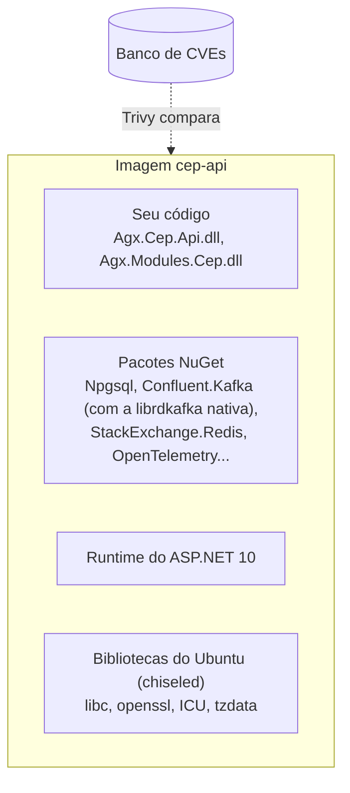

# 10.1 O que vem dentro da imagem, e o Trivy no pipeline

Do código que roda em produção, o seu time escreveu uma fração pequena. O resto veio de outros: a imagem base da Microsoft (com as bibliotecas do Ubuntu), o runtime do .NET, os pacotes NuGet e as dependências deles. Isso é a **cadeia de suprimentos** do software, e qualquer elo pode ter uma vulnerabilidade.

::: conceito CVE e severidade
Uma **CVE** é o identificador público de uma vulnerabilidade conhecida (por exemplo, `CVE-2024-12345`), com uma **severidade** (Low, Medium, High, Critical) e, quando existe, a **versão corrigida** do pacote afetado. Um scanner compara cada pacote da sua imagem com um banco dessas CVEs.
:::



## A mesma imagem, aprovada hoje e reprovada amanhã

::: previsao
Uma imagem passou no scan na segunda-feira e foi para produção. Ninguém mudou uma linha de código. Na quinta-feira, o mesmo pipeline roda de novo (por um commit que só mexe no README) e o scan **reprova**. Como isso é possível? A imagem de produção ficou vulnerável na quinta?
???
Entre segunda e quinta, foi **publicada uma CVE nova** num pacote que já estava na imagem (no openssl da base, por exemplo). O código não mudou; o **conhecimento sobre ele** mudou. O scanner baixa o banco de CVEs atualizado a cada execução e passou a reconhecer o problema.

A imagem de produção **sempre** teve a vulnerabilidade; só ficou conhecida na quinta. É por isso que scan só no pipeline não basta: ele não olha o que já está rodando. O Harbor (lição 10.2) e serviços como o Defender for Containers analisam também o que já foi publicado.

É também por que o projeto faz `docker build --pull`: sempre parte da versão mais recente da imagem base, que traz as correções que a Microsoft publicou.
:::

## A regra do projeto

O job do pipeline ([`ci-cd.yml`](https://github.com/JandersonSR/aks-step-by-step/blob/main/.github/workflows/ci-cd.yml)):

```bash
trivy image \
  --severity HIGH,CRITICAL \
  --ignore-unfixed \
  --ignorefile /.trivyignore \
  --exit-code 1 \
  cep-api:ci
```

| Opção | O que faz | Por quê |
|---|---|---|
| `--severity HIGH,CRITICAL` | Só considera as graves | Bloquear por Low e Medium travaria o time toda semana, por riscos pequenos |
| `--ignore-unfixed` | Ignora CVEs **sem versão corrigida** | Se ainda não existe correção, bloquear o deploy não reduz o risco: só impede você de publicar outras correções |
| `--ignorefile` | Exceções explícitas | Para os casos analisados e aceitos, com motivo |
| `--exit-code 1` | Falha o job se achar algo | É o que transforma relatório em barreira |

::: porque Duas vezes: no PR e antes do push
O job `imagem` constrói e analisa em **todo PR**, sem publicar: a vulnerabilidade aparece na revisão, antes do merge. O job `deploy` analisa de novo **antes do push**: se reprovar, a imagem nem chega ao registry e a tag não vai para o Git. A mesma regra, em dois momentos, porque entre o PR e o merge pode ter saído uma CVE nova.
:::

## Quando o scan reprova: os quatro caminhos

| Origem | O que fazer |
|---|---|
| **Imagem base** (pacote do Ubuntu, runtime) | Rodar o pipeline de novo. O `--pull` traz a base corrigida assim que a Microsoft publica, geralmente em poucos dias |
| **Pacote NuGet direto** | Atualizar a versão em `Directory.Packages.props` |
| **Pacote NuGet transitivo** (dependência de uma dependência) | Fixar a versão corrigida em `Directory.Packages.props`. O projeto tem `CentralPackageTransitivePinningEnabled` ligado para isso |
| **Sem correção aplicável agora e risco entendido** | Uma linha no `.trivyignore`, com o motivo e a data de revisão, aprovada em PR |

::: armadilha
O `.trivyignore` vira lixeira se não tiver disciplina. "Ignorar para o deploy passar" sem motivo nem data é esconder o problema. O formato do projeto exige as duas coisas na mesma linha:

```text
CVE-2024-00000   # sem exploração possível: a lib afetada não é usada em runtime. Revisar em 2027-01-01
```

E a revisão em PR significa que alguém além de quem escreveu concordou.
:::

## Lab: comparar duas imagens

::: quebra
Com Docker, na raiz do aks-step-by-step:

```bash
docker build -t cep-api:lab .
docker run --rm -v /var/run/docker.sock:/var/run/docker.sock aquasec/trivy:0.58.1 \
  image --severity HIGH,CRITICAL --ignore-unfixed cep-api:lab

docker pull mcr.microsoft.com/dotnet/aspnet:6.0
docker run --rm -v /var/run/docker.sock:/var/run/docker.sock aquasec/trivy:0.58.1 \
  image --severity HIGH,CRITICAL --ignore-unfixed mcr.microsoft.com/dotnet/aspnet:6.0
```

Antes de rodar: qual das duas você espera que tenha mais vulnerabilidades graves? Por quê?
:::

::: solucao
A imagem `aspnet:6.0` (uma versão do .NET **fora de suporte** desde novembro de 2024, com base em uma distribuição completa) tende a mostrar **várias** CVEs High e Critical, porque não recebe mais correções. A `cep-api:lab`, com base `10.0-noble-chiseled-extra` recém-baixada, tende a mostrar **nenhuma ou quase nenhuma**.

Duas lições:

1. **Versão fora de suporte é dívida de segurança que só cresce**: ninguém mais publica correções. É o argumento mais forte para manter o runtime atualizado.
2. **Imagem mínima tem menos para dar errado**: sem shell, sem gerenciador de pacotes, sem bibliotecas que a aplicação não usa (lição 6.1).

Os números exatos mudam com o tempo, pela mesma razão da previsão acima.
:::

::: video Security Scans for Docker Images using Trivy! (em inglês)
https://www.youtube.com/watch?v=nXTNEpLT3N4
O Trivy analisando imagens, e como ler o relatório.
:::

## Perguntas para responder sem olhar

::: pergunta
Por que uma imagem que passou no scan pode reprovar dias depois, sem mudança de código?
???
Porque uma CVE nova foi publicada para um pacote que já estava na imagem. O código não mudou; o banco de vulnerabilidades mudou. A imagem em produção já tinha o problema; ele só ficou conhecido.
:::

::: pergunta
Por que o projeto usa `--ignore-unfixed`?
???
Porque bloquear o deploy por uma vulnerabilidade sem correção disponível não reduz o risco (não há para onde atualizar) e impede de publicar outras correções. O bloqueio vale para o que dá para resolver.
:::

::: pergunta
O scan reprovou por um pacote transitivo do NuGet. O que você faz?
???
Fixo a versão corrigida do pacote transitivo no `Directory.Packages.props` (com o pinning transitivo central ligado), rodo os testes e publico. Se não houver correção aplicável e o risco estiver entendido, registro uma exceção no `.trivyignore` com motivo e data de revisão, aprovada em PR.
:::

**Próxima:** [10.2 Harbor](02-harbor.md).
