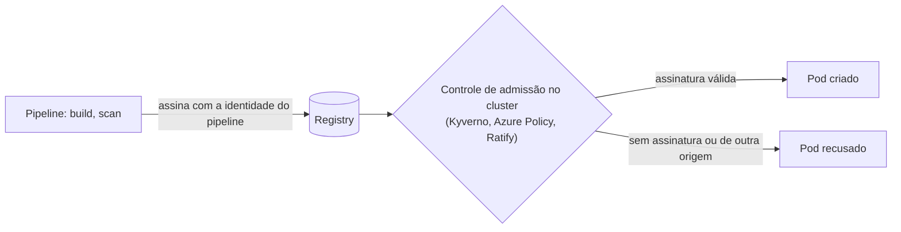

# 10.3 Além do scan: digest, SBOM e assinatura

O scan responde "esta imagem tem vulnerabilidades conhecidas?". Ele não responde "esta imagem é **a mesma** que o pipeline construiu e testou?" nem "**quem** a construiu?". Esta lição é curta e aponta os próximos degraus, que aparecem em entrevistas de sênior e staff e em auditorias.

## Tag é um apelido, digest é a identidade

::: conceito Tag e digest
Uma **tag** (`cep-api:142`) é um nome que aponta para uma imagem, e pode ser **movida** para outra imagem por quem tem permissão de push. O **digest** (`cep-api@sha256:3f9a...`) é o hash do conteúdo: identifica exatamente uma imagem, e não pode apontar para outra.
:::

::: previsao
A tag `142` está em produção, com 4 pods em 2 nós. Alguém com permissão de push envia uma imagem **diferente** com a mesma tag `142`. O chart não mudou. Uma hora depois, o HPA cria 2 pods novos, um deles num nó novo criado pelo autoscaler. Que imagem cada pod roda?
???
**Versões misturadas, sem ninguém saber.** Os pods antigos continuam com a imagem original. Os pods novos nos nós antigos provavelmente também (a imagem `142` já está em cache no nó e a política padrão para uma tag que não é `latest` é não baixar de novo). Mas o pod no **nó novo** baixa a tag `142` do registry, e recebe a imagem **nova**.

Duas versões em produção com o mesmo nome, e o `/info` de todas diz `142`. Um bug que aparece "em alguns pods" e some quando você reinicia.

As defesas:

- **Imutabilidade de tag no registry**: o Harbor tem regras que impedem sobrescrever uma tag existente; o ACR também tem essa opção.
- **Referenciar por digest** no deploy (`image: harbor.<base>/cep/cep-api@sha256:...`): o que roda é exatamente o que foi analisado, sempre.
- **Robôs com o mínimo** (lição 10.2): o cluster nem consegue fazer push.
:::

## SBOM: a lista de ingredientes

::: conceito SBOM
*Software Bill of Materials*: a lista de todos os componentes de uma imagem ou aplicação, com versões (formatos padrão: SPDX e CycloneDX). Com ela guardada para cada versão publicada, a pergunta "estamos usando a biblioteca X na versão vulnerável?" vira uma consulta, e não uma investigação imagem por imagem, no dia em que uma vulnerabilidade grave e famosa aparece.
:::

O Trivy gera SBOM (`trivy image --format cyclonedx --output sbom.json cep-api:ci`). Publicar o SBOM junto com cada imagem é um passo pequeno no pipeline e uma exigência crescente de clientes grandes e de regulações.

## Assinatura e controle de admissão

O passo seguinte é garantir que **só imagens construídas pelo seu pipeline** rodem no cluster:

| Peça | O que faz |
|---|---|
| **Assinatura** (cosign, do Sigstore, ou Notation) | O pipeline assina o digest da imagem; a assinatura fica no registry, ao lado da imagem |
| **Controle de admissão** | Um componente que intercepta toda criação de pod e confere a assinatura antes de deixar o pod ser criado |
| **Atestações** | Além da assinatura, documentos assinados como "esta imagem foi analisada e passou" ou "foi construída a partir do commit X" (proveniência) |

::: porque Por que isso vai além do Harbor
A política do Harbor diz "não entrego imagem vulnerável". A assinatura com controle de admissão diz "não **rodo** nada que não tenha vindo do meu pipeline", qualquer que seja o registry. Juntas, elas cobrem os dois lados: a qualidade da imagem e a origem dela.
:::

::: video Signing and Verifying Container Images With Sigstore Cosign and Kyverno (em inglês)
https://www.youtube.com/watch?v=HLb1Q086u6M
A assinatura no pipeline e a verificação no cluster, funcionando juntas.
:::

## Manter tudo atualizado sem depender de lembrar

Scan aponta o problema; alguém precisa atualizar. Ferramentas como **Dependabot** ou **Renovate** abrem PRs sozinhas quando sai uma versão nova de um pacote NuGet, de uma imagem base ou de uma action do GitHub. Com os testes e o scan rodando em cada PR, atualizar vira revisar e aprovar, não lembrar de fazer.

## Perguntas para responder sem olhar

::: pergunta
Qual a diferença entre referenciar uma imagem por tag e por digest?
???
A tag é um apelido que pode ser movido para outra imagem por quem tem push; o digest é o hash do conteúdo e identifica exatamente uma imagem. Com digest, o que roda é sempre o que foi testado e analisado.
:::

::: pergunta
Para que serve um SBOM?
???
É a lista de componentes e versões de cada imagem publicada. Quando sai uma vulnerabilidade grave numa biblioteca, responde na hora quais versões em produção a usam, sem investigar imagem por imagem.
:::

::: pergunta
O que assinatura de imagem com controle de admissão garante que o scan não garante?
???
A origem: só rodam no cluster imagens assinadas pelo seu pipeline. O scan diz se a imagem tem vulnerabilidades conhecidas, mas não se ela é a que o pipeline construiu.
:::

**Próxima:** [Perguntas de entrevista do módulo](perguntas-de-entrevista.md).
