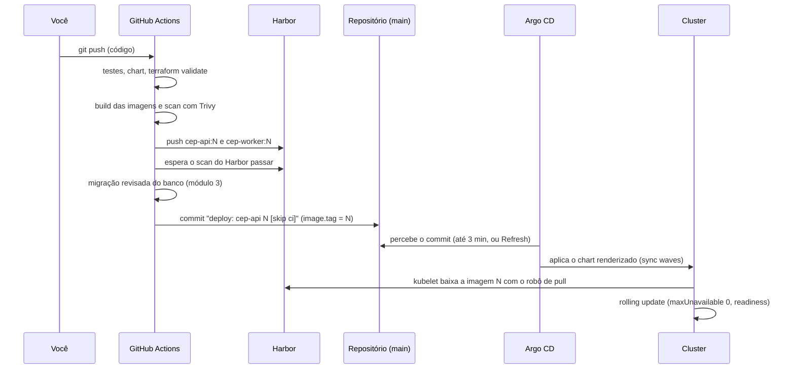

# 11.2 O fluxo de um deploy, e a volta

## Do `git push` ao pod novo



O passo que muda tudo é o commit do bot. Do [`ci-cd.yml`](https://github.com/JandersonSR/aks-step-by-step/blob/main/.github/workflows/ci-cd.yml):

```bash
git fetch origin main
git checkout -B main origin/main
yq -i '.image.tag = strenv(TAG)' charts/cep-api/values-dev.yaml
git commit -am "deploy: cep-api $TAG [skip ci]"
git push origin HEAD:main
```

::: porque Os detalhes do passo
- **`git fetch` e `checkout -B main origin/main`**: o job rodou a partir de um commit que pode já não ser o mais recente da `main` (alguém fez merge no meio). Partir do `origin/main` atual evita que o push falhe por estar desatualizado, ou que desfaça a mudança de outra pessoa.
- **`yq` e não `sed`**: muda o campo `image.tag` entendendo o YAML, sem risco de trocar uma linha errada que por acaso tenha o mesmo texto.
- **A ordem**: a tag só vai para o Git depois do scan do Harbor e da migração. O Git só passa a dizer "rode a versão N" quando a versão N pode, de fato, rodar.
:::

::: previsao
Alguém remove o `[skip ci]` da mensagem do commit "por estética". O que acontece no próximo deploy?
???
O commit do bot é um push na `main`, que **dispara o pipeline de novo**. Esse novo pipeline roda testes, build, scan, push de uma imagem `N+1` (idêntica em código), e grava um novo commit `deploy: cep-api N+1`, que dispara outro pipeline... Um **laço infinito** de pipelines, cada um publicando uma imagem nova, até alguém cancelar.

O `[skip ci]` diz ao GitHub Actions para não disparar workflows por aquele commit. Pequeno, e essencial em qualquer fluxo em que o pipeline escreve no próprio repositório.
:::

## A ordem de aplicação: sync waves

O chart tem anotações como esta, na ServiceAccount, no ConfigMap e no SecretProviderClass:

```yaml
annotations:
  argocd.argoproj.io/sync-wave: "-1"   # antes do Deployment que depende dele
```

::: porque
O Argo CD aplica os recursos em ondas, da menor para a maior, e espera cada onda ficar saudável antes da próxima. O Deployment (onda 0, o padrão) depende da ServiceAccount (para a identidade), do ConfigMap (variáveis de ambiente) e do SecretProviderClass (o volume do Key Vault). Sem as ondas, o Deployment poderia ser criado antes, e os pods ficariam em `ContainerCreating` por alguns ciclos até as dependências aparecerem. Funcionaria no fim, mas com erros falsos no caminho, e às vezes com o Argo CD marcando a sincronização como falha.
:::

## Voltar uma versão: `git revert`

```bash
git log --oneline --grep "deploy: cep-api" -3
git revert <commit do deploy ruim>
git push
```

O commit de revert muda o `image.tag` de volta para a versão anterior, e o Argo CD aplica. O histórico fica com os três fatos: publicamos a N, ela tinha problema, voltamos para a N-1.

::: porque Por que não `helm rollback` aqui
Com o Argo CD, não existe release do Helm no cluster (lição 7.1): `helm rollback` nem tem o que voltar. E mesmo que tivesse, voltar algo direto no cluster seria uma mudança fora do Git, que o `selfHeal` desfaria em segundos, reaplicando a versão ruim. Em GitOps, **toda** mudança passa pelo Git, inclusive a volta.

O Argo CD também tem um botão de rollback para uma das últimas revisões sincronizadas (`revisionHistoryLimit = 10`), mas ele só funciona com a sincronização automática desligada, e a Application fica fora do fluxo normal até alguém religá-la. O `git revert` mantém tudo no fluxo normal.
:::

::: armadilha O revert não volta o banco
Como na lição 7.3: o `git revert` volta o código, não o schema. Se a versão N rodou uma migração incompatível com a N-1, voltar o código não basta. É por isso que o módulo 3 insiste em expand/contract: com migrações compatíveis com a versão anterior, o revert é sempre seguro.
:::

## A proteção de branch e o bot

Se a `main` exigir PR para qualquer mudança, o push do bot é recusado. As saídas, do laboratório para produção:

| Saída | Como | Quando |
|---|---|---|
| Liberar o bot na regra de proteção | Exceção para o `github-actions[bot]` | Laboratório, time pequeno |
| O bot abre um PR com a tag nova | Uma pessoa aprova o deploy aprovando o PR | Quando cada deploy precisa de aprovação humana |
| **Repositório GitOps separado** | Código num repositório, os values de cada ambiente noutro; o pipeline do código escreve no de GitOps | Vários ambientes e times: o padrão de mercado |

## Perguntas para responder sem olhar

::: pergunta
No fluxo do projeto, o que o pipeline faz para publicar uma versão, já que não tem acesso ao cluster?
???
Constrói e analisa as imagens, envia ao Harbor, espera o scan dele, aplica a migração revisada e grava a tag nova no `values-dev.yaml` com um commit `[skip ci]`. O Argo CD percebe o commit e aplica no cluster.
:::

::: pergunta
Para que serve o `[skip ci]` no commit do bot?
???
Para o commit que o próprio pipeline grava na `main` não disparar o pipeline de novo, o que criaria um laço infinito de builds e deploys.
:::

::: pergunta
Como voltar uma versão em GitOps, e por que não fazer direto no cluster?
???
Com `git revert` do commit de deploy: o Argo CD aplica a tag anterior. Mudar direto no cluster seria desfeito pelo `selfHeal` e não deixaria registro; em GitOps, toda mudança, inclusive a volta, passa pelo Git.
:::

**Próxima:** [11.3 Operar](03-operacao.md).
